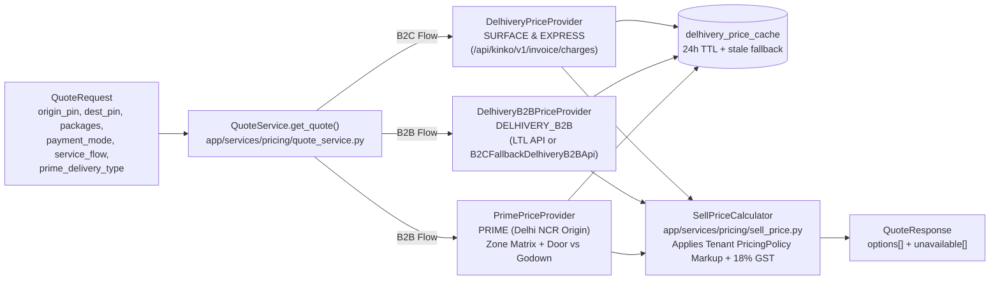

# Naviera System Architecture (`docs/ARCHITECTURE.md`)

Naviera is an **Edge-Dynamic Multi-Tenant Monolith** engineered for **Delhivery One (`one.delhivery.com`) parity**, serving both **B2C Express Parcels** and **B2B Heavy Cargo (LTL/FTL)** from a single Next.js 16 frontend and a single FastAPI backend.

---

## 1. High-Level Topology

```mermaid
flowchart TD
    Browser["Browser / Client\nlogismart.naviera.com"] --> Edge["Next.js 16 Edge Middleware\nfrontend/src/middleware.ts"]
    Edge -->|Rewrites to /[tenant_slug]/...| Zones["Three Frontend Zones\n1. (marketing) Server Components\n2. (app) Authenticated Workspace\n3. track/[id] Public Consignee Portal"]
    Zones -->|HTTPS + X-Tenant-Slug + JWT| API["FastAPI Backend (Render)\nbackend/app/main.py"]
    API --> Endpoints["Controllers: app/api/v1/endpoints/\nValidation + Idempotency + Auth"]
    Endpoints --> Services["Services: app/services/\nPricing, RepricingService, Lifecycle, GST, Wallet"]
    Services --> Repos["Repositories: app/repositories/\nStrict tenant_id Isolation + selectinload"]
    Repos -->|PgBouncer :6543 NullPool| DB[("Supabase PostgreSQL\nSingle Shared Database")]
    Services -->|Live / Cached Quotes| Delhivery["Delhivery One APIs\nB2C kinko/v1/invoice/charges\n+ B2B Fallback / LTL API"]
    GHCron["GitHub Actions Cron (*/14 * * * *)\n.github/workflows/temporal-hooks.yml"] -->|POST /api/v1/internal/temporal-hooks/run\n+ X-Cron-Secret (also keeps Render warm)| API
    API -->|run_temporal_hooks_iteration()| Worker["Temporal Hooks Engine\nbackend/scripts/temporal_hooks_worker.py"]
    Worker -->|Appointment Expiry & Stale E-Way Bill Holds| DB
```

---

## 2. Frontend Architecture: Three Zones & Runtime Theming

### 2.1 Edge Subdomain & Custom-Domain Routing (`frontend/src/middleware.ts`)
- Every incoming HTTP request is intercepted at the edge by `middleware.ts`.
- In production (`NEXT_PUBLIC_ROOT_DOMAIN=naviera.com`), the tenant slug is extracted from either a mapped custom domain in `CUSTOM_DOMAIN_TENANTS` (e.g., `logismart.in:logismart,www.logismart.in:logismart`) or a `<slug>.naviera.com` subdomain (e.g., `logismart.naviera.com`) and rewritten internally to `/[tenant_slug]/...` without changing the browser URL.
- In local development (`localhost:3000`), path-based routing (`/logismart-test/...`, `/logismart/...`) resolves directly to `[tenant_slug]`.

### 2.2 The Three Zones (`frontend/src/app/[tenant_slug]/`)
| Zone | Directory | Rendering Model | Responsibilities |
| :--- | :--- | :--- | :--- |
| **Zone A: Marketing** | `(marketing)/` | Next.js Server Components + ISR (`/api/revalidate`) | Dynamic tenant landing page (`page.tsx`), public rate calculator (`/rate-calculator`), legal & compliance pages (`/terms`, `/privacy`, `/refund-policy`, `/prohibited-items`, `/grievance-officer`). |
| **Zone B: Workspace App** | `(app)/` | Authenticated Client Components (`AuthGuard` + `TenantProvider`) | Role-aware B2C Express and B2B Cargo dashboards, 3-step booking wizards, orders rail, pickup requests/manifests, NDR exceptions, Ops Control Tower (`/ops`), wallet, COD remittances, GST invoices, weight disputes, support tickets, and admin settings. |
| **Zone C: Public Tracking** | `track/[id]/` | Unauthenticated Consignee View | Real-time AWB/LR status stepper and vertical activity timeline. Enforces strict PII masking (`A***a S***a`, `******3210`, city/state/PIN only) and never exposes freight prices or wallet data. |

### 2.3 Runtime CSS Variable Theming (`ThemeProvider`)
- Tenant brand colors (`--primary`, `--secondary`) and logos are fetched from `GET /api/v1/tenants/{slug}/public` and injected into `:root` at runtime.
- Components use semantic Tailwind classes (`bg-primary`, `text-primary`, `border-primary`). Hardcoded brand colors are blocked by `frontend/scripts/find-branding-colors.py`.

---

## 3. Backend Architecture: Enterprise 3-Tier Layering

```plaintext
backend/app/
├── api/v1/endpoints/   # HTTP Controllers (tenants, users, shipments, manifests, pricing, pricing_prime,
│                       #   wallet, delhivery_modules, exceptions, appointments, addresses, dashboard, tracking)
├── services/           # Domain & Financial Orchestration
│   ├── pricing/        # Rate Engines (quote_service, delhivery, delhivery_b2b, prime, sell_price, booking, policy)
│   ├── repricing.py    # Single Price Writer (preview & apply post-booking price changes)
│   ├── shipment_lifecycle.py # Single Status Authority (ShipmentLifecycleMachine)
│   ├── gst_documents.py      # Sequential FY Tax Invoices, Credit Notes & Debit Notes
│   ├── cod_payout.py         # Door collectible calculator & post-delivery freeze
│   └── wallet.py             # Prepaid ledger & maker-checker recharge approvals
├── repositories/       # Multi-Tenant DAOs (every query filters by tenant_id + selectinload)
├── models/             # SQLModel Database Entities (tenants, pickups, manifests, pricing, prime, repricing, wallet, ...)
├── schemas/v1/         # Pydantic Request/Response DTOs (source for frontend/src/api_client)
└── core/               # db.py (PgBouncer NullPool), security.py, dependencies.py, permissions.py, money.py, idempotency.py
```

### 3.1 Core Domain Entities (`PickupRequest` vs. `Manifest`)
- **`PickupRequest` (`pickup_requests` table in `backend/app/models/pickups.py`):**
  Represents a single **Shipment / Order / AWB / Lorry Receipt (LR)** (`service_flow` = `B2C` or `B2B`, `shipment_type` = `FORWARD` or `REVERSE`, `service_option` = `SURFACE` | `EXPRESS` | `DELHIVERY_B2B` | `PRIME`). Linked 1:1 to `PaymentDetails`, 1:N to `Package` boxes, 1:N to `PickupDocument` compliance rows, and 1:N to `ShipmentActivity` timeline events.
- **`Manifest` (`manifests` table in `backend/app/models/manifests.py`):**
  Represents a warehouse **Pickup Request (PUR) / Fleet Run-Sheet** (`manifest_code`, `pickup_address_id`, `scheduled_date`, `time_slot`). Groups `OPEN` shipments together (transitioning them to `ASSIGNED`) or records a **Blind Pickup** (`is_blind_pickup = True`, `total_boxes = N`) before individual LRs are created.

### 3.2 Scheduled Jobs: Temporal Hooks & Free Render Keep-Warm
- **What runs (`run_temporal_hooks_iteration` in `backend/scripts/temporal_hooks_worker.py`, all tenants):** there is no appointments table; both checks work on `pickup_requests` columns.
  1. **Expired Delivery Appointments:** an `IN_TRANSIT` / `OUT_FOR_DELIVERY` shipment whose `appointment_end` (TIMESTAMPTZ, compared in aware UTC) has passed goes to `EXCEPTION` with `ndr_reason = APPOINTMENT_NEEDED` (actions: Book appointment / Deliver without appointment). Parcels not yet picked up are never flagged (D-04c). `BOOK_APPOINTMENT` only accepts a slot that ends in the future, and `DELIVER_WITHOUT_APPOINTMENT` clears the window, so the same slot is never re-flagged (D-08).
  2. **Stale E-Way Bills:** an `IN_TRANSIT` shipment with goods value `payment_details.shipment_total_value` $\ge$ ₹50,000 (`EWAY_BILL_MANDATORY_THRESHOLD`, the same constant booking uses) and no update (`updated_at`) for more than 72 hours goes to `EXCEPTION` with `ndr_reason = EWAY_BILL_MISSING` (action: **Update e-way bill**; Delhivery `b2b-exceptions-management#eway-bill-missing`, `shipment-exceptions#2-ewaybill-missing`). Resolving it bumps `updated_at`, which restarts the 72 h clock.
- **Every hold** is validated by `ShipmentLifecycleMachine.validate_transition`, writes a customer-visible `STATUS_CHANGE` activity whose `ndr_raise.held_from` tells the resolve flow where to resume (D-04), and runs `FOR UPDATE SKIP LOCKED` per batch. Each check has its own try/rollback.
- **Idempotency:** a held row is `EXCEPTION`, so it matches neither query; a repeated pass returns `{"status": "ok", "appointments_held": 0, "eway_bills_held": 0}`.
- **Protected Cron Endpoint (`POST /api/v1/internal/temporal-hooks/run` in `backend/app/api/v1/endpoints/internal.py`):**
  - Mounted outside the public OpenAPI schema (`include_in_schema=False`).
  - Requires header `X-Cron-Secret` to match `settings.CRON_SECRET` via constant-time `secrets.compare_digest`. When `CRON_SECRET` is empty/unset or the header is missing/wrong, the endpoint returns `403 Forbidden`.
  - Returns `200 {"status":"ok","appointments_held":N,"eway_bills_held":M}`. If a check fails it returns `500 {"status":"error",…,"failed_checks":[…]}` (the checks that succeeded stay committed) and logs at `ERROR`. Every call logs one line `temporal_hooks_run appointments_held=N eway_bills_held=M duration_ms=…`.
- **Every-14-Minute Schedulers (two callers, overlapping calls are safe):**
  - **PRIMARY: Supabase `pg_cron` + `pg_net`.** Job `naviera-temporal-hooks` (`*/14 * * * *`), created by Alembic revision `f9a0b1c2d3e4` (`backend/alembic/versions/f9a0b1c2d3e4_pg_cron_temporal_hooks.py`). The job reads the URL and the secret from **Supabase Vault** (`naviera_temporal_hooks_url`, `naviera_cron_secret`) at run time, so no secret is stored in git or in `cron.job`. It does nothing until both Vault secrets exist. `pg_net` timeout is 120 s, which covers a Render cold start (~50 s).
  - **BACKUP: GitHub Actions [`.github/workflows/temporal-hooks.yml`](../.github/workflows/temporal-hooks.yml)** (`cron: "*/14 * * * *"` plus manual `workflow_dispatch`, `curl --fail --retry 3`, repository secrets `CRON_SECRET` + `NAVIERA_API_URL`). GitHub `schedule` is best-effort: on this low-activity repo it fired about every 4 h instead of every 14 min, and scheduled workflows on a public repo are auto-disabled after 60 days without a push. That is why it is only the backup.
  - **Keep-Warm Side Effect:** Render Free web services sleep after 15 minutes of inactivity and give 750 free instance-hours/month (enough for one 24/7 service). A call every 14 minutes runs the hooks without a paid Render Cron job and keeps `naviera-backend` warm.
- **Where to see runs:** Supabase Dashboard → **Integrations → Cron → `naviera-temporal-hooks` → job runs** (`cron.job_run_details`); the HTTP status/body of each pg_net call in `net._http_response` (kept ~6 h); Render `naviera-backend` → **Logs**, filter `temporal_hooks_run`; Logfire (`message LIKE 'temporal_hooks_run%'` or the `POST /api/v1/internal/temporal-hooks/run` span). Step-by-step in [`RUNBOOK.md`](RUNBOOK.md) §1.5.

---

## 4. Multi-Option Pricing & Sell-Price Engine (`backend/app/services/pricing/`)



1. **B2C Express (`SURFACE` & `EXPRESS`):**
   - Volumetric weight: $\frac{L \times B \times H\text{ (cm)}}{5000}$ per box; chargeable weight is $\max(\text{actual}, \text{volumetric})$ with a `500 g` minimum (`0.5 kg` slabs).
   - Queries Delhivery One's live `/api/kinko/v1/invoice/charges/json/` endpoint with a 24-hour DB cache (`delhivery_price_cache`) and stale-on-error fallback.
2. **B2B Heavy Cargo (`DELHIVERY_B2B` & `PRIME`):**
   - Volumetric weight: $\frac{L \times B \times H\text{ (cm)}}{4500}$ per box ($\approx 6\text{ kg/cft}$); chargeable weight is $\max(\text{actual}, \text{volumetric})$ with a `20 kg` minimum (`1 kg` slabs).
   - **Delhivery B2B Cargo (`DELHIVERY_B2B`):** Uses `RealDelhiveryB2BApi` when dedicated LTL credentials (`DELHIVERY_B2B_USERNAME` + `DELHIVERY_B2B_PASSWORD`) are configured, and automatically falls back in production to `B2CFallbackDelhiveryB2BApi` (`backend/app/services/pricing/delhivery_b2b_client.py`) using the live B2C API token (`DELHIVERY_API_TOKEN`) when `DELHIVERY_B2B_PASSWORD` is empty.
   - **Logismart Prime (`PRIME`):** Serves shipments originating from **Delhi NCR** (`11xxxx`, `121xxx`, `122xxx`, `201xxx`, `124507`, `131001`) across 18 seeded destination zones (`prime_zones` + `prime_lane_rates`). Supports **Door Delivery** vs. **Godown / Hub Self-Pickup** (`prime_delivery_type = GODOWN` waives the ₹150 door delivery fee).
3. **Tenant Markup & Sell-Price Policy (`backend/app/services/pricing/sell_price.py`):**
   - Applies the tenant's per-option markup (`PERCENT`, `FLAT`, or `BOTH`, positive or negative discount) on pre-tax carrier subtotals and computes 18% GST (`9% CGST + 9% SGST` intra-state or `18% IGST` inter-state).

---

## 5. Financial Architecture, Single Price Writer & Lifecycle

### 5.1 Option A Hybrid Financials
- **Logistics Freight Columns (`payment_details`):** `base_freight`, `tax_amount`, `total_logistics_cost`.
- **Commercial Valuation Columns (`payment_details`):** `shipment_value`, `shipment_tax_value`, `shipment_total_value`, `add_shipping_to_cod`.
- **Auditable JSONB Breakdown (`pricing_breakdown`):** Stores `carrier_cost` (hidden from customer/public responses), `markup`, `sell` lines, chargeable weight, and surcharges.

### 5.2 Single Price Writer (`RepricingService`)
Every post-booking price mutation—whether from editing a shipment (`ShipmentService`), recording hub measurements (`ShipmentMeasurementService`), resolving a weight dispute (`DelhiveryModulesService`), or applying an admin bidirectional price override—flows through `RepricingService.apply()` (`backend/app/services/repricing.py`):
1. Computes the exact rupee delta ($\Delta = \text{new\_total} - \text{old\_total}$).
2. Records an immutable `shipment_charge_adjustments` row (`before_total`, `after_total`, `delta_amount`, `reason`, `settlement_action`).
3. Debits ($\Delta > 0$) or refunds ($\Delta < 0$) the appropriate wallet (`user_id` for customer orders, `None` for staff company orders) via `WalletRepository.atomic_adjust`.
4. Issues a sequential GST `DEBIT_NOTE` ($\Delta > 0$) or `CREDIT_NOTE` ($\Delta < 0$) linked to the original `TAX_INVOICE` via `GSTDocumentService`.
   - **Numbering lock:** each series (`tenant + FY + INVOICE/CREDIT_NOTE/DEBIT_NOTE`) is allocated as `max + 1` under `pg_advisory_xact_lock`, held until the request commits (`DelhiveryModulesRepository.lock_document_series`). The wait is capped by a local `lock_timeout` of 20 s. On timeout the whole request rolls back and returns **503** with `Retry-After: 5` ("Nothing was charged"). The booking wizard keeps its `Idempotency-Key` after any 5xx, so pressing Book again replays the booking instead of creating a second one.

### 5.3 Single Status Authority (`ShipmentLifecycleMachine`)
`backend/app/services/shipment_lifecycle.py` enforces all status transitions:
- **Active Stages:** `OPEN` $\rightarrow$ `ASSIGNED` $\rightarrow$ `PICKED` $\rightarrow$ `IN_TRANSIT` $\rightarrow$ `OUT_FOR_DELIVERY` $\rightarrow$ `COMPLETED` (Delivered).
- **Exception & RTO Stages:** `EXCEPTION` (NDR) $\rightarrow$ `OUT_FOR_DELIVERY` (re-attempt, max 3) or `RTO_INITIATED` $\rightarrow$ `RTO_IN_TRANSIT` $\rightarrow$ `RTO_DELIVERED`.
- **Invariants:** Pre-pickup cancellation (`OPEN` / `ASSIGNED` $\rightarrow$ `CANCELLED`) refunds 100% of freight + GST and issues a `CREDIT_NOTE`. Post-pickup cancellation converts to `RTO_INITIATED` with no freight refund. RTO shipments can never transition to `COMPLETED`.

---

## 6. Database Pooling (`backend/app/core/db.py` — DO NOT TOUCH)

Naviera connects to PostgreSQL through **Supabase PgBouncer on port `6543` (transaction pooling mode)**. To prevent `DuplicatePreparedStatementError` and `asyncpg` socket deadlocks:
- `poolclass=NullPool` delegates connection pooling entirely to PgBouncer.
- `connect_args={"statement_cache_size": 0, "prepared_statement_name_func": lambda: f"__asyncpg_{uuid4()}__"}` disables client-side prepared statement caching.
