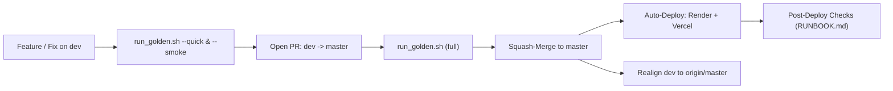

# Developer Setup, Testing & Workflow Guide (`docs/DEVELOPMENT.md`)

This guide covers everything a developer or AI coding agent needs to set up, run, test, and ship changes in **Naviera**.

---

## 1. Local Workstation Setup (Primary Dev Loop)

### 1.1 Prerequisites
- **Python:** `3.11` (`>=3.11,<3.15`) and **Poetry** (`>=1.8`)
- **Node.js:** `20` (`>=20`) and **npm**
- **Google Chrome / Chromium:** Used on headless CDP port `:9224` when running the Selenium/CDP UI E2E suite (`backend/scripts/tests/ui_golden/`)

### 1.2 Install Dependencies & Initialize `.env` Files
```bash
# 1. Copy committed environment templates (if not already present)
cp -n backend/.env.example backend/.env
cp -n frontend/.env.example frontend/.env.local

# 2. Install backend & frontend dependencies (add '--with e2e' in backend if running headless Chrome UI E2E tests)
cd backend && poetry install && cd ..
cd frontend && npm ci && cd ..
```

### 1.3 Start the Stack (Ports `:8000` & `:3000`)
```bash
# Terminal 1 — FastAPI Backend (:8000)
cd backend
poetry run uvicorn app.main:app --reload --reload-dir app --host 0.0.0.0 --port 8000

# Terminal 2 — Next.js Frontend (:3000)
cd frontend
npm run dev -- -p 3000
```
*(In VS Code, `.vscode/tasks.json` provides 4 tasks under **Terminal ▸ Run Task**: `Naviera: Run Backend`, `Naviera: Run Frontend`, `Naviera: Run Full Stack`, and `Naviera: Quick Checks (ruff, tsc, audit, vitest, pure unit tests)` which runs `bash scripts/run_golden.sh --quick`.)*

Open:
- **Frontend (`logismart-test` workspace):** `http://localhost:3000/logismart-test`
- **Backend OpenAPI / Swagger UI:** `http://localhost:8000/docs`
- **Health & DB readiness:** `http://localhost:8000/health` and `http://localhost:8000/health/ready`

### 1.4 Optional: GitHub Codespaces / Dev Container (Secondary Environment)
A lean devcontainer (`.devcontainer/devcontainer.json` + `.devcontainer/post-create.sh`, Node `20` + Python `3.11` + Poetry `2`) is included:
1. Click **Code ▸ Codespaces ▸ Create codespace on `dev`**.
2. `.devcontainer/post-create.sh` runs `poetry install` (main + dev, omitting the optional `e2e` group so Codespaces load quickly) and `npm ci`, and copies `backend/.env.example` $\rightarrow$ `backend/.env` and `frontend/.env.example` $\rightarrow$ `frontend/.env.local` if missing. To install the optional UI E2E dependencies (`pytest-playwright`, `pypdf`) later, run `cd backend && poetry install --with e2e`.
3. Codespaces user/repository secrets named after the keys in `.env.example` are injected directly as environment variables, which `pydantic-settings` and Next.js read before any `.env` file.

---

## 2. Environment Variables (`backend/.env` & `frontend/.env.local`)

#### Key `backend/.env` Variables
| Variable | Purpose | Local Default / Example |
| :--- | :--- | :--- |
| `ENVIRONMENT` | Runtime mode (`development` or `production`) | `development` |
| `DATABASE_URL` | Async Postgres URL (`postgresql+asyncpg://...`, port `6543` for Supabase PgBouncer) | Required |
| `SUPABASE_URL` | Supabase project URL (`https://<project-ref>.supabase.co`) | Required |
| `SUPABASE_JWT_SECRET` | JWT secret for verifying access tokens | Required |
| `SUPABASE_SERVICE_KEY` | Service-role key for server-side auth operations | Required |
| `FRONTEND_APP_URL` | Canonical frontend origin for links | `http://localhost:3000` |
| `REVALIDATION_SECRET` | Shared secret for Next.js ISR cache invalidation | Match `frontend/.env.local` |
| `CRON_SECRET` | Shared secret for `POST /api/v1/internal/temporal-hooks/run` (`X-Cron-Secret` header) | Optional locally (endpoint returns `403` when unset); set on Render + GitHub Actions secret `CRON_SECRET` |
| `DELHIVERY_API_TOKEN` | Delhivery One B2C API token (`env` = `fake` \| `staging` \| `production`) | Optional (`DELHIVERY_ENV=fake` uses deterministic offline rates) |
| `DELHIVERY_B2B_ENV` | Delhivery B2B Cargo mode (`fake` \| `staging` \| `production`) | `fake` locally; `production` uses `B2CFallbackDelhiveryB2BApi` when `DELHIVERY_B2B_PASSWORD` is empty |

> [!IMPORTANT]
> `backend/app/core/config.py` uses `pydantic-settings` with `extra="forbid"`. **Never** add test-only variables (`GOLDEN_TENANT_SLUG`, `GOLDEN_TEST_PASSWORD`, `UI_*`, `PROD_*`) to `backend/.env`—export them in your shell instead.

#### Key `frontend/.env.local` Variables
| Variable | Purpose | Local Default |
| :--- | :--- | :--- |
| `NEXT_PUBLIC_API_URL` | FastAPI base URL | `http://localhost:8000` |
| `NEXT_PUBLIC_ROOT_DOMAIN` | Root domain for subdomain resolution | `localhost:3000` |
| `CUSTOM_DOMAIN_TENANTS` | Comma-separated `<host>:<tenant_slug>` custom-domain rewrites in `middleware.ts` | Optional locally; `logismart.in:logismart,www.logismart.in:logismart` on Vercel |
| `NEXT_PUBLIC_SUPABASE_URL` | Supabase project URL | Match `SUPABASE_URL` |
| `NEXT_PUBLIC_SUPABASE_ANON_KEY` | Public anon key for client auth | Required |
| `REVALIDATION_SECRET` | Shared secret for `/api/revalidate` | Match `backend/.env` |

---

## 3. Verification & Testing Tiers (`backend/scripts/run_golden.sh`)

All verification is orchestrated through `backend/scripts/run_golden.sh`.

> [!CAUTION]
> **Live-Tenant Safety:** Every DB-touching test, seed, and reset is hard-locked to `logismart-test` (`ALLOWED_TEST_SLUGS` in `backend/scripts/tenant_data_core.py`). Never run more than **one** DB-touching test session at a time.

| Tier | Command | DB Required? | What It Verifies |
| :--- | :--- | :---: | :--- |
| **Quick** | `bash backend/scripts/run_golden.sh --quick` | No (~60s) | `ruff check .`, `tsc --noEmit`, `npm run test:audit` (`math-check.py` + `find-branding-colors.py`), `vitest` (64 suites), and 35 pure backend `pytest` unit suites. |
| **Smoke** | `bash backend/scripts/run_golden.sh --smoke` | Yes (~3–4m) | Resets & reseeds `logismart-test`, runs B2C lifecycle (`test_09`), B2B lifecycle (`test_10`), D9 pricing matrix (`test_11`), `SMOKE_UI_SUITES`, and `golden_checks.py` (`assert_live_tenants_untouched` + wallet/GST invariants). |
| **Full (Default)** | `bash backend/scripts/run_golden.sh` | Yes (~10–12m) | Static + all unit suites + all 8 `golden_journeys/` API suites + all headless Chrome `ui_golden/` suites (CDP `:9224`) + `golden_checks.py`. |

Every run writes structured logs, JUnit XML, and `summary.json` under `llm_resources/.agents/golden_runs/<timestamp>_<tier>/`.

---

## 4. OpenAPI TypeScript Client Generation

Whenever you add or modify Pydantic request/response models in `backend/app/schemas/v1/` or route signatures in `backend/app/api/v1/endpoints/`, regenerate the typed frontend client (`frontend/src/api_client/`):

```bash
cd frontend
curl -o openapi.json http://localhost:8000/openapi.json
npx openapi-typescript-codegen --input openapi.json --output ./src/api_client --client axios
rm openapi.json
npx tsc --noEmit
```

---

## 5. Database Migrations (Alembic)

1. Always obtain explicit human approval before running `alembic revision` or `alembic upgrade` (see [`.agents/skills/db-migration/SKILL.md`](../.agents/skills/db-migration/SKILL.md)).
2. Inspect current migration status:
   ```bash
   cd backend
   poetry run alembic current
   poetry run alembic heads
   ```
3. Apply approved migrations:
   ```bash
   cd backend
   poetry run alembic upgrade head
   ```

---

## 6. Git & Release Workflow (`dev` $\rightarrow$ PR $\rightarrow$ `master`)



1. **Develop on `dev`:** All daily engineering happens on `dev` (or a feature branch merged into `dev`).
2. **Pre-Merge Verification:** Run `bash backend/scripts/run_golden.sh` (full mode) before merging into `master`.
3. **Squash-Merge into `master`:** Merging to `master` triggers automatic production deployments on **Render** (`naviera-backend` at `https://naviera-backend.onrender.com`) and **Vercel** (`naviera` frontend); [`.github/workflows/temporal-hooks.yml`](../.github/workflows/temporal-hooks.yml) runs `POST /api/v1/internal/temporal-hooks/run` every 14 minutes.
4. **Realign `dev` After Every Squash-Merge:**
   ```bash
   git fetch origin
   git checkout dev
   git reset --hard origin/master
   git push --force-with-lease origin dev
   ```
   *(Or use `git merge -s ours origin/master` if preserving intermediate commits on `dev`.)*
5. **Post-Deploy Check:** Run the production health and pricing verification in [`RUNBOOK.md`](RUNBOOK.md).
