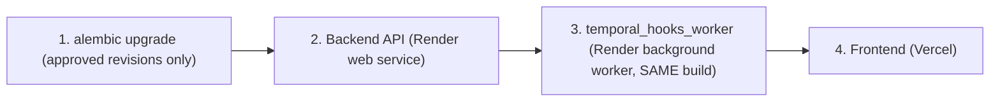

# Naviera release runbook (Logismart lean MVP)

Operational steps for deploying Naviera, applying migrations, running the golden test suite on
`logismart-test`, wiping test data from live `logismart`, and the go-live check.

Background and decisions: the ship-readiness plan (Phases A to F) and [`docs/BACKLOG.md`](BACKLOG.md).
Architecture: [`README.md`](../README.md) and [`.agents/AGENTS.md`](../.agents/AGENTS.md).

> [!CAUTION]
> **There is one Supabase project** (`<project-ref>.supabase.co`). Local dev, the golden tests and
> production all use the same database. Every `alembic upgrade` changes the **live** schema, and
> every script run with `--execute` writes **live** rows. There is no staging copy to try a
> migration on first.

All commands run from `naviera/backend` unless stated. In a headless container (such as GitHub Codespaces), export this first (already set in `~/.bashrc` by `.devcontainer/post-create.sh`):

```bash
export PYTHON_KEYRING_BACKEND=keyring.backends.null.Keyring   # poetry without a desktop keyring
```

---

## 1. Environment & Fresh-Fork Bootstrap

### 1.1 Environment files

| File | Template | Notes |
|---|---|---|
| `backend/.env` | [`backend/.env.example`](../backend/.env.example) | Every `Settings` field in `app/core/config.py`. **Unknown keys break startup** (pydantic-settings `extra_forbidden`), so do not add test variables here |
| `frontend/.env.local` (Vercel: project env) | [`frontend/.env.example`](../frontend/.env.example) | `NEXT_PUBLIC_SUPABASE_URL`, `NEXT_PUBLIC_SUPABASE_ANON_KEY`, `BACKEND_API_URL`, `REVALIDATION_SECRET` |
| Shell / CI only | commented block at the bottom of `backend/.env.example` | `GOLDEN_TENANT_SLUG` (default `logismart-test`), `GOLDEN_TEST_PASSWORD`, `UI_CDP_URL`, `UI_FRONTEND_URL`, `UI_API_URL`, `UI_SLOW_MO_MS`, `UI_HIGHLIGHT_MS`, `PROPERTY_MAX_EXAMPLES` |

`GOLDEN_TEST_PASSWORD` is the shared password of the seeded `@logismart.in` test accounts. Keep it in a
password manager and `export` it per shell. Never write it into a tracked file or `backend/.env`.

In **GitHub Codespaces**, `.devcontainer/post-create.sh` installs dependencies (`poetry install --with e2e` + `npm ci`) and copies `backend/.env.example` → `backend/.env` and `frontend/.env.example` → `frontend/.env.local` if missing; Codespaces secrets arrive directly as environment variables, which override `.env`.

### 1.2 Bootstrapping a fresh fork (empty Supabase database)

If you forked this repository and created a brand-new, empty Supabase project:

1. **Create a Supabase project & configure secrets:**
   - Grab the **Transaction Pooler URL** (port `6543`) for `DATABASE_URL`, the **Session Pooler / Direct URL** (port `5432`) for `ALEMBIC_DATABASE_URL`, the **JWT Secret** for `SECRET_KEY`, and your project URL + `anon` key.
   - Set them as GitHub Codespaces secrets (which arrive as environment variables; see [`.devcontainer/devcontainer.json`](../.devcontainer/devcontainer.json)) or fill `backend/.env` and `frontend/.env.local` from their `.env.example` templates.
2. **Apply the Alembic migration chain (`2dc7f2258368` → `c6d7e8f9a0b1`, 36 revisions):**
   ```bash
   cd backend
   poetry run alembic heads          # must print c6d7e8f9a0b1 (head)
   poetry run alembic upgrade head --sql > /tmp/schema.sql   # optional offline SQL preview
   poetry run alembic upgrade head
   ```
   On an empty database this creates the full schema (revision `c2a411a349d3` was fixed on
   2026-10-29 to create the `ndrexceptionreason` enum before adding a value to it). This is the
   only time `upgrade head` is fine: on the shared live database follow §3 (one approved revision at a time).
3. **Create a tenant and its first `owner`:**
   - **Option A — Seed the self-contained `logismart-test` tenant (recommended for immediate testing & golden suite):**
     ```bash
     export GOLDEN_TEST_PASSWORD='<choose-a-strong-password>'
     poetry run python -m scripts.seed_logismart_test --execute
     ```
     This works on a completely empty database: it creates the `logismart-test` tenant, provisions all 8
     canonical `@logismart.in` role accounts in both Supabase `auth.users` and `public."user"` (including
     `owner@logismart.in` with `role = owner` and `allowed_scopes = BOTH`), seeds 3 saved addresses and
     5 wallets, and lets you log in immediately at `http://localhost:3000/logismart-test/login`.
   - **Option B — Create a tenant with no users and claim `owner` via first signup:**
     ```bash
     poetry run seed     # scripts/seed.py: creates the demo `naviera` + `logismart` tenant rows only
     ```
     `scripts/seed.py` is create-only (an existing slug is skipped, its settings are never overwritten)
     and inserts **no** user rows. The first person who signs up at `http://localhost:3000/<tenant_slug>/login`
     (`POST /api/v1/users/auth/signup`) on a tenant with **0 users** becomes `role = owner` with
     `allowed_scopes = BOTH` (`TenantService.get_or_create_user`, `backend/app/services/tenants.py`).
     Then fill in Settings (company/GST, invoice prefix, rate card and the **merchant UPI ID**: wallet
     recharge shows "UPI not configured" until a UPI ID is saved; there is no built-in default).
     For your own brand, insert a `tenant` row with your slug the same way (no users), or copy
     `backend/scripts/tests/golden_journeys/fixtures/logismart_test_settings.json` as a starting point
     with `environment` set to `"production"`.
4. **Start the application:**
   - Run the VS Code task `Naviera: Run Full Stack` (or `cd backend && poetry run uvicorn app.main:app --host 0.0.0.0 --port 8000 --reload --reload-dir app` in Terminal 1 and `cd frontend && npm run dev -- -p 3000` in Terminal 2).
   - Optional background worker: `cd backend && poetry run python -m scripts.temporal_hooks_worker`.

### 1.3 Delhivery API token (B2C) and B2B Cargo credentials

Live Delhivery prices are fetched server-side for **one** tenant, the one in `DELHIVERY_TENANT_ID` (live
`logismart`). Every other tenant gets "price unavailable" for Delhivery options; the golden test tenant
`logismart-test` always uses the built-in fake provider (`services/pricing/fake_delhivery.py`).

| Key (`backend/.env`, Render env, Codespaces secret) | What | Where it comes from |
|---|---|---|
| `DELHIVERY_B2C_TOKEN` | Delhivery B2C (Surface / Express) API token, sent as `Authorization: Token …` | one.delhivery.com → pick the **Domestic** account in the header switcher → Settings → **API Setup**. Copy the existing live token; do **not** click "Rotate" unless you mean to (it breaks the old token immediately) |
| `DELHIVERY_B2C_BASE_URL` | `https://track.delhivery.com` (production; staging prices are ₹0) | default |
| `DELHIVERY_TENANT_ID` | UUID of the tenant the keys belong to | `select id from tenant where slug = 'logismart'` |
| `DELHIVERY_B2B_USERNAME` | Delhivery B2B Cargo (LTL) API user, e.g. `LOGISMARTB2BC` | B2B Surface account (header switcher → "B2B Surface") |
| `DELHIVERY_B2B_PASSWORD` | LTL API password (`POST /ums/login` → 24 h JWT) | **not shown in the panel**, see below |
| `DELHIVERY_B2B_BASE_URL` | `https://ltl-clients-api.delhivery.com` (staging has no pricing file) | default |

Which Domestic account the token belongs to decides the price and the services: e.g. the C2C account is
Surface-only (Express returns ₹0, which the app shows as "price unavailable"), while a Franchise account
offers Surface + Express at a higher rate. Bookings on one.delhivery.com must use the **same** account.

**Getting the B2B Cargo API password** (the panel's B2B "API Setup" token is *not* accepted by the LTL API):
1. Self-serve: `curl -s -X POST https://ltl-clients-api.delhivery.com/forgot-password -H 'Content-Type: application/json' -d '{"username":"LOGISMARTB2BC"}'`.
   Delhivery emails a reset link to the account's registered owner email; open it and set a password.
2. Or, from the registered email, ask the Delhivery account manager (or `lastmile-integration@delhivery.com`) to
   "enable production LTL API credentials for client LOGISMART B2BC (username LOGISMARTB2BC) and confirm the
   pricing file is loaded for /freight/estimate".
3. Put it in `DELHIVERY_B2B_PASSWORD` (Render env + local `backend/.env`), restart the API, then test **once**
   (a wrong password locks the user for 10 minutes). "Pricing File Not exist" = ask Delhivery to load the rate card.
4. Delhivery expires LTL passwords every 180 days: put a calendar reminder to rotate it.

When `DELHIVERY_B2B_PASSWORD` is empty, **Delhivery B2B Cargo** prices live via the B2C-token fallback (`B2CFallbackDelhiveryB2BApi` using `DELHIVERY_B2C_TOKEN`, divisor `4500`, `20 kg` minimum) alongside **Logismart Prime**; setting `DELHIVERY_B2B_PASSWORD` switches to the native LTL `/ums/login` + `/freight/estimate` endpoint.

**Apply / rotate a key:** update the value in Render (API **and** worker) and in your local `backend/.env`, then
restart the API. Keys are read once at startup (pydantic `Settings`); nothing is stored in the database.

**How a missing or broken key looks** (there is no alert, so check after every rotation):

| Symptom on the quote / booking screen | Meaning |
|---|---|
| "Delhivery prices are not connected yet…" | `DELHIVERY_B2C_TOKEN` or `DELHIVERY_TENANT_ID` empty, or this tenant is not `DELHIVERY_TENANT_ID` |
| Amber note "Last known price (N min old); final price is checked when you book." (`priced_from_cache: true`) | Delhivery did not answer (timeout, 401/403 = bad or rotated token, 429, 5xx); a stored price ≤ 24 h old was used |
| "Delhivery's price is unavailable right now…" | Same failure and no stored price for that route; an invalid token looks exactly like "Delhivery down" |
| Express shows "price unavailable" but Surface works | The Domestic account has no Express rate card (Delhivery returns ₹0) |

**Check a token** (read-only; never paste the token into a tracked file):

```bash
cd backend && set -a && . ./.env && set +a
curl -s -o /dev/null -w "%{http_code}\n" -H "Authorization: Token $DELHIVERY_B2C_TOKEN" \
  "${DELHIVERY_B2C_BASE_URL:-https://track.delhivery.com}/c/api/pin-codes/json/?filter_codes=122001"   # 200 = OK, 401/403 = bad token
```

Staff can also open Settings › Pricing: `GET /api/v1/pricing/policy` returns `delhivery_configured` (key present
for this tenant; it does not prove the key is valid) and `delhivery_b2b_configured`.

### 1.4 Supabase production hardening (exposed schemas, custom SMTP & auth redirects)

Before opening live traffic on Supabase (`<project-ref>.supabase.co`), verify these three dashboard settings:

1. **Disable PostgREST on `public` schema (`M-01`):**
   - All 24 application tables in `public` have Row-Level Security (RLS) enabled with a deny-all policy for direct PostgREST callers (because all data access goes through FastAPI using the `postgres` DB role).
   - As defense-in-depth, open **Supabase Dashboard → Project Settings → API → Exposed schemas** and remove `public` (leave only `graphql_public` or empty) so `SUPABASE_ANON_KEY` cannot query tables via `/rest/v1/*`.
2. **Configure Custom SMTP (`D-02`):**
   - Supabase's built-in mail server is rate-limited to ~3–4 emails/hour, which blocks customer OTP logins and password resets in production.
   - Open **Supabase Dashboard → Authentication → SMTP Settings**, enable **Custom SMTP**, and configure Resend (`smtp.resend.com`, port `465` SSL) or AWS SES with a verified sender domain (e.g. `no-reply@logismart.in`).
3. **Allowed Auth Redirect URLs (`D-01`):**
   - Open **Supabase Dashboard → Authentication → URL Configuration** and ensure `Site URL` is set to the production domain (`https://logismart.in` or `https://logismart.naviera.com`) and `Redirect URLs` includes `https://**/<slug>/callback` (e.g. `https://*.naviera.com/callback`, rewritten by `middleware.ts` to `frontend/src/app/[tenant_slug]/callback/page.tsx`) and `http://localhost:3000/**` for local development.

---

## 2. Deploy order

Deploy the parts of one release in this order, all from the **same commit**:



1. **Migrations**: see §3. Every migration so far is additive, so the old API keeps working while the
   new schema is in place.
2. **Backend API**:
   ```bash
   poetry install --only main
   poetry run uvicorn app.main:app --host 0.0.0.0 --port $PORT --no-access-log
   ```
3. **Background worker**: expires overdue delivery appointments and flags stale e-way bills, for
   **all tenants** in one loop.
   ```bash
   poetry run python -m scripts.temporal_hooks_worker
   ```
   > [!WARNING]
   > Deploy the worker from the **same build as the API**. After M-C1 the `pickupstatus` enum has
   > `OUT_FOR_DELIVERY`, `RTO_IN_TRANSIT`, `RTO_DELIVERED` and `LOST`. An older worker build that
   > reads a row with one of these statuses (for example a `logismart-test` row left by the golden
   > suite) fails enum parsing and stops processing every tenant.
4. **Frontend (Vercel)**: root directory `frontend`, Node 20, build `npm run build`. Never run
   `npm run build` while `npm run dev` runs on the same checkout (they share `.next`).
5. **Smoke test**: public home + `/track`, sign in, Orders page, wallet page, log out returns to login.

---

## 3. Migrations

### 3.1 Rules

- Every `alembic upgrade` needs the user's explicit, separate approval (AGENTS.md §2.4), with what
  changes, why, and side effects explained first.
- Apply **one revision at a time** (`alembic upgrade <revision>`), never `upgrade head` across
  revisions that were not all approved.
- Enum changes use raw SQL (`ALTER TYPE ... ADD VALUE IF NOT EXISTS`) inside `autocommit_block()`.
- Never "fix" history by deleting the `alembic_version` table: it is the live database.

```bash
poetry run alembic heads      # must print exactly one head
poetry run alembic current    # what the live DB is on
poetry run alembic upgrade <revision>
poetry run alembic current    # must print the revision just applied
```

### 3.2 Current chain (live `alembic current` = `c6d7e8f9a0b1`, head)

| Revision | File (`backend/alembic/versions/`) | What | Git state |
|---|---|---|---|
| `c4e8f1a2b3d5` | `c4e8f1a2b3d5_add_pickup_request_flow_to_manifests.py` | Pickup Requests for B2C + B2B (`service_flow`, 9-digit PUR number, `NOT_PICKED`) | committed |
| `d1e2f3a4b5c6` | `d1e2f3a4b5c6_add_delivery_exception_ndr_fields.py` | NDR reasons, attempt count, remark, `charge_amount` | committed |
| `e2f3a4b5c6d7` | `e2f3a4b5c6d7_add_tenant_settings_history.py` | `tenant_settings_history` | committed |
| `f3a4b5c6d7e8` | `f3a4b5c6d7e8_delhivery_one_parity_modules.py` | Support tickets, COD remittances, billing invoices, weight disputes, user profile fields | committed |
| `a8b9c0d1e2f3` | `a8b9c0d1e2f3_unify_user_role_enum.py` | Unified `UserRole` enum, `delhivery_role` dropped | committed |
| `3f9a1c2b7d01` | M-B1 `3f9a1c2b7d01_add_shipment_charge_adjustments.py` | Append-only `shipment_charge_adjustments` (audit of every price change) | committed |
| `4a2b8c3d9e02` | M-B2 `4a2b8c3d9e02_add_shipment_measurements.py` | `shipment_measurements` (one active row per shipment = billing basis) | committed |
| `5b3c9d4eaf03` | M-B3 `5b3c9d4eaf03_add_freight_collectible_and_delivered_box_count.py` | `payment_details.freight_collectible`, `pickups.delivered_box_count` | committed |
| `6c4dae5fb004` | M-B4 `6c4dae5fb004_gst_links_money_uniques_and_idempotency_keys.py` | `billing_invoices.shipment_id/original_invoice_id/bill_to_type`, unique GST number, one INVOICE per shipment, one COD_SETTLEMENT/RTO_FREIGHT per shipment, `idempotency_keys` (no backfill) | committed |
| `7d5ebf60c105` | M-C1 `7d5ebf60c105_add_lifecycle_pickup_statuses.py` | `pickupstatus` + `OUT_FOR_DELIVERY`, `RTO_IN_TRANSIT`, `RTO_DELIVERED`, `LOST` | committed |
| `9a1b2c3d4e5f` | M-P1 `9a1b2c3d4e5f_service_option_and_carrier_cost.py` | `service_option` (`DELHIVERY_SURFACE`, `DELHIVERY_EXPRESS`, `PRIME_SURFACE`), `carrier_awb`, `carrier_cost` JSONB, `CARRIER` measurement source, `delhivery_price_cache` table | committed |
| `b5c6d7e8f9a0` | M-P2 `b5c6d7e8f9a0_prime_rate_tables.py` | `prime_zones`, `prime_zone_pincodes`, `prime_lanes` tables | committed |
| `c6d7e8f9a0b1` | M-P3 `c6d7e8f9a0b1_delhivery_b2b_service_option.py` | `pickups.service_option` CHECK `ck_pickups_service_option_valid` adds `DELHIVERY_B2B_SURFACE` (**head**) | committed |

Older revisions down to `2dc7f2258368` are committed or staged.

> [!IMPORTANT]
> All 36 migration revisions (`2dc7f2258368` → `c6d7e8f9a0b1`) are committed in `backend/alembic/versions/` and applied on the live database.

Known drift: `QC_FAILED` and `REJECTED_AT_PICKUP` are added by `944203e6741b`; the old TASKS.md
reference to a `c0d1e2f3a4b5` migration was wrong (no such file).

### 3.3 Rollback notes

- Roll back **code first** (redeploy the previous API + worker + frontend), then decide whether a
  schema downgrade is needed at all. Additive migrations rarely need one.
- M-B1 / M-B2 downgrade **drops the audit and measurement tables**: their rows are lost. Bills already
  saved on shipments stay as they are.
- M-B3 / M-B4 downgrade drops the new columns, indexes and `idempotency_keys`.
- **M-C1: PostgreSQL cannot drop an enum value.** The downgrade first maps rows with a new status back
  to the closest old one, then rebuilds `pickupstatus` from the 10 original values and converts
  `pickups.status`. This is lossy (e.g. an `RTO_DELIVERED` row becomes an old status) and takes a
  lock on `pickups`. Prefer a forward fix.
- Downgrade one revision at a time (`alembic downgrade <previous-revision>`), each with approval.

---

## 4. The `logismart-test` tenant

| Item | Value |
|---|---|
| Slug | `logismart-test` (the only entry in `scripts/tenant_data_core.py` `ALLOWED_TEST_SLUGS`) |
| Marker | `tenant.settings.environment == "test"`, TEST banner, GST prefix `LTST` (never filed) |
| Accounts | `owner@`, `admin@`, `operations@`, `support@`, `readonly@`, `customerb2c@`, `customerb2b@`, `b2bonboarding@` `logismart.in` |
| Fixtures | `backend/scripts/tests/golden_journeys/fixtures/logismart_test_{accounts,settings,addresses}.json` |
| Protected | the live owner email (`PROTECTED_LIVE_EMAILS` in `scripts/tenant_data_core.py`) can never be seeded or get a test token |

Seed or repair it (idempotent; **dry run by default**):

```bash
poetry run python -m scripts.seed_logismart_test                       # dry run, rolled back
export GOLDEN_TEST_PASSWORD='<test-accounts-password>'
poetry run python -m scripts.seed_logismart_test --execute             # write
poetry run python -m scripts.seed_logismart_test --execute --refresh-settings   # also reset settings to the fixture
```

Reset: you do not run one by hand. The golden session fixture (`golden_journeys/conftest.py`,
`reset_test_tenant`) deletes every operational row of `logismart-test`, removes non-canonical users
and re-seeds once per pytest session, under a file lock. `scripts/wipe_tenant_test_data.py` refuses
test slugs by design; never point it at `logismart-test`.

> [!WARNING]
> Never sign in with a `@logismart.in` test account on the **live** tenant (`/logismart/login`).
> Login JIT-provisions a customer row on that tenant (post-MVP item PM-3). If it happens, the wipe dry
> run (§6) shows the extra user.

---

## 5. Golden suite

One command runs everything against `logismart-test` only:

```bash
cd naviera/backend
export PYTHON_KEYRING_BACKEND=keyring.backends.null.Keyring
export GOLDEN_TEST_PASSWORD='<test-accounts-password>'
export GOLDEN_TENANT_SLUG=logismart-test        # optional, this is the default
poetry install --with e2e                       # once: pytest-playwright, pypdf
mkdir -p ../llm_resources/.agents/golden_runs
bash scripts/run_golden.sh 2>&1 | tee ../llm_resources/.agents/golden_runs/run_$(date +%Y%m%dT%H%M%S).log
```

`run_golden.sh` does: seed (`--execute`, idempotent) → API journeys (`scripts/tests/golden_journeys/`)
→ UI journeys (`scripts/tests/ui_golden/`) → integrity/money suites. A full run takes about 45+ minutes.

Prerequisites:
- Backend on `:8000` and frontend on `:3000` from the **current** working copy (the suites call the
  running API over HTTP; suite 7/8 also runs in-process). Start the API with `--reload-dir app` so test
  files, logs and scratch writes do not restart it mid-run:
  `poetry run uvicorn app.main:app --host 0.0.0.0 --port 8000 --reload --reload-dir app`.
- For the UI layer, either mode works:
  - **Attached (watchable):** a Chrome with remote debugging on `127.0.0.1:9224` (`UI_CDP_URL`).
    Playwright attaches over CDP and closes only the tabs/contexts it opened, never that browser.
  - **Self-launched:** if nothing answers on `:9224` (or `UI_HEADLESS=1`), the harness launches its
    own headless Chrome (`UI_CHROME_PATH`, else `/opt/google/chrome/chrome` if present, else
    `google-chrome` / `chromium` / `chromium-browser` on `PATH`; temp profile) and closes
    only that one. No browser download either way.
- The frontend proxies `/api` to the backend with `experimental.proxyTimeout` = 120 s
  (`frontend/next.config.ts`): money writes such as a pickup dispatch with actual pieces can take
  ~45 s from a dev box far from the Supabase region, beyond Next's 30 s default.
- Only **one** DB-touching test run at a time. Two concurrent runs fight over the reset lock and leave
  stuck locks on the shared database.
- Stuck run / stale locks: never kill the uvicorn, Next.js or Chrome processes. Inspect
  `pg_stat_activity` / `pg_locks` and `pg_terminate_backend` only **your own** stale test backends
  (`idle in transaction` for more than a few minutes, from your machine), never live traffic.
- `backend/app/core/db.py` is production config ([DO NOT TOUCH], AGENTS.md §5). If the tests need other
  connect args, build a test-only engine in the harness instead.
- Logs and scratch output go under `llm_resources/.agents/` (git-ignored), never the repo root, and
  scratch scripts read credentials only from the environment or `backend/.env` via `Settings`.

### Watching a run (visible Chrome on `:9224`)

```bash
google-chrome --remote-debugging-port=9224 --user-data-dir=/tmp/naviera-cdp-chrome &   # optional visible browser
export UI_CDP_URL=http://127.0.0.1:9224 UI_SLOW_MO_MS=300 UI_HIGHLIGHT_MS=450
poetry run pytest scripts/tests/ui_golden -m ui -s
```

Each step shows a banner (`J09 step 3/7: ...`) and outlines the element before each click; desktop
tabs are 1440×900 and the `/ops` rider screens 390×844. Set `UI_SLOW_MO_MS=0 UI_HIGHLIGHT_MS=0` for a
fast run. Every money screen asserts **screen ₹ == DB ₹** through the read-only `DbOracle`.

### Static checks (no database)

```bash
poetry run ruff check .
poetry run pytest scripts/tests --collect-only -q
cd ../frontend && npx tsc --noEmit && npm run test:audit && npx vitest run
```

---

## 6. Live wipe of `logismart` (one time, go-ahead #2)

> [!NOTE]
> **Done on 2026-10-28 00:33 UTC** (user go-ahead #2): 253 rows deleted, 7 test users removed,
> the live Owner account sole Owner (B2C + B2B), next GST serials `LOGI2627I/C/D` = 1. Backup:
> `llm_resources/.agents/backups/logismart_20261028T003340Z/`. Today only step 1 (the dry run) is used, as
> the read-only go-live check that live is still clean. The steps below stay for the record and for an
> emergency re-run (e.g. a test account was used on live).

Before go-live, all operational rows in live `logismart` were golden-test data from 2026-10-17. The wipe
removes them, promotes the live owner account to Owner (before the 7 test users are deleted, so the
tenant is never ownerless), pins the GST prefix `LOGI`, and restarts GST numbering at `000001`.

1. **Dry run** (writes a CSV backup + `manifest.json` with SHA-256 under
   `llm_resources/.agents/backups/logismart_<timestamp>/`, then runs every DELETE and all checks inside
   one transaction and **rolls back**):
   ```bash
   poetry run python -m scripts.wipe_tenant_test_data --tenant logismart
   ```
   Read the summary: rows per table, "rows NOT created by the 7 test identities" must be 0 (otherwise
   it aborts: a real order exists), exactly one user left (the live owner), next GST serials = 1,
   other tenants unchanged.
2. Show the dry-run summary and backup path to the user and get **go-ahead #2**.
3. **Execute** (same steps, commits):
   ```bash
   poetry run python -m scripts.wipe_tenant_test_data --tenant logismart --execute --confirm-slug logismart
   ```
4. Run the go-live check (§7).

Only `logismart` is accepted (`WIPE_ALLOWED_SLUGS`). For a routine demo cleanup of another tenant
that keeps users and saved addresses, use `scripts/prepare_logismart_handover.py --tenant <slug>`
(dry run by default; `--execute --confirm-slug <slug>`).

---

## 7. Go-live checklist (live `logismart`, read-only)

| # | Check | How | Expected |
|---|---|---|---|
| 1 | Golden suite green | §5, two consecutive full runs | 0 failures; live `logismart` row counts identical before and after |
| 2 | No test rows on live | wipe dry run (§6 step 1) | 0 rows to delete in every table; one user (the live owner) |
| 3 | GST numbering restarts | same dry-run summary | next serial = 1 for `LOGI2627I`, `LOGI2627C`, `LOGI2627D` (first invoice `LOGI2627I000001`) |
| 4 | Integrity audit | `GET /api/v1/wallet/audit-integrity` with `X-Tenant-Slug: logismart` and the live owner's JWT | `passed: true`, `discrepancy_count: 0` |
| 5 | Test tokens refused | a JWT for a `logismart-test` account against a guarded endpoint, e.g. `GET /api/v1/users/me` with `X-Tenant-Slug: logismart` | `403 User does not have access to this tenant.` Do **not** use `/users/auth/login`, `/users/onboard` or signup for this check: they JIT-provision |
| 6 | Worker on the same build | Render dashboard | worker commit == API commit, worker log shows no enum errors |
| 7 | Migrations | `poetry run alembic current` | `c6d7e8f9a0b1` (or `b5c6d7e8f9a0` before M-P3 is applied) and all 13 untracked migration files are committed |
| 8 | Env & Delhivery keys | Render + Vercel settings (§1.1, §1.3) | every key from both `.env.example` files set; `ENVIRONMENT=production`; `DELHIVERY_B2C_TOKEN` + `DELHIVERY_TENANT_ID` set for live `logismart` (`DELHIVERY_B2B_USERNAME`/`PASSWORD` once B2B password is set); no test variables |
| 9 | Prime zones & lanes | §8 (`golive_db.py verify` or `/settings/prime-lanes`) | 56 zones, 2,123 pincodes, 74 lanes (55 active routes) seeded on live `logismart`; `pricing_policy` present with COD fee off until admin sets it |
| 10 | Supabase hardening | Supabase Dashboard (§1.4) | `public` removed from **Settings → API → Exposed schemas** (`M-01`); **Custom SMTP** (Resend/SES) enabled in **Authentication → SMTP Settings** (`D-02`); Auth Redirect URLs set (`D-01`) |
| 11 | Rotate leaked secrets | Supabase dashboard + Vercel/Render env | **`REVALIDATION_SECRET`** rotated, and the **Supabase DB password** rotated. Update `DATABASE_URL` / `ALEMBIC_DATABASE_URL` everywhere after the rotation |
| 12 | Business settings review | `/logismart/settings` | Replace personal UPI VPA (initial setup VPA) with Logismart's business current-account VPA, decide whether to enable `strict_finlock`, and set COD fee % + min when ready to enable COD |
| 13 | Smoke test | §2 step 5 | all pass |

```bash
# Check 4 / 5 example (replace the token; never paste tokens into tracked files)
curl -s -H "Authorization: Bearer $LIVE_OWNER_JWT" -H "X-Tenant-Slug: logismart" \
  "$BACKEND/api/v1/wallet/audit-integrity"
curl -s -o /dev/null -w "%{http_code}\n" -H "Authorization: Bearer $TEST_ACCOUNT_JWT" \
  -H "X-Tenant-Slug: logismart" "$BACKEND/api/v1/users/me"      # expect 403
```

---

## 8. Logismart Prime zones & lanes (live `logismart`)

Prime prices come only from three tenant-scoped tables: `prime_zones` (named areas), `prime_zone_pincodes`
(pincode → zone + ODA flag) and `prime_lanes` (per transporter: rate/kg, minimums, charges, TAT, markup %, active).
A pincode that is in no zone, or a zone pair with no active lane, shows a greyed-out Prime card ("Logismart Prime
does not deliver to pincode … yet"). Delhivery being down does not affect Prime.

**Seeded on live 2026-11-01** (user-approved go-live DB update):
- **Zones:** 56 zones / 2,123 pincodes. Source: India Post all-India pincode directory (public data.gov.in export) →
  one row per pincode, matched to a zone by district, or by post-office town name when it names a zone in the same
  state (Bahadurgarh, Bhiwandi, Dharuhera, Kundli, Narnaul, Vapi, Haldwani). `is_oda` from Delhivery's B2C pincode API
  (`/c/api/pin-codes/json/`): Delhivery marks every served pincode in these zones as non-ODA; the 55 pincodes Delhivery
  does **not** serve were marked ODA (conservative: Prime adds the ODA charge there).
- **Lanes:** 74 from the rate sheet's Sheet1 (`Delhi NCR` → 55 destination zones; cheapest transporter per route
  active, 19 kept as standby); one row skipped (Pune / Vision Express rate "NA"). Markup 20 % on every lane unless a
  Prime markup is set in Settings › Pricing (it overrides the lane markup).

**Edit day to day:** Settings › **Prime lanes** (`/settings/prime-lanes`, staff): edit rates, activate a standby
transporter, CSV export/import. Zones and pincodes have no UI yet; change them with the script below.

**Re-seed / add pincodes** (dry run first; writes only with `--execute`; never removes rows, a pincode already in
another zone is reported and left alone):

```bash
cd backend
# pincodes CSV columns: pin,city,district,state,is_oda  (city may be blank; is_oda true/false)
poetry run python -m scripts.seed_prime_zones --tenant-slug logismart --pincodes-csv pins.csv            # dry run
poetry run python -m scripts.seed_prime_zones --tenant-slug logismart --pincodes-csv pins.csv --execute
# lanes from a TSV/CSV export of the rate sheet (Sheet1 is read; zones must exist first)
poetry run python -m scripts.import_prime_lanes --tenant-slug logismart --file sheet.tsv --offline       # sheet report only
poetry run python -m scripts.import_prime_lanes --tenant-slug logismart --file sheet.tsv                 # DB dry run
poetry run python -m scripts.import_prime_lanes --tenant-slug logismart --file sheet.tsv --execute
```

A new city in the sheet must first be added to `PRIME_ZONE_SPECS` in `backend/scripts/seed_prime_zones.py`
(zone name, state, spellings), then zones re-seeded, then lanes imported. To refresh ODA flags, re-run the seed with
an updated `is_oda` column (existing pincodes in the same zone get their flag updated).
