# Logismart Team Handover Guide

**For:** Logismart business, operations, finance and support staff.
**Platform:** <https://logismart.naviera.com> (built on Naviera).
**You already know:** [one.delhivery.com](https://one.delhivery.com) (Delhivery One). This guide maps every screen to the Delhivery One screen you use today.

> [!NOTE]
> Version: 1 November 2026 (Go-Live Release). Every rule in this guide was checked against the code of the release you are getting. Where Logismart works differently from Delhivery One, the guide says so and why. Help-center links point to <https://help.delhivery.com/docs/>. Also see the companion quick-start comparison in [DELHIVERY_VS_LOGISMART.md](DELHIVERY_VS_LOGISMART.md).

How to read the boxes:

- **On Delhivery One:** the matching Delhivery One screen and its help article.
- **Different here:** where Logismart deliberately does something else, and why.
- **Limitation:** something Delhivery One has that this first version (MVP) does not have yet.

---

## Contents

0. [Start Here: Zero-Jargon Beginner Playbook (6 Everyday Workflows in 3 Clicks)](#0-start-here-zero-jargon-beginner-playbook-6-everyday-workflows-in-3-clicks)
1. [Logismart on one page](#1-logismart-on-one-page)
2. [Who does what: roles](#2-who-does-what-roles)
3. [Signing in, passwords and sessions](#3-signing-in-passwords-and-sessions)
4. [First-time setup (Owner and Admin)](#4-first-time-setup-owner-and-admin)
5. [Adding people, roles and B2B approval](#5-adding-people-roles-and-b2b-approval)
6. [How pricing works](#6-how-pricing-works)
7. [Daily operations](#7-daily-operations)
8. [Money: wallet, COD, GST documents, weight disputes](#8-money-wallet-cod-gst-documents-weight-disputes)
9. [Support tickets](#9-support-tickets)
10. [Public tracking and the consignee](#10-public-tracking-and-the-consignee)
11. [Role-by-role daily checklists](#11-role-by-role-daily-checklists)
12. [MVP limitations and known risks](#12-mvp-limitations-and-known-risks)
13. [FAQ and troubleshooting](#13-faq-and-troubleshooting)
14. [Glossary](#14-glossary)
15. [Delhivery One help-center map](#15-delhivery-one-help-center-map)
16. [Go-live checklist and owners](#16-go-live-checklist-and-owners)

---

## 0. Start Here: Zero-Jargon Beginner Playbook (6 Everyday Workflows in 3 Clicks)

**In plain English:** You do not need any technical knowledge to run Logismart. Think of Logismart as your own branded version of **Delhivery One (`one.delhivery.com`)** where your customers book parcels and truck cargo, pay into a prepaid wallet, and download GST bills—while you (Logismart Admin & Ops) add your profit margin and dispatch the boxes.

Before you start, here are the **6 everyday shop-floor words** you will see on screen:

- **AWB (Air Waybill):** The barcode tracking number printed on a small parcel box (like `LOGISMART-X9A2B3C4` on Logismart, or Delhivery's 14-digit number on `one.delhivery.com`).
- **LR (Lorry Receipt):** The transport receipt number for a multi-box heavy truck/cargo order (`B2B Cargo`). We print **3 copies** on A4 paper: one for the sender, one for the receiver, and one for the truck driver.
- **PUR (Pickup Request):** A request telling the pickup boy or truck driver *"Come to my warehouse today between 2 PM and 6 PM to pick up these ready boxes."*
- **UTR (Unique Transaction Reference):** The 12-digit bank reference number shown in GPay / PhonePe / Paytm or on a bank NEFT transfer receipt that proves money was actually paid.
- **Door Delivery vs. Godown Pickup (B2B Cargo):** **Door Delivery** means our truck delivers the boxes right to the buyer's shop door (costs a small extra Door Delivery fee). **Godown Pickup** means the buyer sends their own person to pick up the boxes from the destination transport warehouse (₹0 Door Delivery fee).
- **Credit Note vs. Debit Note (GST Bills):** If we **refund** money back to a customer's wallet (because an order was cancelled or overpriced), the system automatically creates a **GST Credit Note** reducing their tax bill. If we **charge extra** money from their wallet (because the box was heavier at the hub or underpriced), the system automatically creates a **GST Debit Note**.

---

### Workflow 1: Set Your Profit Margin Once (Admin — 3 Clicks)

**Real-world story:** Delhivery charges Logismart a wholesale rate (for example, ₹50). You want to automatically add your profit margin (say `10%` or `₹20 flat` per parcel, and `20%` on Logismart Prime truck lanes) before showing the price to your customer.

- **Click 1:** In the left menu, click **Settings ▸ Workspace Settings**, then click **Pricing** on the left tab.
- **Click 2:** For each service (**Delhivery Surface**, **Delhivery Express**, **Delhivery B2B Cargo**), pick **`% of carrier cost`** or **`Fixed ₹ per shipment`** and type your margin. (For **Logismart Prime**, each city-to-city route uses its own markup % on **Settings ▸ Pricing & Prime lanes**, where you can also click **Download Template CSV** to edit rates in Excel.)
- **Click 3:** Click **Save pricing** → review the before/after popup → click **Confirm & save**.
- **On `one.delhivery.com`:** Delhivery only shows you a fixed Rate Card ([rate-card](https://help.delhivery.com/docs/rate-card)). On Logismart, **you** are the platform owner setting the selling price for your sellers.

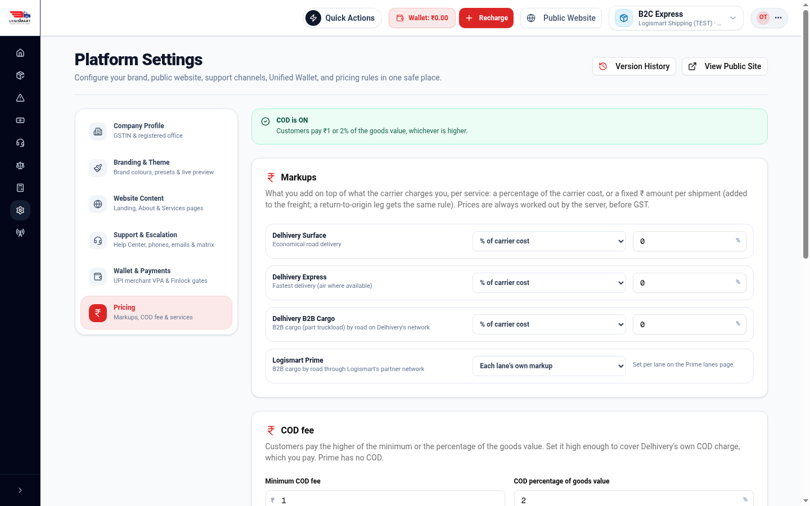

---

### Workflow 2: Add a Customer's Money to Their Wallet (UPI QR or Offline NEFT/Cash — 3 Clicks)

**Real-world story:** A customer wants ₹5,000 in their Logismart wallet so they can book shipments. Either (A) they scan your UPI QR code in the app and type their 12-digit UTR number, or (B) they send ₹5,000 directly to your bank account by NEFT / IMPS / Cash and WhatsApp you the receipt.

- **If the customer paid via the in-app UPI QR:**
  - **Click 1:** Open **Finances ▸ Wallet** (`/wallet`) as Owner or Admin. Look at the yellow **Pending UPI Recharges Requiring Admin Approval** box at the top.
  - **Click 2:** Check your bank statement to confirm the 12-digit UTR and ₹ amount arrived.
  - **Click 3:** Click **Approve & Merge** → **Confirm**. The customer's wallet balance goes up immediately!
- **If the customer paid offline (NEFT / RTGS / IMPS / Cash / Cheque):**
  - **Click 1:** Open **Finances ▸ Wallet** (`/wallet`) and click **+ Record Offline Credit** (top right).
  - **Click 2:** Pick the customer from **Quick Select Customer** (or type their email), type the **Amount (₹)**, choose **NEFT / RTGS** (or Cash/IMPS), and type the **Bank Reference / UTR**.
  - **Click 3:** Click **Credit Wallet**. Their wallet is credited immediately and an official **Advance Receipt Voucher (`REC-...`)** is created!
- **On `one.delhivery.com`:** Finances ▸ Wallet ([unified-wallet-faqs](https://help.delhivery.com/docs/unified-wallet-faqs)).

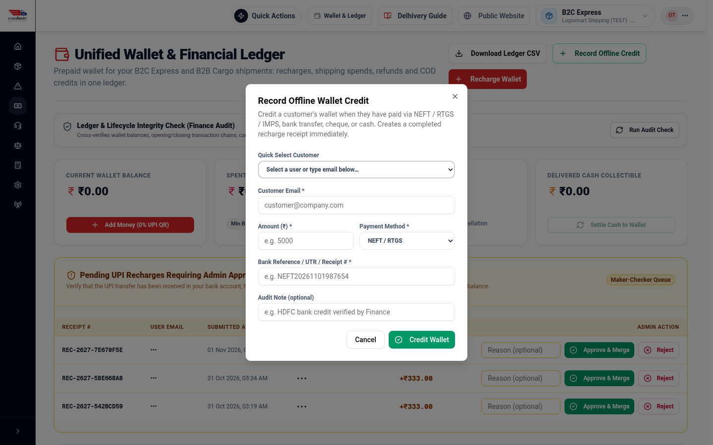

---

### Workflow 3: Book a Small Parcel (B2C Express — 3 Clicks)

**Real-world story:** A seller wants to ship a 500-gram shoe box from Gurugram (`122001`) to Bengaluru (`560001`). Because the item is worth less than ₹50,000, no complicated tax forms or E-Way Bills are needed.

- **Click 1:** Click **Orders & Pickups ▸ Orders ▸ + Create shipment** (`/shipments/new/forward`). Pick the **Pickup Address** and **Receiver Address**, type the **Box Weight & L×B×H**, choose the **Product Category**, and type the **Shipment Value (₹)**. *(Leave the collapsed "Optional Tax, Invoice & Compliance Details" box closed unless the parcel is worth ₹50,000 or more—or click **Add HSN / Invoice / Photos** if you want to attach an HSN code, seller invoice number/date, or package photo!)*
- **Click 2:** Click **Find Rates**. You see two clear cards side by side: **Delhivery Surface** (cheaper road) and **Delhivery Express** (faster air). Click the card you want.
- **Click 3:** Click **Book for ₹X**. The money is deducted from the wallet, a GST Tax Invoice is generated, and you can immediately click **Print Label** (`4×6` thermal sticker) and **Add to Pickup Request**.
- **On `one.delhivery.com`:** Orders ▸ Create Forward Shipment ([create-forward-order](https://help.delhivery.com/docs/create-forward-order)).

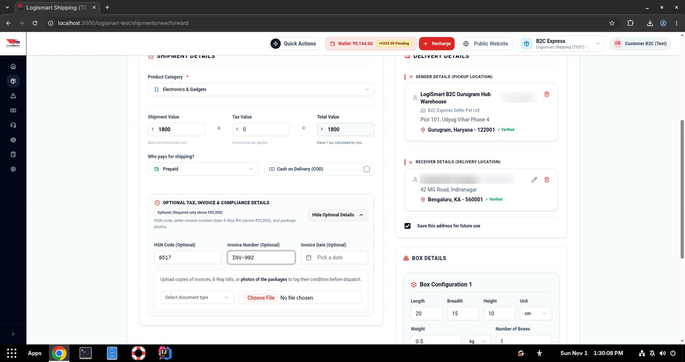

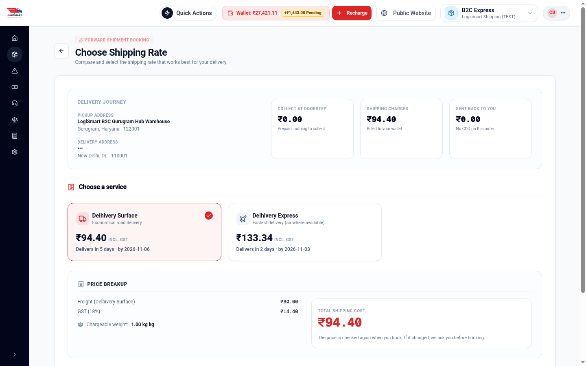

---

### Workflow 4: Book a Heavy Multi-Box Truck Order (B2B Cargo: Door Delivery vs. Godown Pickup — 3 Clicks)

**Real-world story:** A factory wants to send 3 heavy cartons (50 kg total) from Delhi NCR to Mumbai. They want to compare **Door Delivery** (truck delivers to the buyer's shop door) vs. **Godown Pickup** (buyer collects from the Mumbai transport hub for ₹0 door fee), and compare **Logismart Prime** vs. **Delhivery B2B Cargo**.

- **Click 1:** Switch the top-bar Flow Switcher to **B2B Cargo**, then click **B2B Orders ▸ + New LR** (`/b2b/shipments/new/forward`). Pick Origin & Destination, enter your box lines (`Count`, `Weight`, `L×B×H`), Cargo Value, and GST Invoice Number, and click the radio card for **Door Delivery** or **Godown / Hub Pickup**.
- **Click 2:** Click **Compare B2B Rates**. On Step 2, you can flip the live **Door Delivery / Godown Self-Pickup** toggle bar at the top to see the exact ₹ price difference immediately, and compare **Logismart Prime** against **Delhivery B2B Cargo**.
- **Click 3:** Click **Book for ₹X**, then click **Print Label** to get the **3-copy A4 Lorry Receipt Docket** (`Consignor`, `Consignee`, `Driver Copy`) plus barcode stickers for every box (`-B1`, `-B2`, `-B3`).
- **On `one.delhivery.com`:** B2B Cargo ▸ Create Order ([b2b-order-creation](https://help.delhivery.com/docs/b2b-order-creation)).

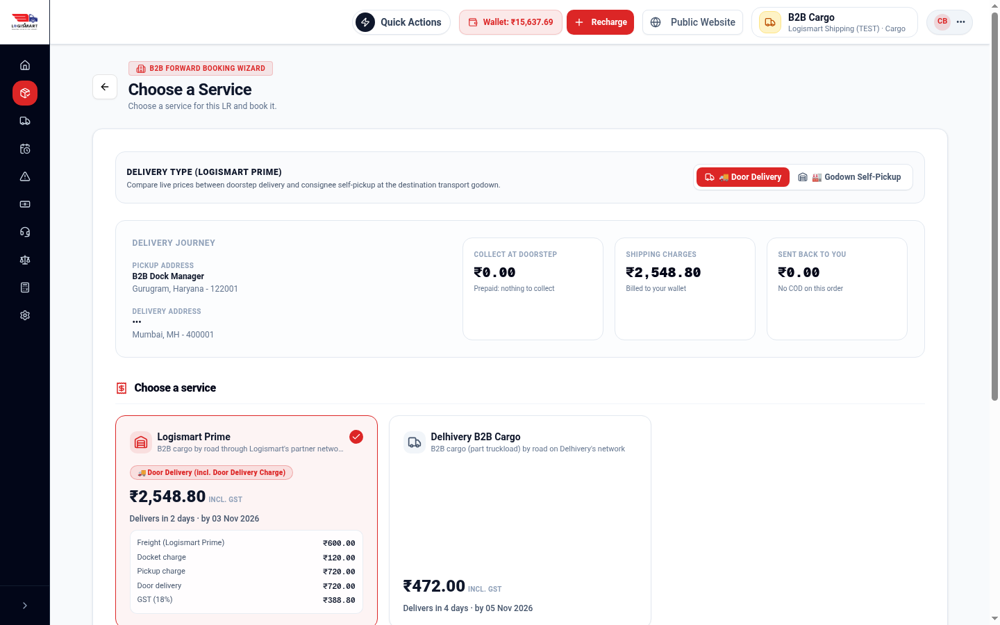

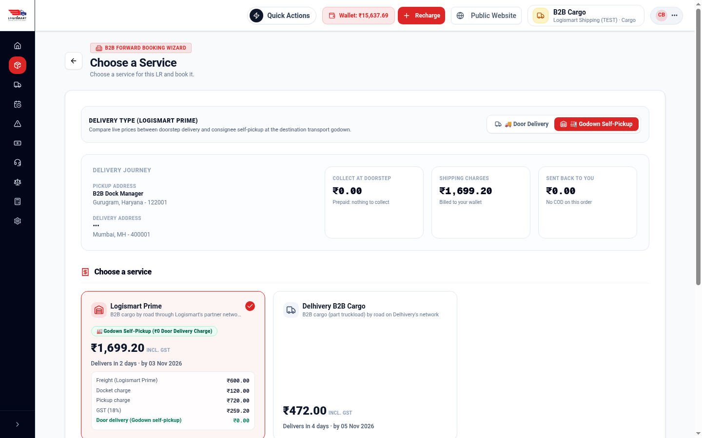

---

### Workflow 5: How Admin Co-ordinates Side-by-Side with `one.delhivery.com` (3 Clicks)

**Real-world story:** A customer just booked a Delhivery parcel on Logismart (`LOGISMART-X9A2B3C4`). Now your Ops clerk needs to book that parcel on Logismart's `one.delhivery.com` account, get the real Delhivery AWB barcode, and link it back on Logismart. We built a **3-Column Side-by-Side Playbook** right on the order screen so your clerk never gets lost.

- **Click 1 (`1. On Logismart — Customer Order`):** Open the order in Logismart and scroll to **Carrier booking** on the right. Click **Copy Details for Delhivery** to copy the shipment details, then click **Open one.delhivery.com ↗**.
- **Click 2 (`2. On one.delhivery.com / Transporter`):** In `one.delhivery.com`, create the order, schedule the pickup, and copy the generated **Delhivery AWB number** and **billed amount**. (For a **Logismart Prime** B2B order, hand the 3-copy LR docket to the partner transporter shown on the card and take their LR/GR number.)
- **Click 3 (`3. Back on Logismart — Sync AWB & Settle Price`):** Back on the Logismart order page, click **Enter carrier booking**, paste the **Delhivery AWB**, **charged weight (kg)**, and **charged amount (₹)**, and click **Save carrier booking**. Logismart links the live AWB onto the 4×6 label and public tracking page!
- *Tip:* Anytime staff want a full cheat-sheet across all 6 workflows, click **`Delhivery Guide`** in the top header bar.

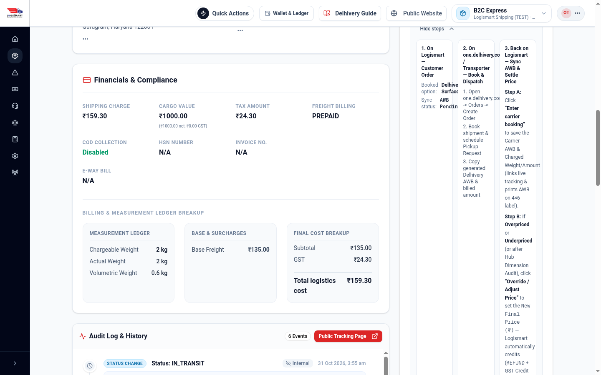

---

### Workflow 6: What to Do When an Order is Overpriced, Underpriced, or Re-Weighed at the Hub (3 Clicks)

**Real-world story:** After a customer books an order (say for `₹159.30`), two things can happen in real life:
1. **Overpriced (Give a Refund / Discount):** You promised the customer a cheaper rate (say `₹120.00`), so you want to reduce the price and send `₹39.30` back to their wallet.
2. **Underpriced or Heavier at Hub (Charge Extra):** Either Delhivery/the transporter charged more (say `₹200.00`), or the box weighed more on the hub scale, so you need to charge the extra `₹40.70` from the customer's wallet.

You have **one simple box** that does all the wallet math and GST tax notes automatically:

- **Click 1:** Open the order (`/shipments/[id]` or `/b2b/shipments/[id]`) as Owner or Admin. In the **Carrier booking** panel on the right, look at **OVERRIDE / ADJUST SHIPMENT PRICE** (or click **Record measurement** at the top if re-weighing a box at the hub).
- **Click 2:** Look at `Current Billed (incl. GST): ₹X`, type the **`New Final Price (₹ incl. 18% GST)`** you want the customer to pay, and type a short **Reason / Note**.
- **Click 3:** Click **Apply Final Price & Settle Wallet** (or **Save measurement**):
  - **If your New Final Price is LOWER (`Overpriced`):** Logismart automatically **refunds the ₹ difference back into the customer's wallet** and issues a **GST Credit Note (`LOGI2627C...`)**.
  - **If your New Final Price is HIGHER (`Underpriced`):** Logismart automatically **deducts the ₹ difference from the customer's wallet** (even if it pushes their wallet negative) and issues a **GST Debit Note (`LOGI2627D...`)**.

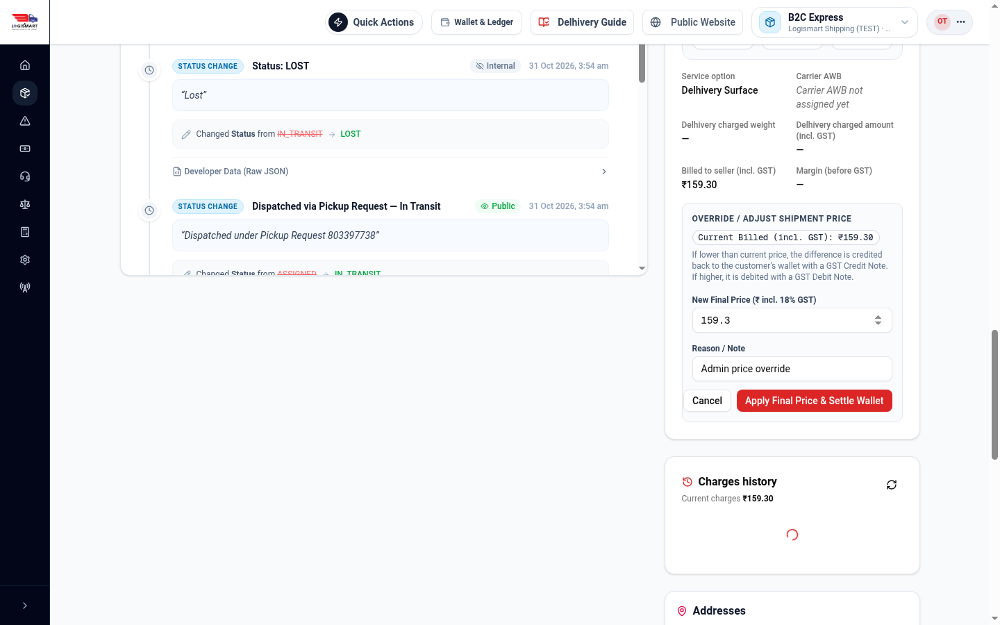

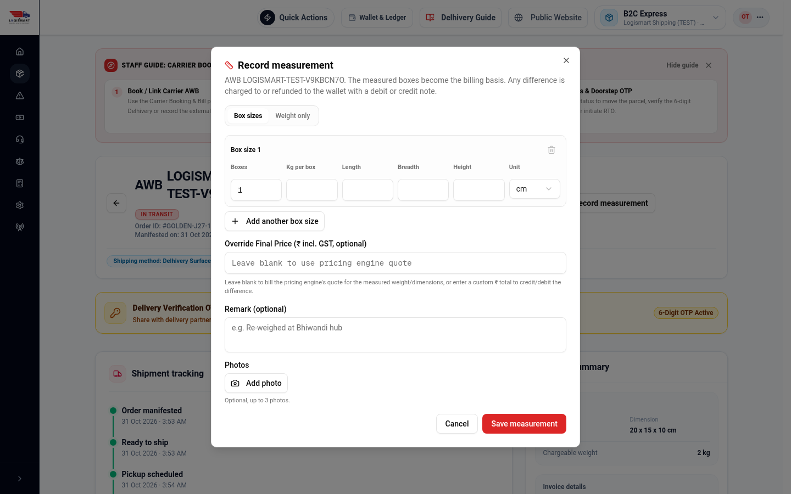

---

## 1. Logismart on one page

Logismart is a logistics company. Your customers (shippers) book parcels and cargo with you. You move them using two carriers:

| What the customer books | Who carries it | Where the price comes from |
|---|---|---|
| **B2C parcel**: Delhivery Surface or Delhivery Express | Delhivery, on Logismart's Delhivery account | Live from Delhivery's B2C price API |
| **B2B cargo**: Logismart Prime | Logismart's partner transporters (own network) | Logismart's Prime lane rate table |
| **B2B cargo**: Delhivery B2B Cargo | Delhivery Cargo (LTL) | Live from Delhivery's B2B price API (with automatic B2C Surface fallback when the B2B API password is not set; see [6.4](#64-delhivery-b2b-cargo)) |

Everything happens in one workspace:

- **Customers** (B2C and B2B shippers) sign up, book, pay from their wallet, track and raise tickets.
- **Logismart staff** set prices, approve money, run pickups and deliveries, and answer tickets.
- **Consignees** (the people receiving parcels) only use the public tracking page.

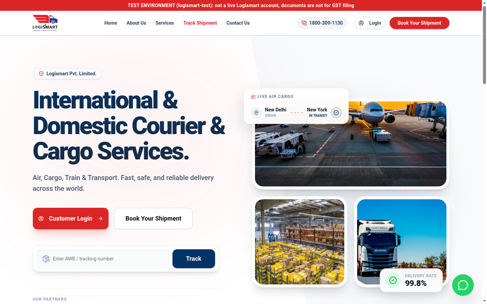

### The big differences from Delhivery One

| Topic | Delhivery One | Logismart |
|---|---|---|
| Who uses it | One seller per account | Logismart staff **and** all its customers in one workspace |
| Booking with the carrier | The order goes to Delhivery automatically | Staff book the parcel on one.delhivery.com by hand and paste the Delhivery AWB back ([7.7](#77-booking-the-parcel-on-onedelhiverycom-and-pasting-the-awb)) |
| Tracking updates | Automatic scans | Staff update every status (picked, in transit, out for delivery, delivered) |
| Wallet recharge | Payment gateway, instant | UPI QR + 12-digit UTR + approval by a second admin, or offline bank transfer / cash recorded by an Admin ([8.2](#82-wallet-recharge-upi--utr--approval-and-offline-credits)) |
| Price & weight adjustments | Carrier re-weighs and debits automatically | Hub measurement or 1-box **Override / Adjust Shipment Price** (`Overpriced` auto-refunds wallet + GST Credit Note; `Underpriced` auto-debits wallet + GST Debit Note; [8.7](#87-how-to-adjust-the-price--recover-or-refund-the-difference-admin-price-override)) |
| COD payout | Fixed remittance cycle, automatic | Finance pays each customer by bank remittance batch ([8.4](#84-cod-cash-on-delivery-money)) |
| Inviting users | Settings › Users › New User | People sign up themselves, then the Owner/Admin gives them a role ([5.1](#51-how-people-get-an-account)) |

### Built-in on-screen guides for Staff and Customers

- **Top-bar `Delhivery Guide` button (Staff only):** Opens the **Delhivery One ↔ Logismart Staff Co-ordination Playbook** modal comparing *What Customer Does on Logismart* | *What Admin Does on one.delhivery.com / Hub* | *What Admin Does on Logismart* across all 6 core workflows.
- **3-Step "How this screen works" banner:** Shown at the top of Booking, Shipment Detail, Pricing, and Ops Control Tower with a **Delhivery One Equivalent** badge. Click **Hide guide** to collapse it into a compact **`How it works ?`** pill.

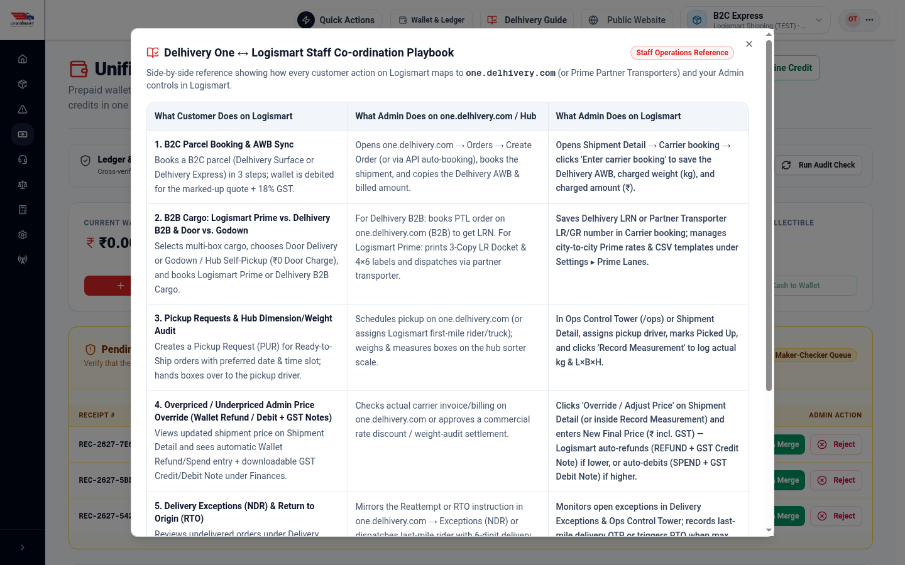

---

## 2. Who does what: roles

There are five **staff** roles (same names as Delhivery One) and one **customer** role.

| Role (as shown on the Users page) | Who at Logismart | Can do |
|---|---|---|
| **Owner** | The founder / account owner | Everything. Only the Owner can make or remove an Admin, or hand over ownership. |
| **Admin** | Business head, finance head | Everything except managing Admins. Settings, pricing, Prime lanes, users, approve recharges, COD remittances, resolve weight claims, mark Lost, start manual RTO. |
| **Operations-User** | Ops lead, hub staff, field executives | Book shipments, run pickup requests, the Ops Control Tower, status updates, OTP delivery, NDR, hub measurements, carrier AWB entry, support tickets. No money, no settings, no users. |
| **Support-User** | Customer support desk | Support tickets, delivery exceptions (non-money actions), weight claims on a customer's behalf. Cannot book, cancel or change status. |
| **Read access Only-User** | Accountant, auditor, investor | Sees everything, including the tenant-wide wallet ledger, remittances and invoices. Cannot change anything. |
| **Customer** | Your shippers | Their own orders, pickups, wallet, invoices, remittances, weight claims, tickets. B2C, B2B or both ("service scope"). |

> **On Delhivery One:** Settings › Users, roles Owner / Admin / Operation-user / Support-user ([users](https://help.delhivery.com/docs/users), [b2b-users-management](https://help.delhivery.com/docs/b2b-users-management)).
> **Different here:** (1) a sixth role, **Customer**, because Logismart's shippers live in the same workspace as Logismart staff. (2) On Delhivery One an Admin cannot add users; here an Admin can manage Operations, Support, Read-only and Customer users (only the Owner manages Admins).

### What each role can open

| Menu item | Owner | Admin | Ops | Support | Read-only | Customer |
|---|---|---|---|---|---|---|
| Home, Orders, Pickup Requests, Delivery Exceptions, Support, Disputes, Rate calculator | ✅ | ✅ | ✅ | ✅ | ✅ (view only) | ✅ (own) |
| Create Shipment (`/shipments/new/*`) & Create Pickup Request (`/pickup-requests/new`) | ✅ | ✅ | ✅ | ❌ | ❌ | ✅ |
| Finances › Wallet | ✅ | ✅ | ❌ | ❌ | ✅ (view all) | ✅ (own) |
| Finances › Remittances, Invoices | ✅ | ✅ | ❌ | ❌ | ✅ (view all) | ✅ (own) |
| Settings › Pickup Addresses / My Facilities | ✅ | ✅ | ✅ | ✅ | ✅ (view) | ✅ (own) |
| Settings › Users, Workspace Settings | ✅ | ✅ | ❌ | ❌ | ❌ | ❌ |
| Settings › Pricing & Prime lanes | ✅ edit | ✅ edit | view | view | view | ❌ |
| Ops Control Tower (`/ops`) | ✅ | ✅ | ✅ | ❌ | ❌ | ❌ |

- For **Staff**, the left sidebar is grouped into three sections: **Daily Shipping & Money**, **Platform Setup** (inside Settings), and **Staff & Hub Operations** (`Ops Control Tower`).
- In the top header, **Customers** see their live wallet balance and **+ Recharge** button; **Owner / Admin / Ops** see a clean **Wallet & Ledger** link pill; **Support** and **Read-only** users do not have a personal wallet pill.
- Staff always see both flows (B2C and B2B). A role change reaches the person's screen the next time they load a page.

### The flow switcher (B2C Express / B2B Cargo)

The top bar has **Choose your flow**: **B2C Express** (domestic parcels, forward and DTO) and **B2B Cargo** (heavy cargo, LTL / surface freight). Each flow has its own menu and home page. The app remembers your last choice.

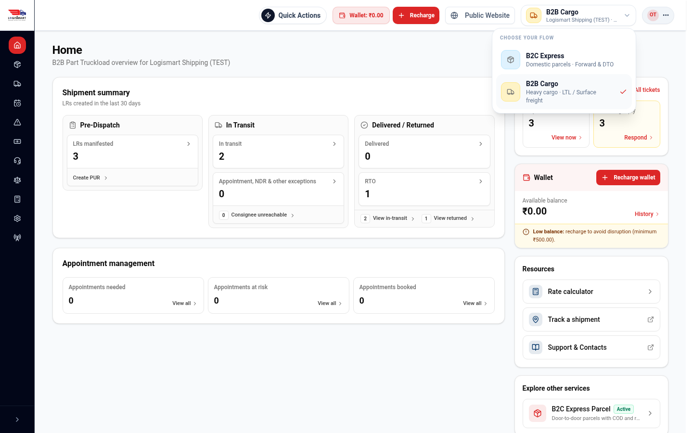

> **On Delhivery One:** the Domestic (B2C) and Cargo (B2B) panels with a panel switcher ([b2b-cargo-orders](https://help.delhivery.com/docs/b2b-cargo-orders)).

A B2C-only customer sees **Request Access** next to B2B Cargo (see [5.4](#54-b2b-access-requests-and-approval)).

Each flow's **Home** shows the order summary for the last 30 days by stage, performance, support, wallet and resources.

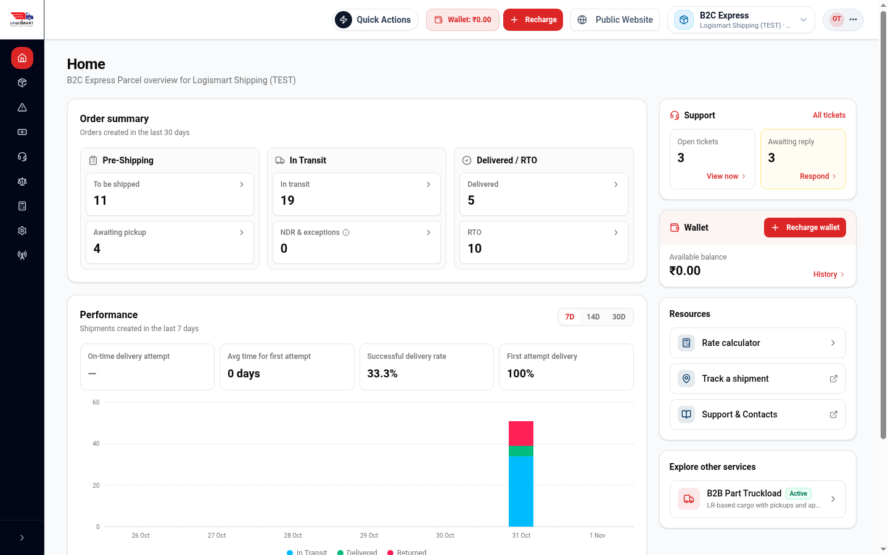

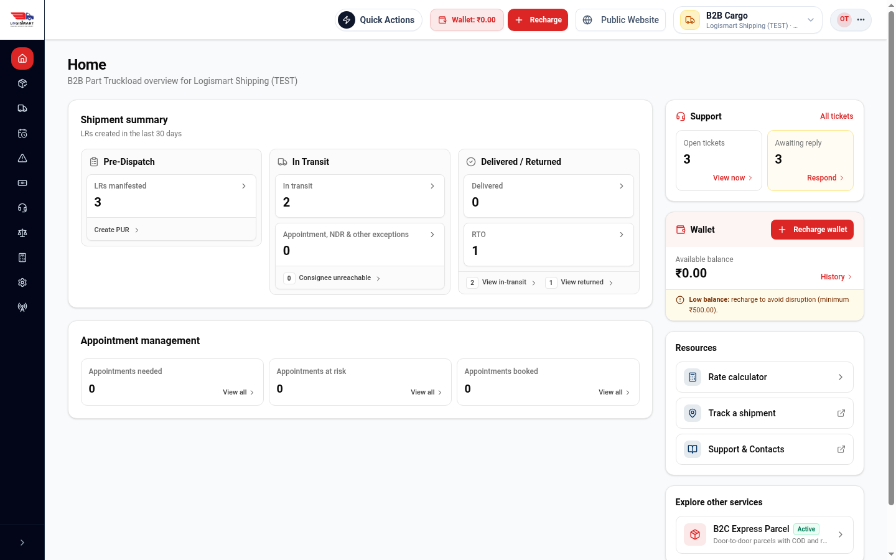

---

## 3. Signing in, passwords and sessions

Go to **https://logismart.naviera.com/login**. The page has three tabs: **Sign In**, **Create Account**, **Email OTP**.

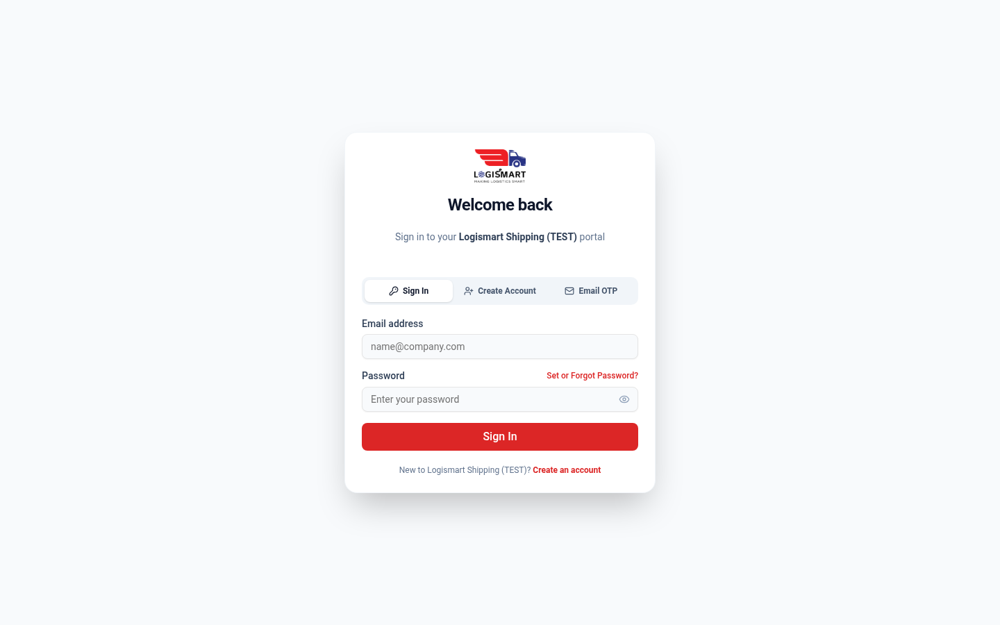

| I want to… | Do this |
|---|---|
| Sign in | **Sign In** tab → email + password → **Sign In**. |
| Create an account | **Create Account** → full name, email, password (8+ characters), tick the Terms & Prohibited Items box → **Create Account**. New accounts start as **Customer, B2C**. |
| Sign in without a password | **Email OTP** → email → **Send 6-Digit OTP** → type the code → **Verify & Sign In** (works only for existing accounts). |
| Reset or set a password | **Sign In** tab → **Set or Forgot Password?** → email + new password → **Send Code to Set Password** → either type the 6-digit code from the email **or** click the link in the email. Both save your new password. |
| Change password while signed in | Profile menu (top right) → **My profile** → **Change password** → enter new password → **Update Password**. |
| Log out | Profile menu (top right) → **Log out**. |
| Use another account | Log out, then sign in with the other email. There is no "switch account" button. |

Rules to know:

- **Email OTP** and **Set or Forgot Password** do not create new accounts. If an email is not registered yet, you see *"No account found for this email. Use Create Account to sign up."*
- Too many wrong passwords: 10 tries per account per 5 minutes, then wait.
- A password session lasts **24 hours**. After that the app sends you back to the login page.
- An email can exist only once across Naviera. If you see "An account with this email already exists", use Sign In, Email OTP or Set or Forgot Password.

> **On Delhivery One:** Login FAQs ([faqs](https://help.delhivery.com/docs/faqs)).
> **Different here:** Delhivery emails a reset link valid for 5 minutes. Logismart supports both typing the 6-digit code on the login page and clicking the email reset link.

### "Access not available"

If you see a full-screen **Access not available** card:

- "This login doesn't have access to this workspace yet…" → you signed in with an email that has no account in Logismart. Click **Sign out** and use the right email, or ask an Admin.
- "Your account has been deactivated…" → an Admin deactivated you. Ask the Owner or an Admin.

---

## 4. First-time setup (Owner and Admin)

Open **Settings › Workspace Settings** (`/settings`, title **Platform Settings**). Only the Owner and Admins can open it. It has six sections on the left.

Sections 1 to 5 share one **Save Settings** bar at the bottom (with **Discard Changes**). The **Pricing** section has its own **Save pricing** button. Every save is kept in **Version History** (top right).

> **On Delhivery One:** Settings › Company Details, Profile, Tax configuration ([profile](https://help.delhivery.com/docs/profile), [add-gst-details-for-label-cum-invoice](https://help.delhivery.com/docs/add-gst-details-for-label-cum-invoice)).

### 4.1 Company Profile

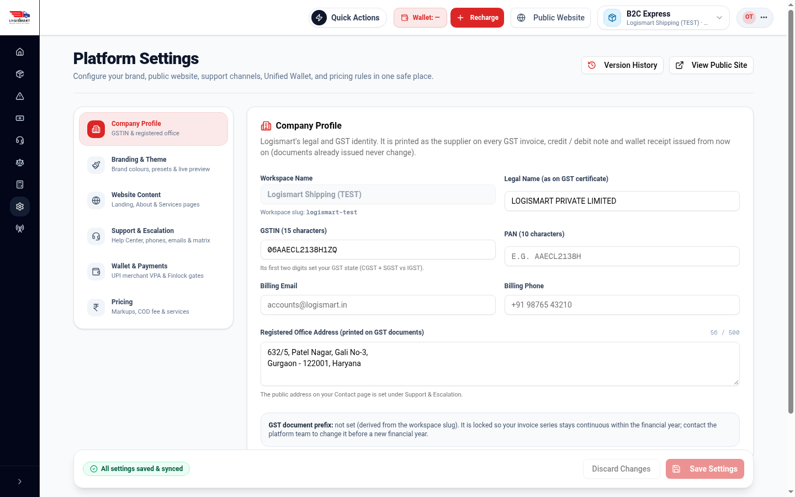

- **Legal Name**, **Registered GSTIN (15 Characters)** (`06AAECL2138H1ZQ`), **PAN** (`AAECL2138H`), **Billing Email**, **Billing Phone**, and **Registered Office Address**: printed directly on GST Tax Invoices, Credit Notes, Debit Notes, and B2B Lorry Receipts.
- The workspace name and workspace slug are fixed. Ask the Naviera tech team to change them.
- **GST document prefix**: locked to **LOGI** on the live workspace (for example `LOGI2627I000001`). The prefix cannot be changed once used.

### 4.2 Branding & Theme

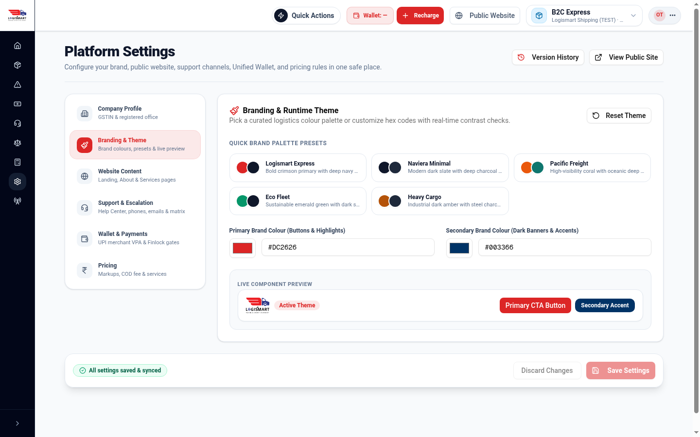

- Pick a **Quick Brand Palette Preset** or set **Primary** and **Secondary Brand Colour** (hex). The page previews the colours before you save.
- An amber warning appears if white button text would be hard to read.
- **Limitation:** there is no logo upload. Send the logo to the Naviera tech team.

### 4.3 Website Content

Edit the public website: announcement bar, hero headline and button, About Us story and offer cards, Services cards (with an icon picker) and value-add bullets. Headlines are limited to 120 characters and paragraphs to 1,000.

### 4.4 Support & Escalation

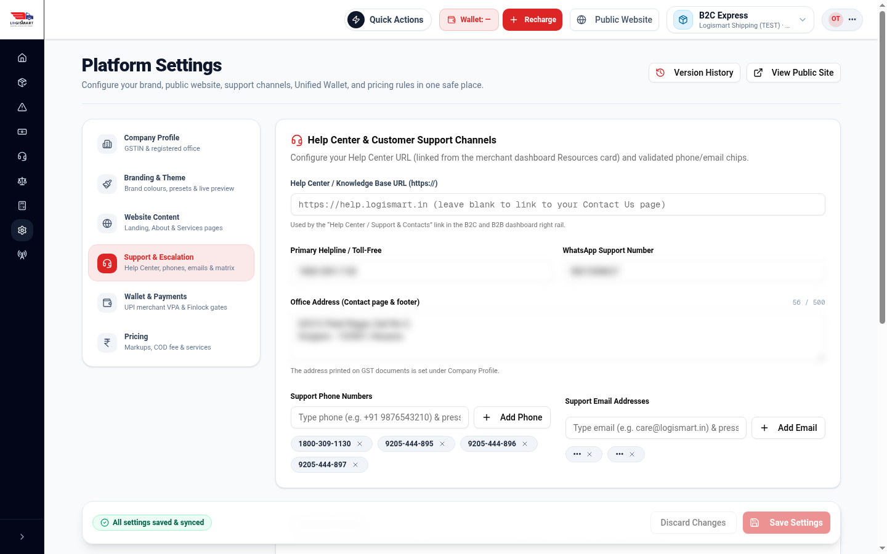

- **Help Center / Knowledge Base URL**: optional, must start with `https://`. If blank, the dashboard **Resources** card links to your Contact page.
- **Primary Helpline**, **WhatsApp Support Number**, extra **Support Phone Numbers** and **Support Email Addresses**. The WhatsApp number also shows a floating WhatsApp button on the public website.
- **Escalation Matrix**: Level 1 Customer Support → Level 2 Operations Lead → Level 3 Nodal Officer → Level 4 Management. Each level needs an email; the phone is optional. It is published on the public **Contact** page.

### 4.5 Wallet & Payments (UPI)

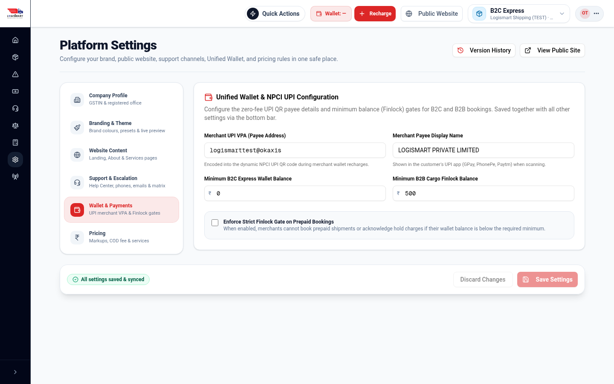

- **Merchant UPI VPA (Payee Address)**: Logismart's company UPI ID (for example `name@bank`). **Until this is filled, nobody can recharge their wallet via UPI QR** ("UPI not configured"). At launch the field holds `logismart@okaxis`; the Owner/Admin can update it here to Logismart's business UPI ID whenever decided.
- **Merchant Payee Display Name**: the name shown in GPay / PhonePe / Paytm.
- **Enforce Strict Finlock Gate on Prepaid Bookings**: OFF by default. When ON, a customer cannot book a prepaid shipment unless the wallet covers it and stays above the minimum. The minimums are **Minimum B2C Express Wallet Balance** (default ₹0) and **Minimum B2B Cargo Finlock Balance** (default ₹500).

> [!IMPORTANT]
> With Strict Finlock **OFF**, bookings go through even with no money in the wallet, and the wallet goes negative. Decide this before launch (see [12](#12-mvp-limitations-and-known-risks)).

> **On Delhivery One:** Unified Wallet and Finlock ([unified-wallet-faqs](https://help.delhivery.com/docs/unified-wallet-faqs), [b2b-wallet](https://help.delhivery.com/docs/b2b-wallet)).
> **Different here:** Delhivery's Finlock starts when the balance passes a permitted negative limit. Logismart's Finlock is a switch: ON blocks bookings below the minimum, OFF allows unlimited negative balance.

### 4.6 Pricing (markups, COD fee, services)


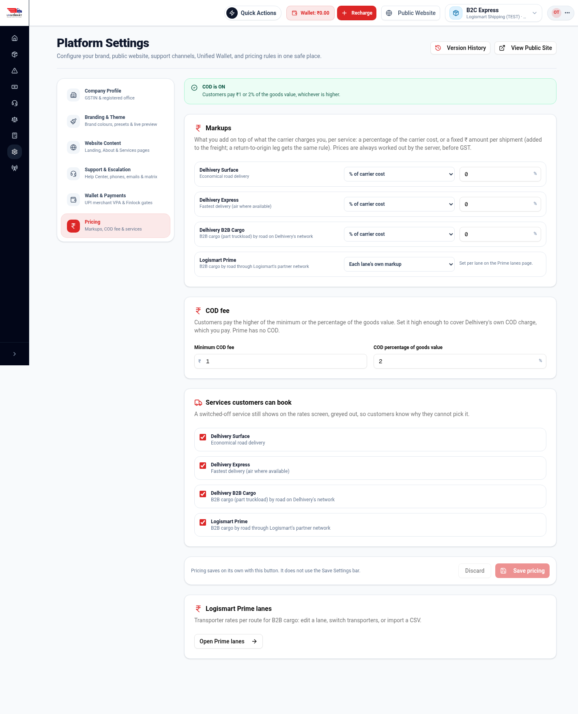

This is where Logismart decides its selling price. Ops, Support and Read-only users can see it (read-only) on the **Pricing & Prime lanes** page.

- **Markups** per service: how much Logismart adds on top of its carrier cost:
  - **Delhivery Surface (B2C)**, **Delhivery Express (B2C)**, and **Delhivery B2B Cargo**: choose **`% of carrier cost`** or **`Fixed ₹ per shipment`**. Launch value: **0%** on all Delhivery services (you sell at Delhivery's price unless you add a `%` or `₹` markup).
  - **Logismart Prime (B2B)**: uses **Each lane's own markup** (`markup_percent` on each lane row in the Prime lanes table; launch value: **20%**).
- **COD fee**: **Minimum COD fee (₹)** and **COD percentage of goods value**. The customer pays the higher of the two. **COD stays OFF until both are filled.** Launch value: COD off.
- **Services customers can book**: tick boxes for **Delhivery Surface**, **Delhivery Express**, **Logismart Prime**, and **Delhivery B2B Cargo**. A switched-off service shows greyed out with *"This service is switched off by Logismart for now."*
- **Save pricing** opens **Confirm pricing changes** with before → after. New prices apply to new quotes and bookings only. Shipments already booked keep their price.

A yellow banner **"Delhivery price API not connected yet"** means the Delhivery token is missing on the server. Ask the Naviera tech team ([13](#13-faq-and-troubleshooting)).

> **On Delhivery One:** the Rate Card shows the price Delhivery charges you ([rate-card](https://help.delhivery.com/docs/rate-card)).
> **Different here:** this screen is Logismart's own selling policy for its customers. Delhivery One has no equivalent because there you are the customer.

### 4.7 Prime lanes (rate table) and CSV import/export

Open **Settings › Pricing & Prime lanes** (`/settings/prime-lanes`). All staff can view it; only the Owner and Admins can change it. Customers cannot see it.

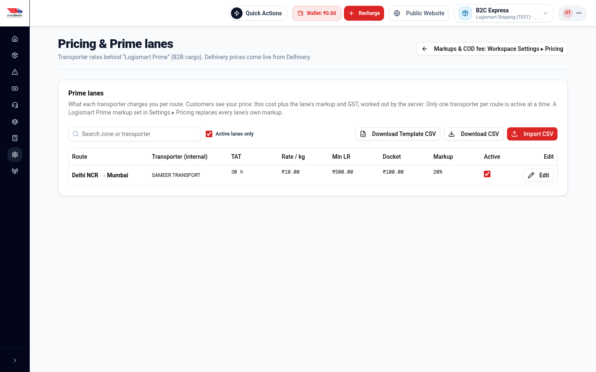

Each **lane** is one transporter's **cost** for one route (origin zone → destination zone). Customers see your price: that cost plus the lane's markup plus 18% GST. Transporter names are internal and never shown to customers.

- Columns: Route, Transporter (internal), TAT (h), Rate / kg (₹), Min LR (₹), Docket (₹), Markup (%), Active, Edit.
- **Edit** (pencil) changes TAT, rate per kg, minimum LR, docket and markup inline. Enter saves, Esc cancels.
- **Active**: only one transporter per route is active. Ticking a lane switches off the other transporter on that route. Unticking means customers can no longer book that route.
- **Download Template CSV** downloads a ready-to-fill sample file (`prime_lanes_template.csv`) with the exact column headers and two sample rows (`Delhi NCR → Mumbai` and `Bengaluru → Hyderabad`).
- **Download CSV** exports all current lanes (`prime_lanes.csv`).
- **Import CSV**: upload a file with the same columns → **Check file** (nothing is saved yet) → read "N lanes will be added, N updated and N switched off", fix any "Problems to fix" → **Import these changes**.

CSV columns, in order:

```
origin_zone, dest_zone, mode, transporter_name, tat_hours, rate_per_kg, min_lr_charge,
docket_charge, min_chargeable_kg, volumetric_divisor, max_dimension_cm, delivery_type,
oda_per_kg, oda_min, odd_weight_per_kg, odd_weight_min, pickup_per_kg, pickup_min,
door_delivery_per_kg, door_delivery_min, markup_percent, is_active
```

CSV rules:

- `mode` is always `SURFACE`. `delivery_type` is `GODOWN` (receiver collects from the transporter's godown; door delivery is a paid add-on) or `DOOR` (door delivery included).
- A lane is identified by origin + destination + mode + transporter name.
- One bad row stops the whole import. Files must be UTF-8 and under 1 MB.
- Lanes not in the file are left alone. There is no delete: switch a lane off instead.
- Zones (which pincodes belong to "Delhi NCR", "Mumbai", …) cannot be created in the app. An unknown zone gives "Unknown zone …; create it first". Ask the Naviera tech team to add zones.
- ODA, heavy-box, pickup, door-delivery and volumetric fields can only be changed by CSV.

**At launch** the live workspace has 56 zones (2,123 pincodes) and 74 lanes from Logismart's rate sheet: 55 routes from **Delhi NCR** to other cities, each with its cheapest transporter active and 19 standby transporters switched off. There is **no Delhi NCR → Delhi NCR lane** and no route that starts outside Delhi NCR, so those B2B quotes show "Logismart Prime has no rate from A to B yet" (while **Delhivery B2B Cargo** can still quote and book those routes). Pincodes that Delhivery does not serve are marked ODA, so they carry the ODA charge.

> **Different here:** Logismart Prime is Logismart's own transporter network. Delhivery One has no equivalent. The closest screen is the B2B Rate Calculator ([b2b-serviceability-rate-calculator](https://help.delhivery.com/docs/b2b-serviceability-rate-calculator)).

### 4.8 Version History (undo a settings change)

**Version History** lists the last 20 saves with who saved and which sections changed. **Restore** puts Company Profile, Branding, Website Content, Support & Escalation, and Wallet & Payments back to how they were **before** that save while **preserving your current Pricing & Markups** and user roles. Restoring first saves the current state, so you can undo the restore.

---

## 5. Adding people, roles and B2B approval

Open **Settings › Users** (`/team`). Only the Owner and Admins can open it.

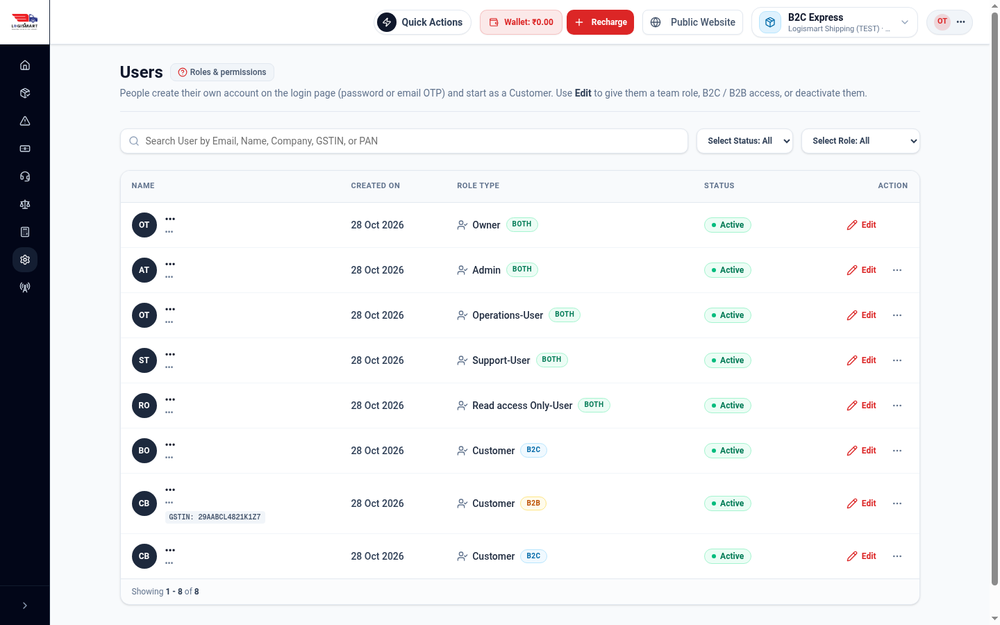

### 5.1 How people get an account

> **Different here:** there is **no invite button**. On Delhivery One you click New User and the person gets an email ([users](https://help.delhivery.com/docs/users)). Here:

1. Ask the person to open **logismart.naviera.com/login** and use **Create Account** with their work email.
2. They start as **Customer (B2C)**.
3. You open **Users**, find them, click **Edit**, and pick their role.

### 5.2 Giving a staff role

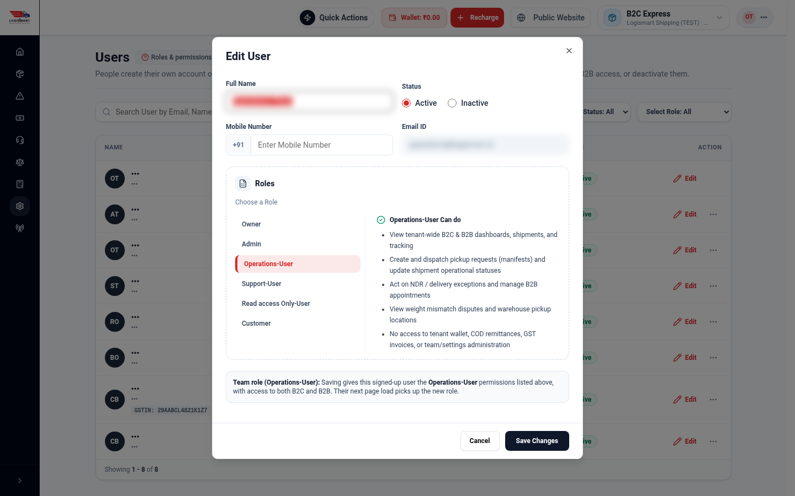

**Edit** → choose **Owner / Admin / Operations-User / Support-User / Read access Only-User** → **Save Changes**. Staff always get both flows (B2C and B2B). The person sees the new menu on their next page load.

Guard rails:

- You cannot change your own role or deactivate yourself.
- Only the Owner can make someone an Admin or change an Admin.
- Only the Owner can hand over ownership. The old Owner becomes an Admin automatically.
- The Owner cannot be demoted or deactivated.
- The email address cannot be changed.

### 5.3 Setting up a customer

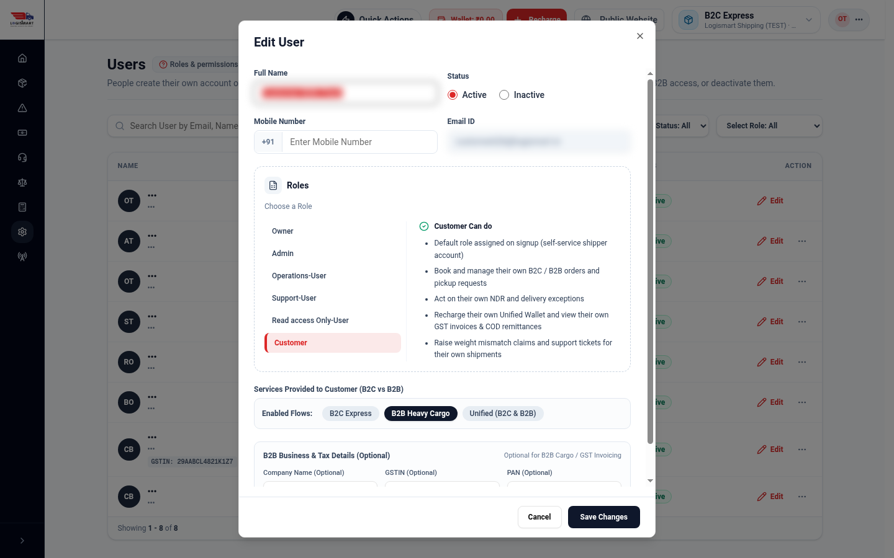

**Edit** → **Customer** → **Enabled Flows**: **B2C Express**, **B2B Heavy Cargo** or **Unified (B2C & B2B)**. Optionally fill **Company Name**, **GSTIN** (PAN fills in automatically) and **PAN**. The GSTIN is printed on the customer's GST invoices.

Quick change: the **⋯** menu on a row → **Service Scope**, or **Deactivate User** / **Activate User**. A deactivated user is locked out immediately.

Customers can also add their company name, billing address and GSTIN once from **My profile**. After that, changes need a support ticket (same as Delhivery One).

### 5.4 B2B access requests and approval

A B2C customer who wants B2B clicks **Request Access** in the flow switcher. The dialog **Request B2B Heavy Cargo Access** asks for company name, GSTIN (PAN is derived automatically), and expected volume.

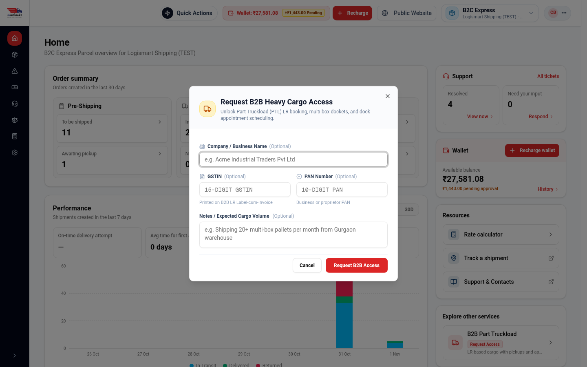

On the Users page, an amber banner **Pending B2B Heavy Cargo Access Requests (N)** appears. Click **Approve B2B** (the customer gets B2C + B2B) or **Reject**.

> [!NOTE]
> Nobody is notified. Check the Users page every day for new requests. A rejected customer is not told; tell them yourself.

> **Different here:** on Delhivery One, B2B is a separate Cargo account. Logismart serves B2C and B2B shippers in one workspace, so B2B is switched on per customer.

---

## 6. How pricing works

### 6.1 The services

| Service | Flow | Carrier | Cash on Delivery |
|---|---|---|---|
| **Delhivery Surface** ("Economical road delivery") | B2C forward and reverse | Delhivery | Yes, if the COD fee is set |
| **Delhivery Express** ("Fastest delivery, air where available") | B2C forward and reverse | Delhivery | Yes, if the COD fee is set |
| **Logismart Prime** ("B2B cargo by road through Logismart's partner network") | B2B forward only | Partner transporter | No |
| **Delhivery B2B Cargo** | B2B forward only | Delhivery Cargo | No (prepaid only) |

### 6.2 The formula (same for every service)

> **Customer price = carrier cost + Logismart markup + COD fee (if COD) + 18% GST**

- **GST is always 18%** (SAC 996812, Courier services). It is split CGST + SGST within Haryana and IGST outside.
- Markup, COD fee and GST are **frozen at booking**. Changing the pricing policy later never changes old shipments.
- Customers see the price lines (Freight, COD fee, RTO freight, GST). They never see the carrier cost, the markup or the transporter name.

### 6.3 Delhivery Surface and Express (B2C)

- The cost is Delhivery's own price for your account, before GST and without Delhivery's COD charge. With 0% markup the customer pays what Delhivery would charge.
- Chargeable weight = higher of dead weight and volumetric weight (L × B × H in cm ÷ 5000), rounded up to the next 500 g.
- A B2C box can weigh at most 50 kg. Above 20 kg the customer must tick "unusually heavy".
- Delhivery tells us if a pincode is not serviceable, under embargo, or has no COD. The option then shows **Not available** with the reason.
- The RTO (return) price is fetched at booking and billed only if the shipment goes RTO.

> [!WARNING]
> With 0% markup, Logismart earns nothing on Delhivery freight. Any difference between our price and Delhivery's invoice (re-weigh, rate change) is a direct loss unless it is passed to the customer. That is why staff must enter Delhivery's charged weight and amount ([7.7](#77-booking-the-parcel-on-onedelhiverycom-and-pasting-the-awb)).

### 6.4 Delhivery B2B Cargo

- Shown as **Delhivery B2B Cargo** (`DELHIVERY_B2B_SURFACE`) alongside **Logismart Prime** on the B2B Rate Calculator (`/b2b/rate-calculator`) and B2B Booking Step 2 (`/b2b/shipments/new/forward`).
- Priced at Delhivery's pre-GST freight + Logismart markup (`%` or `Fixed ₹`, launch: `0%`) + 18% GST.
- Supports **Owner's Risk** and **Carrier's Risk**: ticking **Carrier's Risk** adds the ROV surcharge (`higher of 0.1% of declared value or ₹100`).
- Prepaid only: no COD and no To-Pay. The RTO leg is estimated with the pincodes swapped.
- **Live API & Automatic B2C Token Fallback:**
  - Logismart's Delhivery One B2B account is **`B2B Surface · LOGISMART B2BC`** (API username `LOGISMARTB2BC` on `https://ltl-clients-api.delhivery.com`).
  - Whenever `DELHIVERY_B2B_PASSWORD` is not yet set in `backend/.env` and `DELHIVERY_B2C_TOKEN` (`Domestic · LOGISMART PVT LTD Franchise`) is configured, the server **automatically falls back to pricing `Delhivery B2B Cargo` via the live B2C Surface API** (summing chargeable weight across all boxes rounded to 500 g slabs, plus Carrier's Risk ROV when selected). This ensures **both Logismart Prime and Delhivery B2B Cargo return live, bookable quotes today**.
  - **How to switch to the dedicated LTL API password:** A password-reset link for `LOGISMARTB2BC` has been triggered to `owner@logismart.in` (`POST https://ltl-clients-api.delhivery.com/forgot-password` with `{"username":"LOGISMARTB2BC"}`, or email `lastmile-integration@delhivery.com`). As soon as the Owner sets the password and the tech team puts `DELHIVERY_B2B_PASSWORD` into `backend/.env`, `Delhivery B2B Cargo` automatically switches to `ltl-clients-api.delhivery.com` (rotate every 180 days; a wrong password locks the API user for 10 minutes).

### 6.5 Logismart Prime (B2B): Door Delivery vs. Godown Self-Pickup

Prime cost = the lane's rates:

- **Freight** = rate per kg × chargeable kg. Chargeable kg = the highest of actual weight, volumetric weight (lane divisor, usually L × B × H ÷ 4500) and the lane minimum (usually 50 kg).
- **Docket** charge.
- **Pickup charge** (always): per kg, with a minimum.
- **ODA charge** if the delivery pincode is out of delivery area.
- **Heavy box handling** if any box is over 200 kg.
- **Door Delivery vs. Godown / Hub Self-Pickup:**
  - On Step 1 and Step 2 of B2B booking (and on the B2B Rate Calculator), the customer chooses between **Door Delivery (To Consignee Doorstep)** (adds the lane's `door_delivery` charge) and **Godown / Hub Pickup (Self-Pickup at Destination Hub)** (`₹0.00` door delivery fee). Switching the toggle on Step 2 immediately re-fetches the live quote and updates the itemized price breakdown.
- **Minimum LR charge top-up** to reach the lane minimum.

Then the lane markup and 18% GST are added. RTO costs 100% of the forward freight. Prime has no COD and no reverse.

Not serviceable when: no zone for the pickup or delivery pincode, no active lane for the route, or a box side is longer than the lane allows. A B2B box can weigh up to 2,000 kg and one LR up to 20,000 kg.

### 6.6 Fresh prices, "price changed" and "Delhivery is down"

```
Get rates   → Delhivery price at most 30 minutes old
Book        → always a fresh Delhivery price
              same total      → booked
              different total → "The price has changed" dialog
Delhivery down at Book → last stored price under 24 h old, flagged
              nothing stored  → "Price unavailable, try again shortly"
Prime                  → never depends on Delhivery
```

- **"Last known price (N min old); final price is checked when you book."** (amber card) means the price came from the store.
- **The price has changed** dialog shows "You saw" and "New price". The customer clicks **Book for ₹X** or **Don't book**.

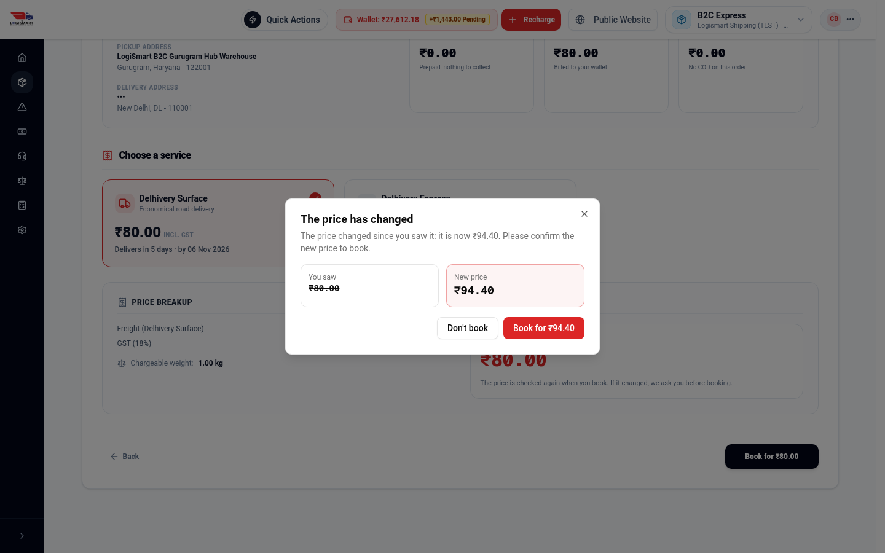

- "We couldn't get a price for this shipment right now. Please try again in a few minutes." means Delhivery is down and nothing is stored.
- No price is ever invented, and a price is never ₹0.

Delhivery allows about 45–50 price calls per 5 minutes for the whole platform. In a busy hour some quotes will use the stored price.

### 6.7 When the weight changes later (or when Admin overrides the price)

When a parcel is re-weighed (at pickup, at the hub, or by Delhivery), the price is recalculated **at the rates of the booking day**:

- Delhivery services: new price = booked price + (Delhivery's price for the new weight − Delhivery's price for the old weight). (For B2C RTO quotes, which Delhivery returns as cumulative forward + return, Logismart subtracts the forward cost so the RTO leg only bills the net return delta.)
- Prime: the lane copy saved at booking is used.
- **Optional Admin Price Override:** Inside the Hub **Record measurement** modal (and on Shipment Detail under **Override / Adjust Shipment Price**), the Owner or Admin can also type a custom **`Override Final Price (₹ incl. GST)`** to override the pricing engine's quote in one step (see [8.7](#87-how-to-adjust-the-price--recover-or-refund-the-difference-admin-price-override)).
- The customer's wallet is debited or refunded the difference, with a GST debit or credit note.
- If Delhivery is down during a weight-only re-quote (without a manual price override), the change is refused and the old price stays: "Delhivery's price is unavailable right now, so this change can't be priced."

---

## 7. Daily operations

### 7.1 The Orders screen

**Orders** (B2C) or **B2B Orders** (B2B) has status buckets on the left:

| Bucket | Statuses |
|---|---|
| Ready to ship | Draft, Open |
| Ready for pickup | Assigned (in a pickup request) |
| In transit | In Transit, Exception (NDR) |
| Out for delivery | Out for delivery |
| RTO - In transit | RTO Initiated, RTO In Transit |
| RTO - Delivered | Returned to seller |
| Delivered | Delivered |
| All shipments | everything |

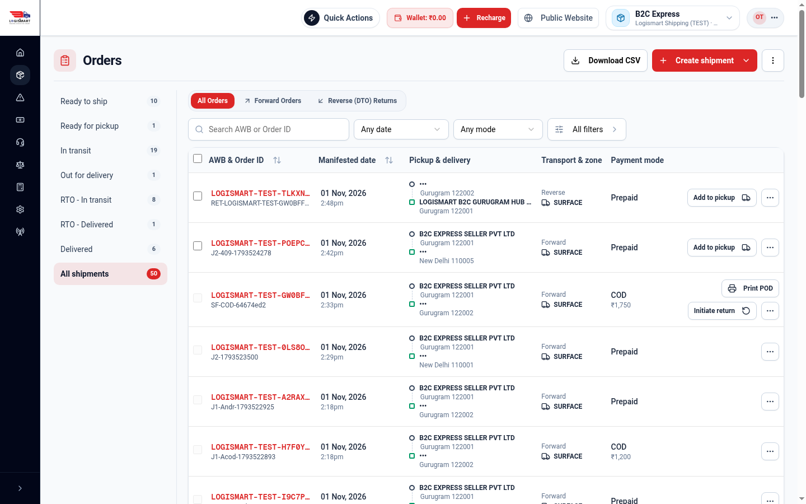

Tabs: **All Orders / Forward Orders / Reverse (DTO) Returns**. Search by AWB or Order ID. Staff see every customer's orders; customers see only their own.

The **Quick Actions** button (lightning, top bar) has Create Forward Shipment, Create Reverse Shipment, Create Pickup Request and Rate Calculator.

> **On Delhivery One:** Orders ([orders](https://help.delhivery.com/docs/orders), [domestic-orders](https://help.delhivery.com/docs/domestic-orders), [b2b-cargo-orders](https://help.delhivery.com/docs/b2b-cargo-orders)).

### 7.2 Booking a B2C parcel

**Forward:** `/shipments/new/forward`.

1. **New Forward Shipment**: Pickup and Receiver addresses, box weight and dimensions, product category, and goods value (plus COD if switched on). For standard parcels up to `₹50,000`, optional tax/compliance fields (`HSN Code`, `Invoice Number/Date`, `E-Way Bill`, `Supporting Documents`) are tucked neatly inside the collapsible **"Optional Tax, Invoice & Compliance Details"** card (which auto-expands whenever goods value exceeds `₹50,000`).
2. **Find Rates** → service cards with prices including GST.
3. **Book for ₹X**.


The order is created as **Ready to ship** with a Logismart tracking ID like `LOGISMART-X9A2B3C4`. A banner says "Next: Add to pickup". Pickup date and slot are chosen later, in the pickup request.

Rules:

- **Prepaid** is taken from the booker's wallet at booking and a GST invoice is issued.
- **Postpaid (billed to wallet)** works the same as Prepaid (wallet-billed at booking with a GST invoice).
- **Freight on Delivery (To-Pay) is off** in this version.
- An **E-Way Bill** (12 digits) is required when the goods value is ₹50,000 or more.
- COD amount must be above 0 and not more than the total value.
- Commercial goods for resale must be booked as B2B cargo.

> **On Delhivery One:** B2C Forward Order Creation ([create-forward-order](https://help.delhivery.com/docs/create-forward-order)).

**Reverse (customer return / DTO):** `/shipments/new/reverse`, or the **Initiate Return (DTO)** button on a delivered forward order (it pre-fills the addresses the other way round).

- A **Reason for Return** is required. You can switch on **Doorstep Quality Check (QC)** with instructions for the field executive.
- No COD on returns. **Find Return Rates** → book.
- If QC fails at the door, the shipment ends as **QC Failed** (or **Rejected at Pickup**) and the freight is refunded with a credit note.

> **On Delhivery One:** B2C Reverse Pickups/DTO ([reverse-ordersdto](https://help.delhivery.com/docs/reverse-ordersdto)).

### 7.3 Booking B2B cargo (LR)

`/b2b/shipments/new/forward` (**LTL / FTL Cargo**).

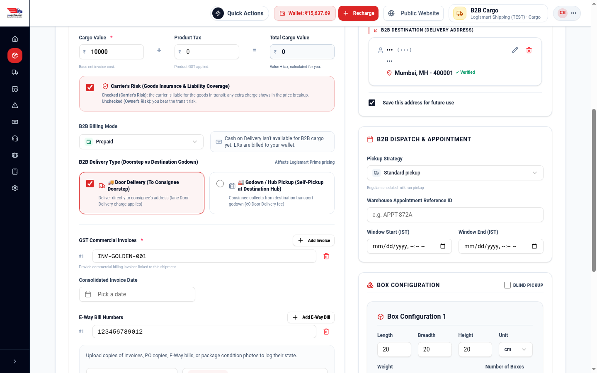

Fields: product category, PO number and date (up to 5 comma-separated POs), cargo value (`> ₹0`) and tax, **Carrier's Risk**, billing mode, **Door Delivery (To Consignee Doorstep)** vs. **Godown / Hub Pickup (Self-Pickup at Destination Hub, ₹0 Door Delivery fee)**, GST commercial invoices (at least 1 required), E-Way Bills (12 digits, required ≥ ₹50,000), documents, origin and destination, pickup strategy, warehouse appointment, and **Blind Pickup** (truck sent before boxes are counted; billed on arrival weight).

**Compare B2B Rates** → toggle **Door Delivery** vs. **Godown Self-Pickup** at the top of Step 2 if needed → choose **Logismart Prime** or **Delhivery B2B Cargo** → **Book for ₹X**.


- No COD on B2B. LRs are billed to the wallet.
- **B2B returns are off** in this version (no Reverse tab on `/b2b/shipments`). Customers who need a return should raise a ticket; ops arrange it.
- Printing a B2B LR (**Print Label**) generates **3 A4 Lorry Receipt Docket copies** (`CONSIGNOR COPY`, `CONSIGNEE COPY`, `DRIVER / TRANSPORTER COPY`) with itemized charges and compliance numbers (`GST Invoice No.`, `E-Way Bill`, `PO No.`) plus child box labels (`-B1..-BN` in `4×6` or `4×2` thermal).

> **On Delhivery One:** Create & Manifest B2B orders ([b2b-order-creation](https://help.delhivery.com/docs/b2b-order-creation)).
> **Different here:** "Carrier's Risk" adds the ROV surcharge (`higher of 0.1% of declared value or ₹100`) on **Delhivery B2B Cargo**; on **Logismart Prime** it is recorded on the LR without changing the lane price.

### 7.4 Booking for a customer (staff)

> [!NOTE]
> Walk-in "book on behalf of a customer" is **not** in this version. When a staff member books a shipment (whether `Prepaid` or `Postpaid`), the order belongs to **that staff member**, is debited from that staff member's wallet, and receives a GST Tax Invoice in their name. Ask customers to book in their own account, or use staff bookings only for Logismart's own house shipments.

Staff can choose any saved address, whereas customers only see their own saved addresses.

> **Different here:** Delhivery One has no equivalent: every seller books in their own account.

### 7.5 Rate calculator

**Rate calculator & serviceability** (`/rate-calculator` and `/b2b/rate-calculator`): pickup and delivery pincodes, boxes, value, payment and COD. It shows the same prices as booking, but books nothing. **Book This Shipment →** carries the details into a booking. Forward only.

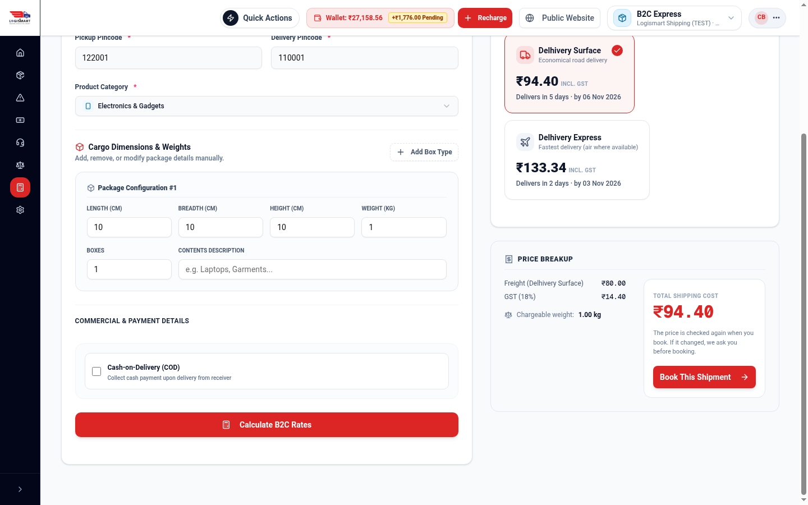

> **On Delhivery One:** Rate Calculator ([rate-calculator](https://help.delhivery.com/docs/rate-calculator), [b2b-serviceability-rate-calculator](https://help.delhivery.com/docs/b2b-serviceability-rate-calculator)).

### 7.6 Pickup requests (PUR)

**Pickup Requests** (`/pickup-requests` and `/b2b/pickup-requests`).

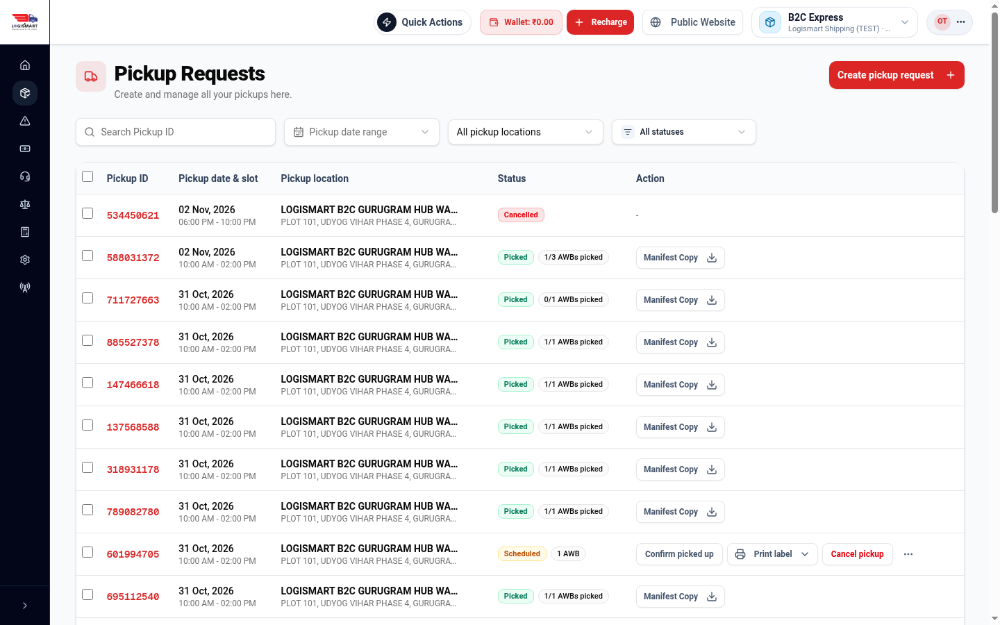

**Create pickup request +**:

1. Select the pickup location, date and slot (06–10, 10–14, 14–18, 18–22).
2. Tick the **Ready to ship** orders from that location. B2B can also tick **Blind pickup** with a box count (at least one LR is still needed).
3. Save. You get a 9-digit **Pickup ID**. The orders move to **Ready for pickup**.

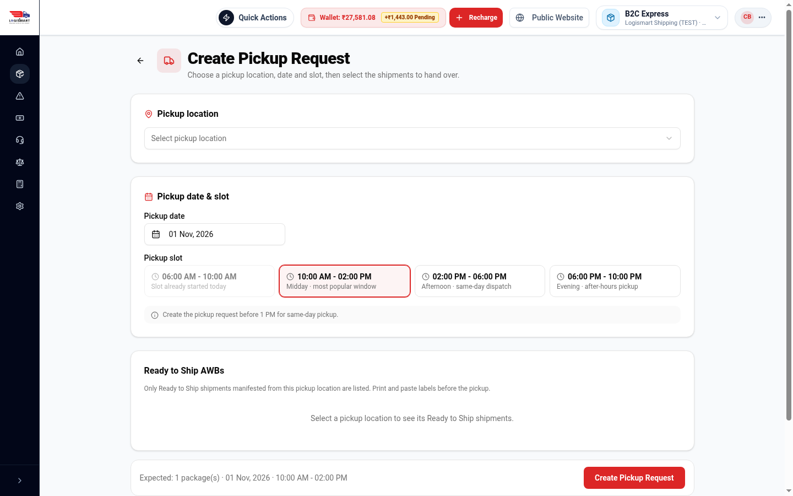

Rules:

- **Cut-off 1 PM (IST)** for same-day pickup. Later requests, or slots that have ended, are moved to the next slot automatically with a notice.
- All orders in one pickup must be from the same location, the same flow, and the same customer.
- You can add more orders to a **Scheduled** pickup from the Orders screen (**Add to Pickup**).

Row actions: **Print label** (A4 or Thermal 4x2), **Cancel pickup** (orders go back to Ready to ship), **Driver run-sheet** (B2B). Ops roles also get **Out for pickup**, **Mark picked up** and **Not picked**. After pickup: **Manifest Copy**.

> **On Delhivery One:** Pickup Requests ([pickup-request](https://help.delhivery.com/docs/pickup-request), [b2b-pickup-request](https://help.delhivery.com/docs/b2b-pickup-request)).
> **Different here:** Delhivery B2B's cut-off is 2 PM; here it is 1 PM for both flows. Late requests are moved, not refused.

### 7.7 Booking the parcel on one.delhivery.com and pasting the AWB

**In plain English:** When a customer books a Delhivery shipment on Logismart, they get a Logismart tracking number (`LOGISMART-...`). Your ops clerk then books the actual parcel on `one.delhivery.com` and pastes Delhivery's AWB number back into Logismart using the **3-Column Side-by-Side Co-ordination Playbook** on the order page:

1. **Column 1 (`1. On Logismart — Customer Order`):** Click **Copy Details for Delhivery** to copy the order details to your clipboard.
2. **Column 2 (`2. On one.delhivery.com / Transporter — Book & Dispatch`):** Click **Open one.delhivery.com ↗**, create the order on Logismart's Delhivery account using the same receiver, weight, and payment mode, and stick **Delhivery's label** on the parcel (or print Logismart's 4×6 label after step 4, which prints `DELHIVERY AWB: <carrier_awb>`).
3. **Column 3 (`3. Back on Logismart — Sync AWB & Settle Price`):** On the Logismart order page (or the **Carrier AWB** button on an Ops delivery card) → card **Carrier booking** → click **Enter carrier booking**.
4. Fill **Delhivery AWB** (required), **charged weight** (kg) and **charged amount** (₹, incl. GST) from Delhivery → **Save carrier booking**.

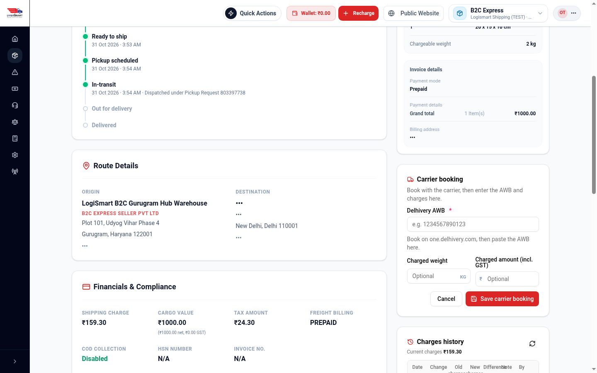

What happens:

- The Delhivery AWB appears on the order, on the B2C `4×6` shipping label PDF (`DELHIVERY AWB: <carrier_awb>`), and on public tracking.
- If Delhivery's charged weight differs from what we billed, the customer is **re-billed at booking-day rates** (wallet debit or refund + GST Debit/Credit Note) and a **Weight Mismatch** row is created automatically so the customer can see and dispute it.
- The card compares the **pre-GST taxable margin** (`seller_billed_taxable − carrier_charged_taxable`). An amber **Negative margin ₹X** alert means Delhivery charged Logismart more than the customer paid: click **Override / Adjust Price** right below it to recover the difference ([8.7](#87-how-to-adjust-the-price--recover-or-refund-the-difference-admin-price-override)) or raise a weight dispute with Delhivery.
- Each Delhivery AWB can be used on only one shipment.

Who can enter it: Owner, Admin, Operations-User. Support and Read-only can view it. Customers see only "Carrier: … · AWB …".

> **Limitation:** no automatic Delhivery booking or tracking. Every status (picked up, in transit, out for delivery, delivered, NDR) must be updated by Logismart staff, using the scans you see on one.delhivery.com. There is no gap report across shipments yet; check each order.

### 7.8 Logismart Prime (own fleet) end to end

**In plain English:** When a customer books a **Logismart Prime** B2B cargo order, you move it through your own partner transporter network instead of Delhivery:

1. Customer books a Prime LR (B2B flow, choosing **Door Delivery** or **Godown Self-Pickup**).
2. Customer (or ops) creates a B2B pickup request.
3. Ops run the pickup on the **Ops Control Tower** (`Out for pickup` → `Confirm Pickup`), confirming the **Actual boxes picked** stepper (or entering box sizes if different).
4. Ops hand the cargo and the **3-copy A4 LR Docket** (`Consignor`, `Consignee`, `Driver / Transporter Copy`) to the route's **active partner transporter**. Staff can see the assigned **`Transporter: <name>`** badge directly on the Shipment Detail page and on the `/ops` dispatch card (it is never shown to customers).
5. Record the transporter's LR/GR number and charged amount in **Carrier booking**.
6. Ops update the status (`In transit` → `Out for delivery`) and take 6-digit OTP proof of delivery (`Deliver with OTP`).

### 7.9 Ops Control Tower (`/ops`)

**In plain English:** The Ops Control Tower is the daily workbench for your hub staff and field riders. On a desktop computer it shows a full dispatch dashboard; on a mobile phone (`390×844`) it automatically switches into a big-button **Field Executive App** for the pickup/delivery boy. (Customers, Support, and Read-only users are blocked from `/ops` with a friendly notice.)

For Owner, Admin and Operations-User. Two modes: **Control Tower (Admin Desktop)** and **Field Executive App (Mobile POD & Pickup)** (opens automatically on phones).

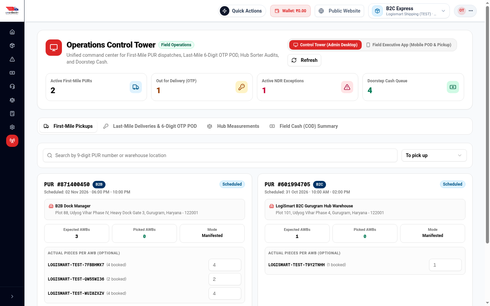

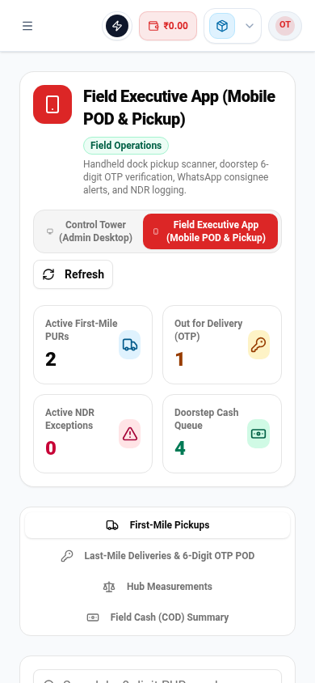

KPI tiles: Active First-Mile PURs, Out for Delivery (OTP), Active NDR Exceptions, Doorstep Cash Queue.

Tabs:

| Tab | What you do |
|---|---|
| **First-Mile Pickups** | Mark Out for Pickup → **Confirm Pickup** (confirms **Actual boxes picked** count) or **Checklist & box sizes** (partial pickup or re-measurement) → or **Mark Not Picked** with a reason. Print the **Run-Sheet PDF**. For returns with QC, tick "QC passed". |
| **Last-Mile Deliveries & 6-Digit OTP POD** | Mark out for delivery → **WhatsApp OTP to Consignee** → **Deliver with OTP** (enter 6-digit OTP + "Received By"). Or **Undelivered / Raise Exception (NDR)**. For returns: **Mark RTO in transit** → **Returned to seller**. |
| **Hub Measurements** | **Record measurement** (box sizes or weight, up to 3 photos, plus optional **Override Final Price ₹** for Admin). The customer is re-billed up or down automatically and sees it under Weight Mismatch. |
| **Field Cash (COD) Summary** | COD shipments with "Doorstep Cash Value" and whether the cash is with the field team or remitted. |

Picked-up orders move straight to **In Transit** and get a 6-digit delivery OTP. Orders not handed over go back to Ready to ship.

> **Limitation:** there is no rider assignment. Everyone with Ops access sees one shared queue (up to 100 active shipments per list).
> **Different here:** Delhivery's rider app is internal to Delhivery; Logismart needs its own field app for Prime and for manual updates.

### 7.10 Out for delivery and OTP proof of delivery (POD)

- The delivery OTP is created when the shipment goes In Transit or Out for delivery.
- **Delivered needs the 6-digit OTP** and "Received By" (Consignee, Family Member, Security Guard, Front Desk).
- The consignee gets the OTP only when ops tap **WhatsApp OTP to Consignee** (it opens WhatsApp on the ops phone with the message ready). There is no automatic SMS.
- If the COD amount changed on the server, Delivered is refused until the screen is refreshed ("COD collectible changed on the server…").

> [!WARNING]
> The rider screen also **shows the OTP** and has an **Auto-fill OTP** button. So "OTP verified" does not prove the rider met the consignee. Logismart accepted this risk for launch (see [12](#12-mvp-limitations-and-known-risks)). Spot-check deliveries by calling consignees, especially COD.

### 7.11 NDR and delivery exceptions

**Delivery Exceptions** (`/delivery-exceptions` for B2C, `/b2b/delivery-exceptions` for B2B).

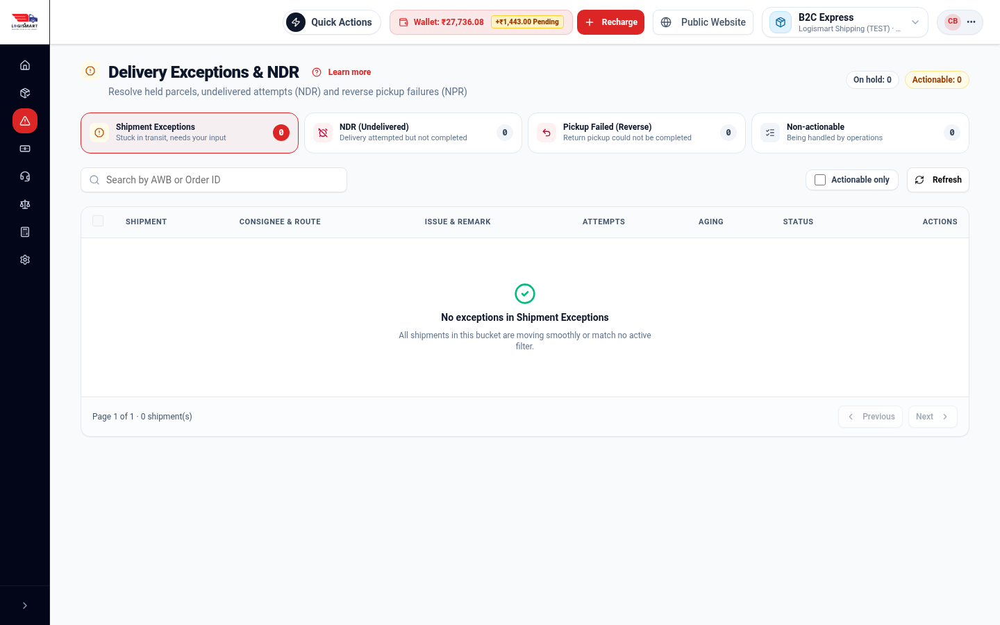

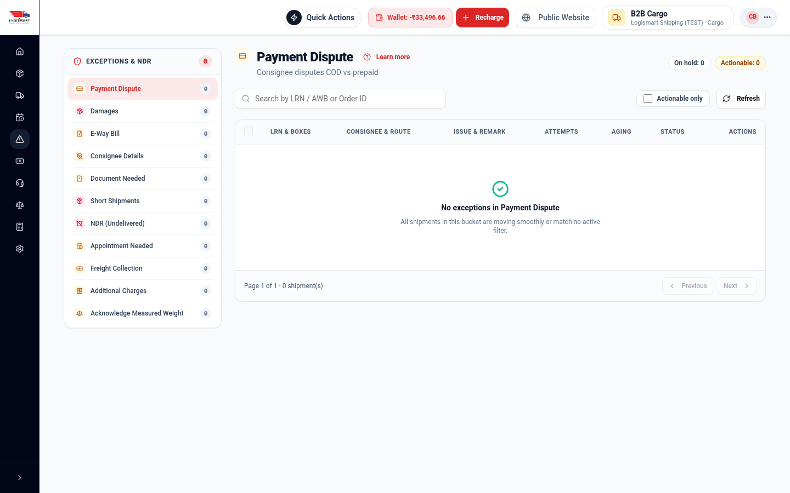

- **Raising** an exception: only Owner, Admin and Operations-User, from the Ops card (**Undelivered / Raise Exception (NDR)**, 9 doorstep reasons) or the order page (**Update Shipment Status**, all reasons). A remark is required. The customer gets an email if email sending is set up.
- **B2C tabs:** Shipment Exceptions, NDR (Undelivered), Pickup Failed, Non-actionable.
- **B2B categories:** Payment Dispute, Damages, E-Way Bill, Consignee Details, Document Needed, Short Shipments, NDR, Appointment Needed, Freight Collection, Additional Charges, Acknowledge Measured Weight.

What the customer (or staff) can do, by reason:

| Reason | Actions |
|---|---|
| Consignee refused / unavailable / rescheduled | Reattempt, Update consignee (B2C), Return to origin |
| Damaged | Reattempt or Return to origin (B2C); Return to origin or Repack & deliver (B2B) |
| E-way bill missing (also raised automatically, see §7.12) | Update e-way bill (12 digits) |
| Consignee details required | Update consignee (same pincode only) |
| Payment dispute | Update payment mode |
| Document needed | Upload document |
| Appointment needed | Book appointment, Deliver without appointment |
| Short shipment | Partial delivery, Hold for all boxes |
| Freight collection / Additional charges (e.g. Mathadi) | Acknowledge charges (paid from wallet) |
| Weight discrepancy | Accept weight, Dispute weight |
| Pickup failed (before pickup) | Reschedule pickup, Cancel pickup |

- Money actions (Acknowledge charges, Accept weight, Return to origin, Update payment mode) can be taken only by the customer who booked it, or by the Owner/Admin on their behalf. Read-only users see `View only` on all exception rows.
- When `Update consignee` is submitted, the updated receiver name, phone, and address line are saved on a fresh delivery address snapshot for that shipment.
- When `Accept weight` is submitted on a weight exception, a **Weight Mismatch** row is also created so the charge is auditable under **Disputes › Weight Mismatch**.
- **After 3 failed delivery attempts the shipment goes RTO automatically.** At pickup stage it is cancelled and refunded.
- Bulk actions (up to 200): Reattempt, Return to origin, Reschedule pickup, Cancel pickup.
- For damaged or short cargo that was Logismart's fault, staff can tick **Logismart is at fault** to waive the RTO charge.

> **On Delhivery One:** Exceptions & NDR ([exception-ndr](https://help.delhivery.com/docs/exception-ndr), [b2b-exceptions-management](https://help.delhivery.com/docs/b2b-exceptions-management), [shipment-exceptions](https://help.delhivery.com/docs/shipment-exceptions)).
> **Limitation:** no SmartNDR or RTO predictor; no bulk e-way bill or invoice upload.

### 7.12 B2B appointments

**Manage Appointments** (`/b2b/appointments`), tabs **Pending / At risk / Booked**. **Book appointment** (or **Reschedule**) asks for PO number (up to 5 comma-separated POs), PO expiry date (`must be on or after the appointment date`), appointment date and slot. Select several LRs for **Create bulk appointment**. Booking an appointment releases an "Appointment needed" hold.

An automatic check runs every 14 minutes and puts two kinds of shipment on hold:

- **Appointment needed:** an In transit or Out for delivery shipment whose booked appointment slot has ended. Fix it with **Book appointment** (the new slot must end in the future) or **Deliver without appointment**.
- **E-way bill missing:** an In transit shipment with goods value of ₹50,000 or more that has had no update for more than 72 hours, because its e-way bill has most likely expired. Fix it with **Update e-way bill**.

The customer sees the hold and the reason on the order timeline.

> **On Delhivery One:** B2B Appointments ([b2b-appointments](https://help.delhivery.com/docs/b2b-appointments)).

### 7.13 RTO (return to origin)

RTO starts when: the customer chooses **Return to origin**, the 3rd delivery attempt fails, an order is cancelled after pickup (by the customer, Owner, or Admin), or the Owner/Admin starts it manually.

Statuses: **RTO Initiated → RTO In Transit → Returned to seller** (ops mark the last one with "Received by").

Billing: the RTO freight is debited once from the customer's wallet with a GST debit note. For COD shipments the COD fee is refunded with a credit note, and the COD is never paid out.

> **On Delhivery One:** B2C Courier Returns / RTO ([courier-returnrto](https://help.delhivery.com/docs/courier-returnrto)).

### 7.14 Lost shipments

Only the **Owner or an Admin** can mark a shipment **Lost** (from In transit, Out for delivery, Exception or an RTO leg). The freight is refunded with a credit note. Public tracking shows "Under investigation". If the parcel is found, move it back to In transit or RTO Initiated; the freight is billed again.

> **Limitation:** no automatic claim. The customer raises a ticket (category Claims / Finance). The draft Terms (`/terms` §5) and backend claim logic cap liability at the lower of the declared value and **₹5,000** per shipment (`Draft — needs legal review`); counsel must confirm this figure.

> **On Delhivery One:** Lost & Damaged Claims ([resolving-claims](https://help.delhivery.com/docs/resolving-claims), [lost-and-damage-claims-b2b-1](https://help.delhivery.com/docs/lost-and-damage-claims-b2b-1)).

### 7.15 Cancel and edit

- **Cancel Order** before pickup: Cancelled, full refund, credit note, removed from its pickup request.
- **Cancel Order** after pickup: it becomes an **RTO** and the RTO freight is charged. Only the **Customer, Owner, or Admin** can cancel after pickup (`Operations-User` is blocked because post-pickup cancellation bills an RTO charge).
- **Edit**: customers (for their own orders) and staff (`Owner`, `Admin`, `Operations-User`) can open `/shipments/[id]/edit` to change order details while the order is Ready to ship and not in a pickup request, or update consignee contact until delivery. COD can change until In Transit. The service can change only before pickup. A live **Reprice Preview** shows the exact ₹ price difference before saving.

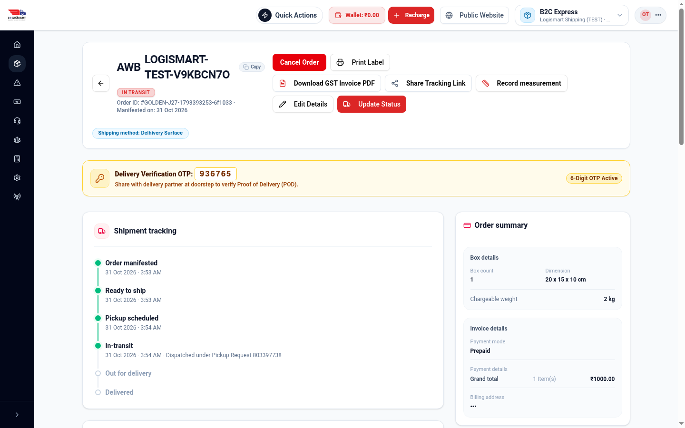

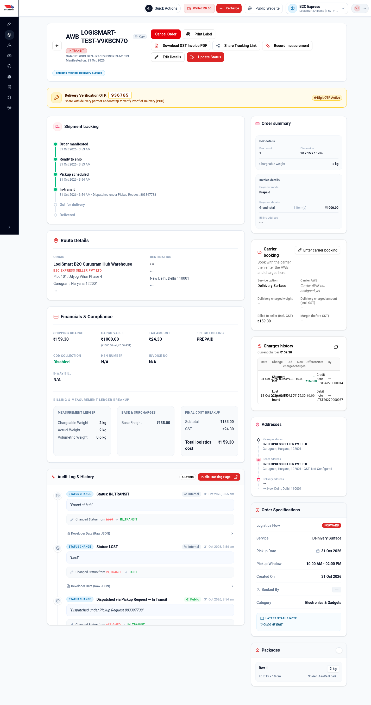

> **On Delhivery One:** Update / Cancel order ([update-forward-order](https://help.delhivery.com/docs/update-forward-order), [cancel-forward-order](https://help.delhivery.com/docs/cancel-forward-order)).

### 7.16 Status reference

| Status (screen name) | Meaning | Next possible |
|---|---|---|
| Draft / Open (Ready to ship) | Booked, not in a pickup | Assigned, Cancelled |
| Assigned (Ready for pickup) | In a pickup request | In Transit, Exception, Cancelled, QC Failed, Rejected at Pickup |
| In Transit | Picked up | Out for delivery, Delivered, RTO Initiated, Exception, Lost |
| Out for delivery | With the delivery executive | Delivered, RTO Initiated, Exception, Lost |
| Exception (NDR) | On hold | back to its stage, RTO Initiated, Cancelled, Lost |
| Delivered | Final | — |
| RTO Initiated → RTO In Transit → Returned to seller | Coming back | Returned to seller is final |
| Lost | Missing | In Transit or RTO Initiated (found) |
| Cancelled, QC Failed, Rejected at Pickup | Final | — |

An RTO shipment can never become Delivered.

---

## 8. Money: wallet, COD, GST documents, weight disputes

### 8.1 The wallet

**Finances › Wallet** (`/wallet`, **Unified Wallet & Financial Ledger**). Every user has their own wallet, starting at ₹0.

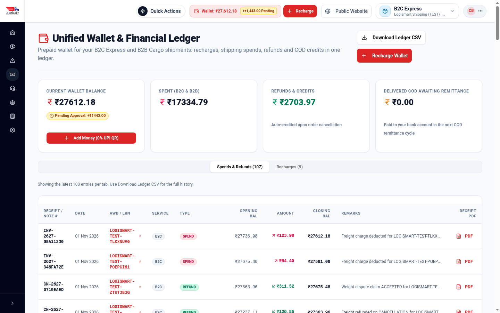

- Cards: Current Wallet Balance (with pending approvals), Add Money (0% UPI QR), Spent, Refunds & Credits, Delivered Cash Collectible (customers see "Delivered COD awaiting remittance"; Owner/Admin see **Settle Cash to Wallet**).
- Tabs: **Spends & Refunds** and **Recharges**. **Download Ledger CSV**.
- Owner, Admin and Read-only see every user's transactions (with a user filter). Others see only their own.
- **Run integrity audit** (Owner, Admin, Read-only) checks that every balance matches its ledger.

> **On Delhivery One:** Unified Wallet ([unified-wallet-faqs](https://help.delhivery.com/docs/unified-wallet-faqs)).

### 8.2 Wallet recharge (UPI + UTR + approval) and Offline Credits

**In plain English:** There are two ways to add money to a customer's wallet:
1. **Self-Service UPI QR + 12-Digit UTR (Maker-Checker):** The customer scans Logismart's UPI QR code, pays in GPay/PhonePe/Paytm, and enters their 12-digit UTR number. An Owner or Admin checks the bank statement and clicks **Approve & Merge**.
2. **Offline Payment Recorded by Admin (NEFT / RTGS / IMPS / Cash / Cheque):** The customer sends money directly to Logismart's bank account (or hands over cash/cheque) and tells Finance. An Owner or Admin clicks **+ Record Offline Credit** on `/wallet` and credits their wallet immediately!

#### Way A: Customer UPI QR + Admin Approval

1. **Recharge Wallet** → **UPI Wallet Recharge** → choose an amount (minimum ₹1) → **Generate UPI QR**.
2. Pay with GPay / PhonePe / Paytm to Logismart's UPI ID.
3. Type the **12-digit UTR** from the payment app → **I Have Paid**. The status is **Pending approval**; the balance does not change yet.
4. An Owner or Admin opens **Wallet**, sees **Pending UPI Recharges Requiring Admin Approval** (with IST date and time), checks the bank statement for that UTR and amount, then clicks **Approve & Merge** (and confirms in the dialog) or **Reject** (with a reason).

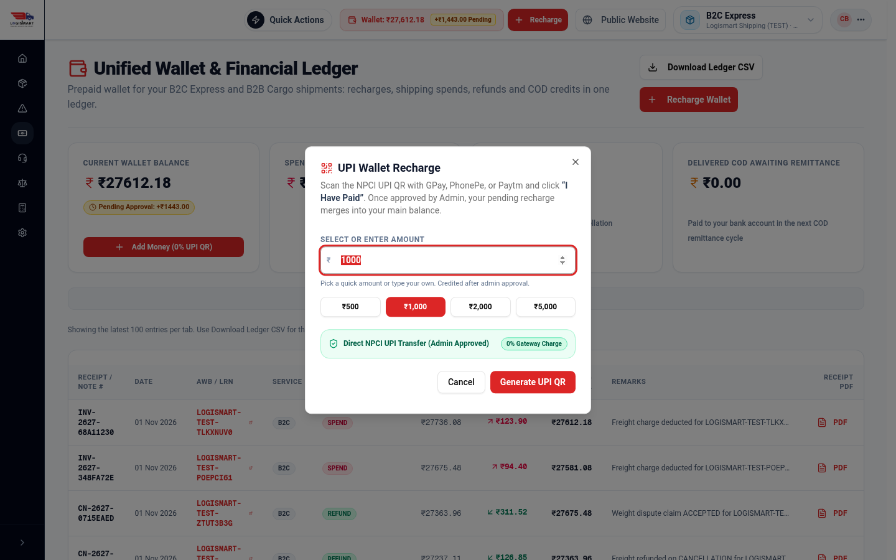

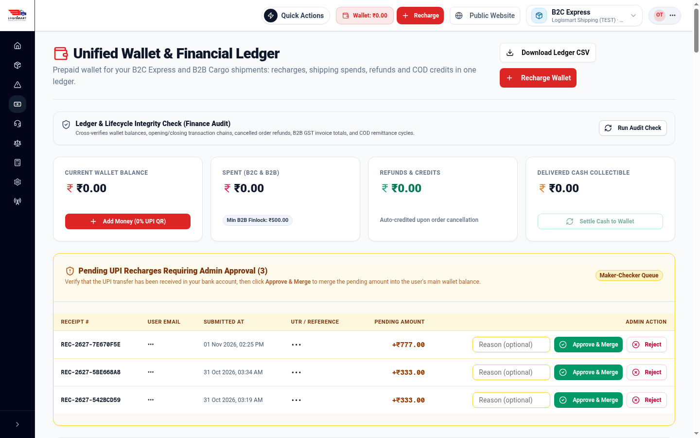

#### Way B: How to Credit a Customer's Wallet When They Pay Offline (NEFT / IMPS / Cash / Direct UPI)

1. Open **Finances › Wallet** (`/wallet`) as **Owner** or **Admin**.
2. Click **+ Record Offline Credit** (top right).
3. Select the customer in **Quick Select Customer** (or type their **Customer Email**), enter the **Amount (₹)**, choose the **Payment Method** (`NEFT / RTGS`, `IMPS`, `UPI Direct`, `Cash`, `Cheque`), enter the **Bank Reference / UTR / Receipt #**, and optionally add an **Audit Note**.
4. Click **Credit Wallet**. The customer's wallet is credited immediately as a `COMPLETED` recharge and an official **Wallet Advance Receipt Voucher (`REC-...`)** is generated.


Rules:

- **Maker-checker on UPI QR requests:** nobody can approve their own UPI QR recharge. If the Owner submits a QR recharge, an Admin must approve, and the other way round.
- Each UTR / bank reference can be used only once.
- Rejected requests show "Rejected by Admin: {reason}" to the customer.
- Who can recharge: customers, Owner and Admin (`Operations-User`, `Support-User`, and `Read access Only-User` cannot recharge).

> **Different here:** Delhivery recharges instantly through a payment gateway. Logismart uses zero-fee UPI QR + human bank verification or direct Admin offline credit.

### 8.3 Negative wallet and Finlock

- Booking debits the wallet. With Strict Finlock OFF (default), the wallet can go below zero.
- Charges after booking (RTO, weight, freight collection, Mathadi, edits, Admin price overrides) are never blocked and can push the wallet negative.
- **COD bank payouts are held while a customer's wallet is negative** ([8.4](#84-cod-cash-on-delivery-money)).
- Refunds never exceed what was paid for that shipment.

### 8.4 COD (cash on delivery) money

The amount the delivery executive collects ("COD: Collect ₹X" on the Ops card and the label) is calculated by the server. Nobody types it.

Customers are paid their COD by **bank remittance batch**. Their wallet card shows **Delivered COD awaiting remittance ₹X — paid to your bank account in the next COD remittance cycle**.

| Way | Who | How |
|---|---|---|
| **Bank remittance batch** (normal) | Owner / Admin (finance) | **Finances › Remittances** → **Process Remittance Batch** → pick the customer → tick the AWBs the bank transfer covers → enter the bank's **UTR** → **Create Settlement Batch**. |
| **Settle Cash to Wallet** | Owner / Admin (`POST /api/v1/wallet/settle-cod`) | Wallet → Delivered Cash Collectible → **Settle Cash to Wallet**. Customers do not see this button (`403` for customers). |

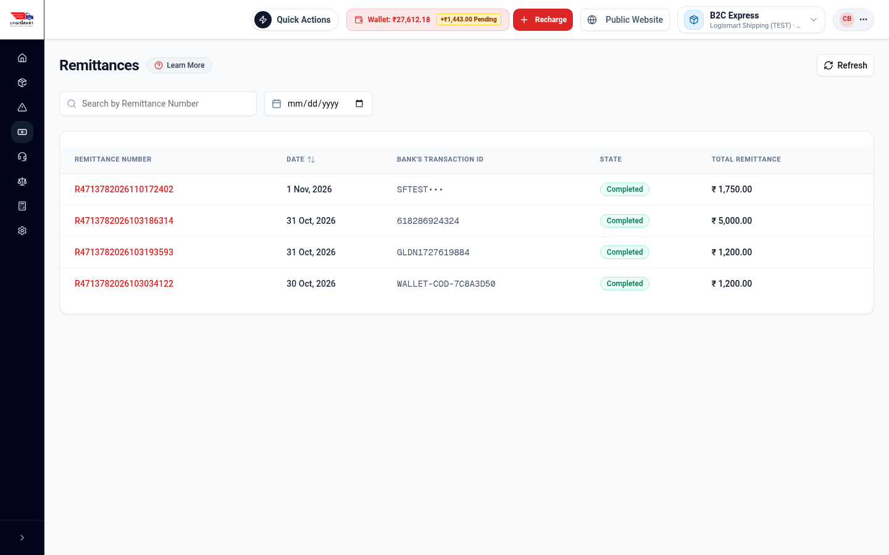

Bank batch rules:

- One customer per batch; tick the AWBs (nothing is swept automatically). Staff see the **MERCHANT** email column on both the Remittances list and the Remittance detail page.
- Only delivered COD shipments that are not RTO and not already paid.
- If the total changed since you opened the list, you get "The payout total for the ticked AWBs is now ₹X…". Reload.
- **Blocked while the customer's wallet is negative.**
- Each remittance has a CSV of its AWBs.

Who sees remittances: Owner, Admin and Read-only (all); customers (their own).

> **On Delhivery One:** COD Remittance ([cod-remittance](https://help.delhivery.com/docs/cod-remittance)).
> **Different here:** no automatic remittance cycle yet; finance creates each batch by hand after the bank transfer. Agree a fixed payout rhythm (for example twice a week) and tell customers.

### 8.5 GST invoices, credit notes and debit notes

Documents are created automatically. Nobody issues them by hand.

| When | Document |
|---|---|
| A wallet-billed shipment is booked | **Tax Invoice** (`LOGI2627I000001`…) |
| The price goes up later (weight, RTO, charges, edit, underpriced Admin override) | **Debit Note** (`…D…`) quoting the invoice |
| The price goes down, or the order is cancelled / lost / rejected / overpriced Admin override | **Credit Note** (`…C…`) |
| NDR additional charges (Mathadi etc.) acknowledged | Debit Note (18% GST added) |

- Number format: `LOGI` + financial year (`2627` = Apr 2026–Mar 2027) + `I`/`C`/`D` + 6-digit serial. No gaps.
- SAC 996812, 18% GST, CGST+SGST in Haryana else IGST. Place of supply = customer's approved GSTIN state, else the pickup state.
- The customer's GSTIN is printed only if their B2B details are approved; otherwise "Unregistered".
- A credit note after the GST Section 34 deadline (30 November after the financial year) is a money credit with no GST.

**Finances › Invoices** (`/finances/invoices`): tabs **All Documents / Invoice List / Credit Notes / Debit Notes**, filter by **From / To** dates, search by document number or AWB, view the **MERCHANT** column (for staff), and click **Download Invoice PDF** or **Download Transaction List CSV**. Click a document number for the detail page. The order page also has **Download GST Invoice PDF**.

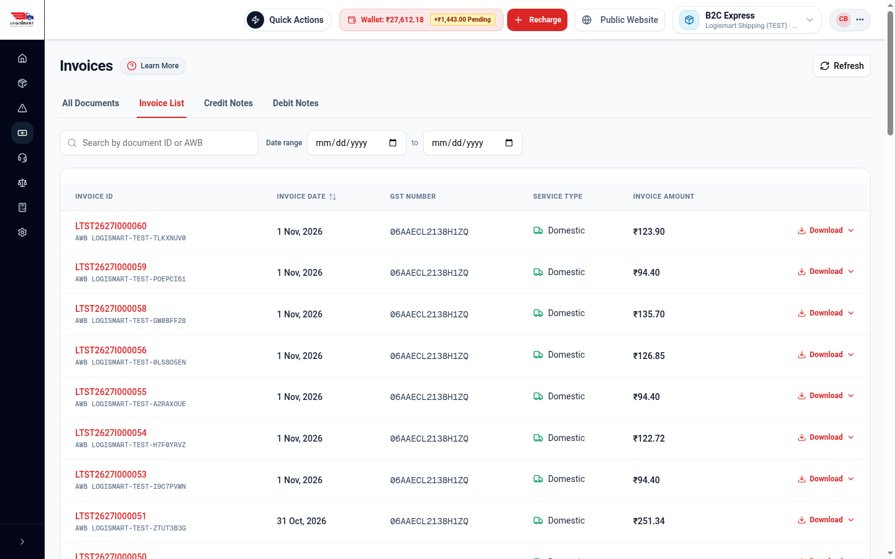

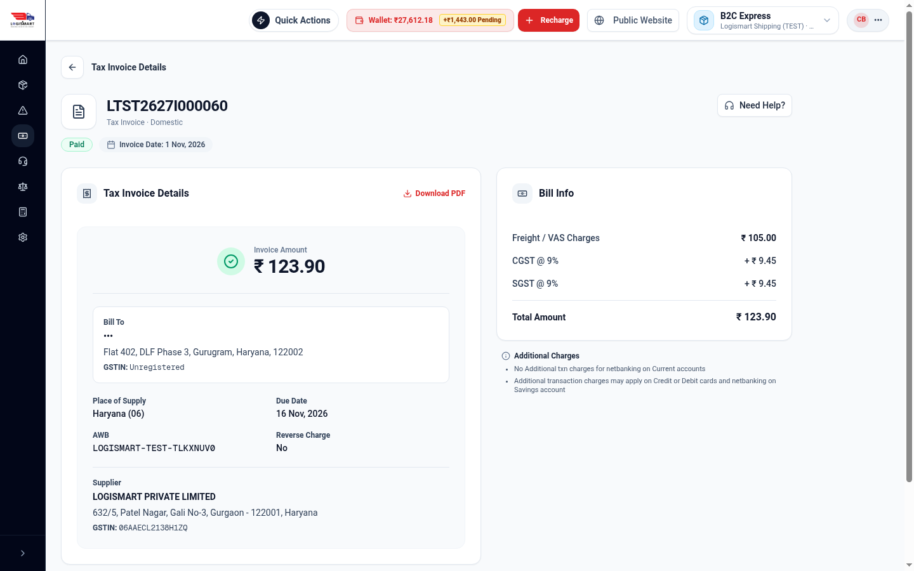

Who sees them: Owner, Admin and Read-only (all); customers (their own).

> **On Delhivery One:** Invoices ([invoices](https://help.delhivery.com/docs/invoices)).
> **Different here:** one invoice per shipment at booking (prepaid model), not one per billing cycle.

### 8.6 Weight discrepancy and weight claims

**In plain English:** Whenever a box weighs more (or measures larger) than what the customer declared—whether recorded at the hub (`Record measurement`), billed by Delhivery (`Enter carrier booking`), or accepted in a weight NDR (`Accept weight`)—Logismart automatically charges the extra freight from the customer's wallet, issues a GST Debit Note, and adds a row to **Disputes › Weight Mismatch** (`/disputes/weight-mismatch`) so the customer can see the evidence and raise a claim if they disagree.

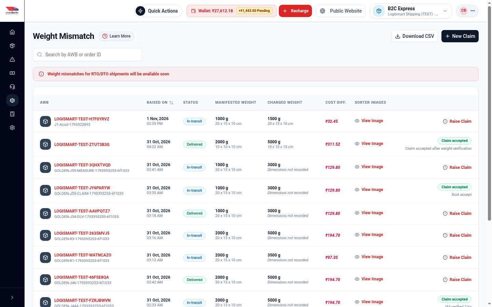

Raising a claim (customer, or any staff except Read-only for them): **Raise Claim** or **New Claim** → pick the unclaimed AWB → claimed weight in grams (more than 0 and less than the charged weight) → **Submit Claim**. One AWB per claim. A support ticket "Weight Mismatch Claim — {AWB}" opens automatically.

Resolving (Owner / Admin only): **Accept** re-prices the shipment at the claimed weight (never below the manifested weight) and refunds up to the extra amount charged, with a credit note. **Reject** keeps the charged weight. Either way the claim is final and the ticket is resolved.

> **On Delhivery One:** Weight Mismatch ([weight-dispute](https://help.delhivery.com/docs/weight-dispute)).
> **Different here:** claims can be raised as soon as the weight is charged, not only after delivery (Delhivery: delivered only). This is deliberate: Logismart weighs at the first-mile hub and debits the wallet straight away, so the customer can dispute straight away. There is no claim deadline, and the claim has a weight only (no dimensions or seller photos). RTO/DTO mismatches are "available soon".

### 8.7 How to Adjust the Price & Recover or Refund the Difference (Admin Price Override)

**In plain English:** What if a shipment is **overpriced** (you want to give the customer a discount/refund) or **underpriced** (actual shipping cost was higher than the engine's quote, or dimensions changed at the hub)? As **Owner** or **Admin**, you never have to calculate 18% GST by hand or edit wallet balances manually. You have two simple ways right on the order screen:

#### Way 1: Direct 1-Box "Override / Adjust Shipment Price" on Shipment Detail (`Overpriced` or `Underpriced`)

1. Open the order (`/shipments/[id]` or `/b2b/shipments/[id]`) as **Owner** or **Admin** and look at **Carrier booking** on the right.
2. In the **OVERRIDE / ADJUST SHIPMENT PRICE** box (or click **Override / Adjust Price**), check the badge **`Current Billed (incl. GST): ₹X`**.
3. Type the **`New Final Price (₹ incl. 18% GST)`** and a short **Reason / Note**, then click **Apply Final Price & Settle Wallet**:
   - **If Overpriced (`New Final Price < Current Billed Price`):** Logismart automatically **credits/refunds the ₹ difference back into the customer's wallet** (`REFUND`), updates `total_logistics_cost` to your new final price, and issues a **GST Credit Note (`LOGI2627C...`)**.
   - **If Underpriced (`New Final Price > Current Billed Price`):** Logismart automatically **debits the ₹ difference from the customer's wallet** (`SPEND`, allowing negative balance if needed), updates `total_logistics_cost`, and issues a **GST Debit Note (`LOGI2627D...`)**.


#### Way 2: Hub Weight/Dimension Audit with Optional Final Price Override (`Record measurement`)

1. On Shipment Detail or `/ops`, click **Record measurement**.
2. Enter the measured **Box sizes** (`L × B × H` and `Kg per box`) or **Weight only**.
3. **Optional:** Leave **`Override Final Price (₹ incl. GST, optional)`** blank to bill the pricing engine's automatic quote for the new weight/dimensions, **OR** type a custom ₹ total to override the engine and settle that exact price (auto-crediting the wallet with a GST Credit Note if lower, or auto-debiting the wallet with a GST Debit Note if higher).
4. Click **Save measurement**.


- Every price change after booking is listed on the order's **Charges history** card: date, change, old and new charges, difference, GST note number and who did it.
- Carrier margin is visible **per shipment** on the **Carrier booking** card ([7.7](#77-booking-the-parcel-on-onedelhiverycom-and-pasting-the-awb)).

> **Limitation:** no margin report or reconciliation export across shipments, and no bulk import of Delhivery's invoice/MIS. Reconcile Delhivery's monthly invoice against the AWBs manually.

---

## 9. Support tickets

**Support** (`/support`): tabs **Open / Resolved / Closed**, search by ticket ID or AWB.

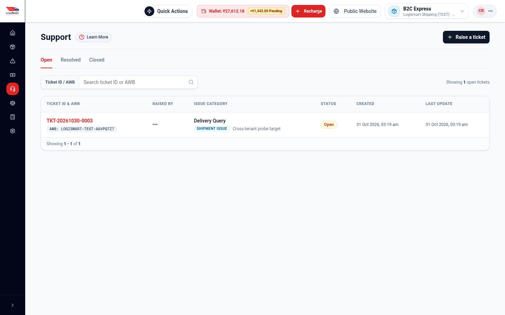

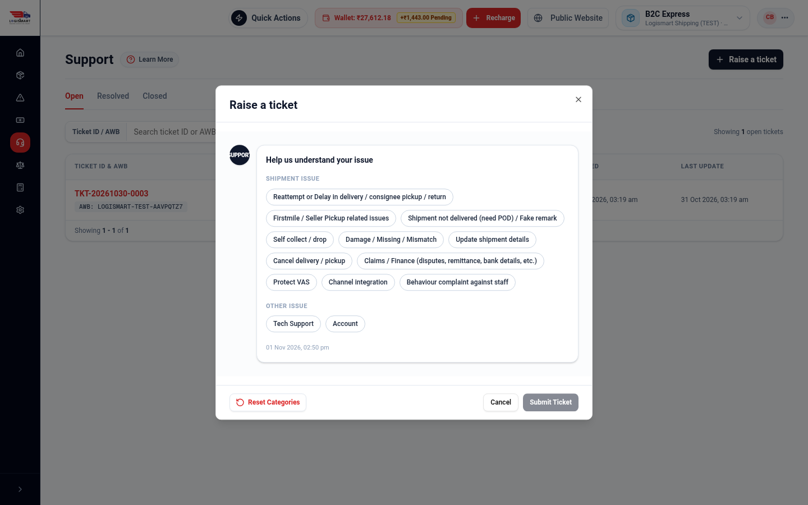

- **+ Raise a ticket** → pick an issue (**Shipment Issue**: delay, pickup, POD, damage, update details, cancel, claims/finance… or **Other Issue**: tech support, account) → enter the AWB (required for Shipment Issues except Claims / Finance; only one open ticket per AWB is allowed at a time) → subject → description → **Submit Ticket**. Number format `TKT-YYYYMMDD-NNNN`.
- Customers see their own tickets. All staff see every ticket.
- Staff reply in the ticket, then **Mark Resolved** or **Close Ticket** (Owner, Admin, Operations-User, Support-User).
- If a customer replies to a Resolved ticket, it reopens. A Closed ticket cannot get customer replies; they raise a new one.
- Tickets are opened automatically for weight claims and B2B short deliveries.
- The dashboard **Support** card shows Open / Awaiting reply (staff) or Resolved / Need your input (customer).

> [!IMPORTANT]
> **No notifications.** Nobody gets an email when a ticket is raised or answered. Support must watch the **Open** tab and the dashboard card throughout the day.

> **On Delhivery One:** Support Tickets ([support-tickets](https://help.delhivery.com/docs/support-tickets), [b2b-support-tickets](https://help.delhivery.com/docs/b2b-support-tickets)).
> **Limitation:** one AWB per ticket, no attachments, no SLA timer, no auto-close after 48 hours, no assignment.

---

## 10. Public tracking and the consignee

Anyone can track at **logismart.naviera.com/track** with the Logismart tracking ID (no login).

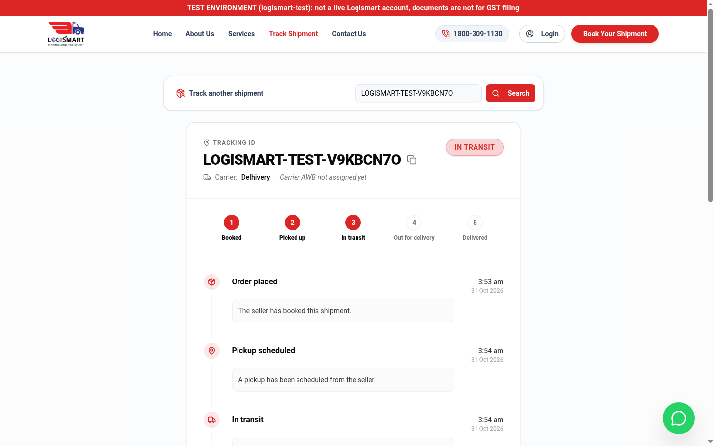

The consignee sees: status, a 5-step progress bar (Booked → Picked up → In transit → Out for delivery → Delivered), simple milestones ("Order placed", "In transit", "Delivery attempted", "Returned to seller", "Under investigation"…), the carrier name and the Delhivery AWB, and who received it (initials only).

The consignee does **not** see: the OTP, money, weights, remarks or internal reasons.

How the consignee gets the OTP: from the ops WhatsApp message on the delivery day, or from the seller (customers see the OTP on their order page).

Each Delhivery-carried parcel can also be tracked on Delhivery's own site with the Delhivery AWB.

> **On Delhivery One:** Track Orders ([track-orders](https://help.delhivery.com/docs/track-orders)).
> **Limitation:** no estimated delivery date and no automatic SMS/WhatsApp updates. Consignee messages are sent by ops from the Ops card (WhatsApp / email buttons).

---

## 11. Role-by-role daily checklists

### Owner

- [ ] First week: finish [section 4](#4-first-time-setup-owner-and-admin) and the [go-live checklist](#16-go-live-checklist-and-owners).
- [ ] Make at least **two** Owner/Admin accounts so recharges can always be approved.
- [ ] Weekly: check Version History and the Users list (remove leavers with Deactivate).
- [ ] Monthly: compare Delhivery's invoice with the Delhivery AWBs and margins in Naviera.

### Admin (business / finance)

- [ ] Morning and afternoon: approve or reject **pending UPI recharges** after checking the bank.
- [ ] Daily: **Users** page → pending **B2B access requests**.
- [ ] Daily: **Weight Mismatch** → resolve claims.
- [ ] On COD payout days: **Remittances › Process Remittance Batch** per customer after the bank transfer.
- [ ] Weekly: **Run integrity audit** on the Wallet page; watch negative wallets.

### Operations-User

- [ ] Before 1 PM: make sure today's pickup requests exist.
- [ ] For every Delhivery shipment: book on one.delhivery.com, stick Delhivery's label, paste the AWB + charged weight + amount.
- [ ] Ops Control Tower: Out for pickup → Confirm Picked Up / Not Picked.
- [ ] Update statuses from Delhivery's scans (In transit, Out for delivery) and take OTP POD for own-fleet deliveries.
- [ ] Raise NDRs with a clear remark; record hub measurements.
- [ ] End of day: Field Cash (COD) summary.

### Support-User

- [ ] Watch **Support › Open** and the dashboard card all day; reply and resolve.
- [ ] Work the **Delivery Exceptions** queues (Reattempt, Update consignee, documents, appointments).
- [ ] Raise weight claims for customers who call in.

### Read access Only-User

- [ ] Use Wallet (all users), Remittances, Invoices and their CSV downloads for accounting. You cannot change anything.

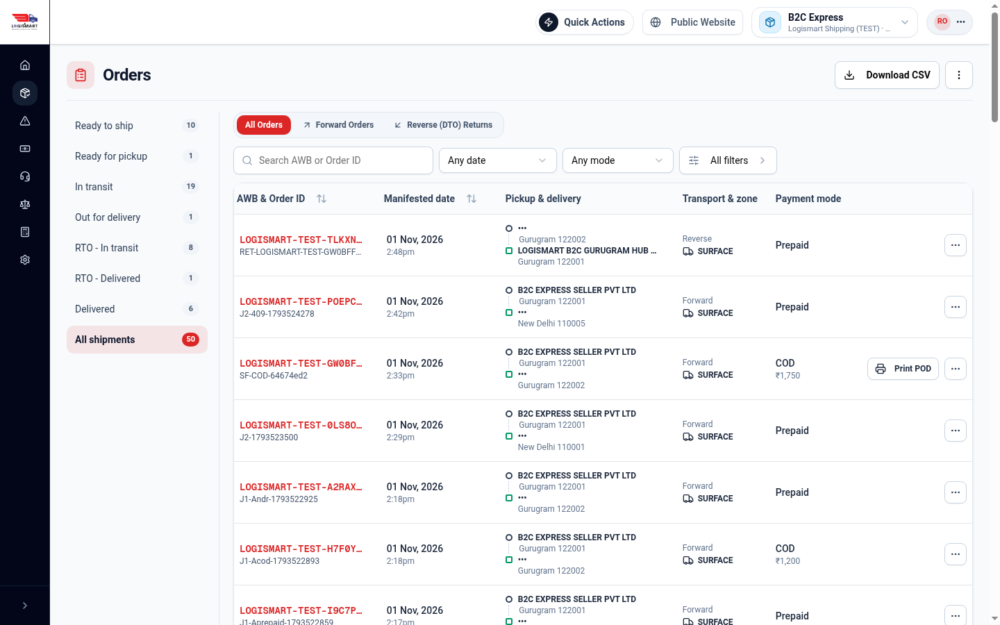

### B2C customer (shipper)

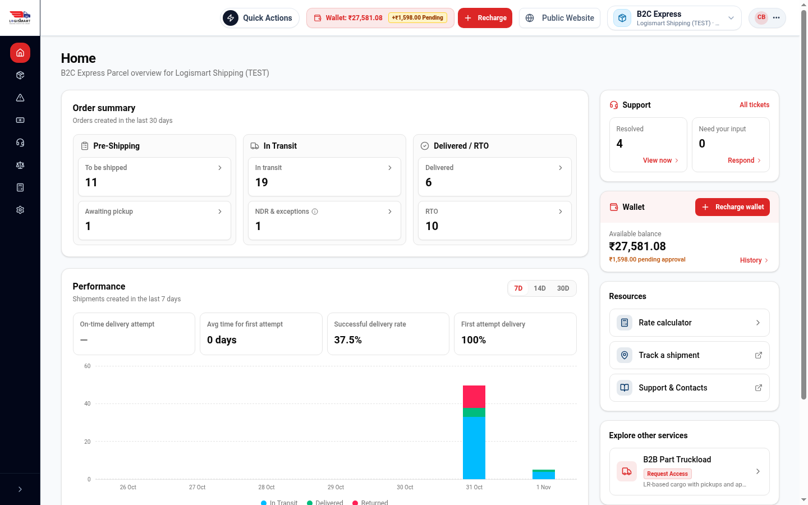


- Recharge the wallet (UPI + UTR) → book forward or reverse → create a pickup request before 1 PM → print labels → track → act on NDRs → receive COD by bank remittance → download invoices → raise tickets.

### B2B customer (shipper)


- Request B2B access (or ask Logismart) → book LRs (Prime / Delhivery B2B Cargo) → B2B pickup request → book appointments → act on B2B exceptions → invoices and tickets.

### Consignee

- Track at `/track`. Share the 6-digit OTP with the delivery executive only at the door.

---

## 12. MVP limitations and known risks

These are known and accepted for launch. Plan around them.

| # | Limitation | What to do meanwhile |
|---|---|---|
| 1 | **No Delhivery order or tracking integration.** Orders are booked on one.delhivery.com by hand; statuses are updated by staff. | Follow [7.7](#77-booking-the-parcel-on-onedelhiverycom-and-pasting-the-awb) for every Delhivery shipment. |
| 2 | **Rider can see the delivery OTP** on `/ops` (and auto-fill it). | Spot-check deliveries by phone, especially COD. |
| 3 | **Cash at the door is not controlled.** No "cash received" step and no rider cash ledger; a shipment marked Delivered becomes payable to the customer. | Reconcile rider cash daily against the Field Cash (COD) summary before paying remittances. |
| 4 | **Open credit / negative wallet.** With Strict Finlock OFF, customers can book with no balance. | Decide Finlock before launch; watch negative wallets; COD payouts are held while negative. |
| 5 | **Freight on Delivery (To-Pay) is off.** | Prepaid or Postpaid (billed to wallet) only. |
| 6 | **B2B returns (reverse LRs) are off.** | Customer raises a ticket; ops arrange the return. |
| 7 | **No COD on B2B.** | Prepaid LRs only. |
| 8 | **No staff "book for customer".** Staff bookings are billed to the booking staff member's own wallet. | Customers book in their own account ([7.4](#74-booking-for-a-customer-staff)). |
| 9 | **Uploaded documents are not private enough.** The documents store can be read by any signed-in user who has the link. A private store is planned. | Do not upload sensitive personal documents (ID cards). |
| 10 | **No user invite emails.** | People self-register; you assign the role ([5.1](#51-how-people-get-an-account)). |
| 11 | **No notifications for tickets or B2B requests.** Other emails (NDR, recharge, weight debit) only go out when the email server is set up. | Watch the screens; set up email (go-live checklist). |
| 12 | **No payment gateway.** UPI QR recharges need a second admin to approve; offline bank transfers are credited by an Admin. | Keep two admins ([8.2](#82-wallet-recharge-upi--utr--approval-and-offline-credits)). |
| 13 | **Delhivery token lives on the server.** A rotated or wrong token looks like "Delhivery down"; nobody is alerted. | Never click "Request Live API Token" on Delhivery One without telling the tech team ([13](#13-faq-and-troubleshooting)). |
| 14 | **No logo upload, no zone editor, no lane delete.** | Ask the Naviera tech team. |
| 15 | **No margin report, no automatic COD cycle, no claim time limit.** | Manual monthly reconciliation. |

---

## 13. FAQ and troubleshooting

**"Access not available" / a 403 after signing in.** You are signed in with an email that has no account here, or you were deactivated. Click **Sign out** and sign in with the right email. If you were just given a role, reload the page.

**A button gives "… cannot …" or "Only Tenant Admins…".** Your role does not allow it (see [2](#2-who-does-what-roles)). Ask an Admin.

**I forgot my password.** Login → **Set or Forgot Password?** → enter your email and new password → click **Send Code to Set Password** → either type the 6-digit code from the email or click the link in the email. See [3](#3-signing-in-passwords-and-sessions).

**I am sent back to the login page.** Your session lasts 24 hours. Sign in again.

**Delhivery cards say "Not available" or "Delhivery prices are not connected yet".**
- "not connected yet": the Delhivery token is missing on the server. Tech team.
- "unavailable right now": Delhivery is down, throttled, or the token was rotated. Try again in a few minutes. If it lasts more than 15 minutes, call the tech team.
- A pincode reason ("does not deliver to PIN…", "embargo"): Delhivery cannot serve it. Use another service.

**Someone rotated the Delhivery API token.** On Delhivery One, "Request Live API Token" kills the old token immediately ([api-token-generation](https://help.delhivery.com/docs/api-token-generation)). Send the new token to the Naviera tech team through a secure channel (never chat or email in plain text). They update the server and restart it. Until then quotes use stored prices (up to 24 hours) and then show unavailable.

**"The price has changed".** Delhivery's price moved since the quote. Book at the new price or don't book.

**"UPI not configured".** The Owner/Admin must fill **Merchant UPI VPA** in Settings › Wallet & Payments.

**A recharge is stuck in "Pending approval".** Another Owner/Admin must approve it. You cannot approve your own.

**"COD payouts are on hold".** The customer's wallet is negative. Ask them to recharge first.

**"Cash on Delivery is not enabled yet".** The COD fee is not set in Settings › Pricing.

**"Logismart Prime has no rate from A to B yet".** No active lane for that route. Add one by CSV import or switch a lane on.

**"Unknown zone … create it first" on CSV import.** The zone does not exist. Ask the tech team to add it.

**"Invalid 6-digit Delivery OTP".** Ask the consignee for the latest OTP (WhatsApp it again from the Ops card).

**"This shipment has no delivery OTP yet".** Move it to In transit or Out for delivery first.

**Pickup slot was changed.** The request was after the 1 PM cut-off, or the slot had ended. It moved to the next slot.

**A customer cannot see B2B.** Approve their B2B request or set Enabled Flows on the Users page.

---

## 14. Glossary

| Term | Meaning |
|---|---|
| **AWB** | Air Waybill: the tracking number of a parcel. Logismart's is like `LOGISMART-X9A2B3C4`; the Delhivery AWB is the carrier's own number. |
| **LR / LRN** | Lorry Receipt (number): the document and number for a B2B cargo consignment. |
| **PUR / Pickup ID** | Pickup Request: a scheduled pickup of one or more orders from one location. 9-digit number. |
| **Manifest / run-sheet** | The list of shipments in a pickup, printed for the driver. |
| **NDR** | Non-Delivery Report: a failed delivery attempt or a shipment on hold. |
| **NPR** | Non-Pickup Report: a failed pickup (shown as "Pickup failed"). |
| **RTO** | Return to Origin: the shipment goes back to the seller. |
| **DTO** | Reverse pickup / customer return: collected from the buyer and delivered to the seller. |
| **ODA** | Out of Delivery Area: a remote pincode with an extra charge. |
| **COD** | Cash on Delivery: the consignee pays cash at the door. |
| **COD fee** | Logismart's fee for collecting COD: higher of a minimum ₹ and a % of goods value. |
| **Door collectible** | The exact cash the delivery executive must collect, calculated by the server. |
| **Prepaid / Postpaid** | Freight paid from the wallet at booking. Postpaid is billed to the wallet the same way (for customers). |
| **To-Pay / Freight on Delivery** | The consignee pays the freight. Off in this version. |
| **Prime / Logismart Prime** | Logismart's own B2B cargo service through partner transporters. |
| **Lane / Zone** | A Prime route (origin zone → destination zone) with one transporter's rates. A zone is a group of pincodes. |
| **Godown / Door delivery** | Godown: the receiver collects from the transporter's warehouse. Door: delivered to the receiver's address (extra on godown lanes). |
| **Chargeable weight** | Higher of dead weight and volumetric weight; what the price is based on. |
| **Volumetric weight** | L × B × H (cm) ÷ 5000 (Delhivery) or ÷ the lane divisor (Prime, usually 4500). |
| **Markup** | What Logismart adds on top of its carrier cost. |
| **Finlock** | Booking block when the wallet is below the minimum (only if Strict Finlock is ON). |
| **UTR** | Unique Transaction Reference of a UPI/bank payment (12 digits for UPI). |
| **Maker-checker** | One person submits, a different person approves. |
| **OTP POD** | Proof of delivery with the consignee's 6-digit one-time password. |
| **E-Way Bill (EWB)** | GST document required for goods worth ₹50,000 or more (12 digits). |
| **GSTIN / PAN / SAC / HSN** | GST number (15 characters) / tax ID (10) / service code (996812 for courier) / goods code. |
| **Credit note / Debit note** | GST documents that reduce / increase an earlier invoice. |
| **Service scope** | Which flows a customer can use: B2C, B2B or both. |
| **Blind pickup** | A B2B truck sent before the boxes are counted; billed on arrival weight. |
| **Carrier's Risk** | Higher liability option on B2B cargo (adds the ROV surcharge `max(0.1% of declared value, ₹100)` on Delhivery B2B Cargo; recorded on Prime LRs). |
| **Delhivery One (DO1)** | Delhivery's seller platform, one.delhivery.com. |

---

## 15. Delhivery One help-center map

| Logismart screen | Delhivery One article |
|---|---|
| Orders, B2B Orders | [orders](https://help.delhivery.com/docs/orders), [domestic-orders](https://help.delhivery.com/docs/domestic-orders), [b2b-cargo-orders](https://help.delhivery.com/docs/b2b-cargo-orders) |
| Create forward / reverse shipment | [create-forward-order](https://help.delhivery.com/docs/create-forward-order), [reverse-ordersdto](https://help.delhivery.com/docs/reverse-ordersdto) |
| Book B2B LR | [b2b-order-creation](https://help.delhivery.com/docs/b2b-order-creation) |
| Edit / cancel | [update-forward-order](https://help.delhivery.com/docs/update-forward-order), [cancel-forward-order](https://help.delhivery.com/docs/cancel-forward-order) |
| Pickup Requests | [pickup-request](https://help.delhivery.com/docs/pickup-request), [b2b-pickup-request](https://help.delhivery.com/docs/b2b-pickup-request) |
| Labels | [shipping-label-configuration](https://help.delhivery.com/docs/shipping-label-configuration), [gst-compliant-shipping-label-cum-invoice-help-guide](https://help.delhivery.com/docs/gst-compliant-shipping-label-cum-invoice-help-guide) |
| Delivery Exceptions | [exception-ndr](https://help.delhivery.com/docs/exception-ndr), [b2b-exceptions-management](https://help.delhivery.com/docs/b2b-exceptions-management), [shipment-exceptions](https://help.delhivery.com/docs/shipment-exceptions) |
| Manage Appointments | [b2b-appointments](https://help.delhivery.com/docs/b2b-appointments) |
| RTO | [courier-returnrto](https://help.delhivery.com/docs/courier-returnrto) |
| Lost / damage claims | [resolving-claims](https://help.delhivery.com/docs/resolving-claims), [lost-and-damage-claims-b2b-1](https://help.delhivery.com/docs/lost-and-damage-claims-b2b-1) |
| Tracking | [track-orders](https://help.delhivery.com/docs/track-orders) |
| Rate calculator | [rate-calculator](https://help.delhivery.com/docs/rate-calculator), [b2b-serviceability-rate-calculator](https://help.delhivery.com/docs/b2b-serviceability-rate-calculator), [calculating-volumetric-weight](https://help.delhivery.com/docs/calculating-volumetric-weight) |
| Pricing policy | [rate-card](https://help.delhivery.com/docs/rate-card) |
| Wallet | [unified-wallet-faqs](https://help.delhivery.com/docs/unified-wallet-faqs), [b2b-wallet](https://help.delhivery.com/docs/b2b-wallet) |
| Remittances | [cod-remittance](https://help.delhivery.com/docs/cod-remittance) |
| Invoices | [invoices](https://help.delhivery.com/docs/invoices) |
| Weight Mismatch | [weight-dispute](https://help.delhivery.com/docs/weight-dispute) |
| Support | [support-tickets](https://help.delhivery.com/docs/support-tickets), [b2b-support-tickets](https://help.delhivery.com/docs/b2b-support-tickets) |
| Users | [users](https://help.delhivery.com/docs/users), [b2b-users-management](https://help.delhivery.com/docs/b2b-users-management) |
| Company profile, GSTIN | [profile](https://help.delhivery.com/docs/profile), [add-gst-details-for-label-cum-invoice](https://help.delhivery.com/docs/add-gst-details-for-label-cum-invoice) |
| Login | [faqs](https://help.delhivery.com/docs/faqs) |
| Delhivery API token | [api-token-generation](https://help.delhivery.com/docs/api-token-generation) |

---

## 16. Go-live checklist and owners

| # | Task | Owner at Logismart | Done when |
|---|---|---|---|
| 1 | **Delhivery B2C API token** (`Domestic · LOGISMART PVT LTD Franchise`, `<configured-in-Render>`) wired on the server for both Surface and Express | Owner + Naviera tech team | **DONE** — Live quotes verified (`122001 → 560001`, 500 g: Surface `₹50.33`, Express `₹61.25`) |
| 2 | **Delhivery B2B (Cargo) API credentials** (`LOGISMARTB2BC` on `ltl-clients-api.delhivery.com`) | Owner + Naviera tech team | **Active via B2C Token Fallback** — Both `Logismart Prime` and `Delhivery B2B Cargo` return live bookable prices today. Password-reset email triggered to `owner@logismart.in`; once the Owner sets the password and hands `DELHIVERY_B2B_PASSWORD` to the tech team, it switches to the LTL API automatically |
| 3 | Check **Company Profile**: Legal Name `LOGISMART PRIVATE LIMITED`, GSTIN `06AAECL2138H1ZQ`, PAN `AAECL2138H`, prefix `LOGI`, registered address | Admin (finance) | **DONE** — Live DB verified (`LOGI2627I000001` ready) |
| 4 | Update **Merchant UPI VPA** (`Settings › Wallet & Payments`) when Logismart decides on its business UPI ID (currently `logismart@okaxis`) | Owner | Recharge dialog shows a QR paying the chosen business account |
| 5 | Decide **Strict Finlock** and minimum balances (`min_b2c: ₹0`, `min_b2b: ₹500`, `strict_finlock: OFF` at launch) | Owner + Admin (finance) | Setting saved in Settings › Wallet & Payments |
| 6 | Set **markups** (launch: Delhivery `0%`, Prime `20%`) and decide the **COD fee** (launch: off) | Owner | **DONE** — Saved on live workspace (`all 4 services enabled`) |
| 7 | Review **Prime lanes** (transporters, rates, active lane per route) | Ops lead + Admin | **DONE** — 56 zones (`2,123` pincodes) and 74 lanes (`55` active routes from Delhi NCR, `19` standby) seeded on live |
| 8 | Fill **Support & Escalation** contacts and the escalation matrix | Support lead | **DONE** — `1800-309-1130`, `9205-444-895/896/897`, `contact@logismart.in`, and escalation matrix configured |
| 9 | Create staff accounts and roles; at least **two** Owner/Admin (sole live owner at launch: `owner@logismart.in`) | Owner | Users page lists everyone with the right role |
| 10 | Brief the ops team on [7.7](#77-booking-the-parcel-on-onedelhiverycom-and-pasting-the-awb) (3-column Delhivery Co-ordination Playbook, paste AWB) and OTP POD | Ops lead | Team has done one test shipment each on the test workspace |
| 11 | Brief support on tickets and exceptions (no notifications: watch the screens) | Support lead | Rota agreed |
| 12 | Legal review of **Terms**, **Privacy**, **Refund policy**, **Prohibited items** (`/prohibited-items`), and **Grievance officer** pages (liability cap is a `₹5,000` draft) | Owner + counsel | Pages approved |
| 13 | Set up email sending (custom SMTP) so password codes and notices arrive reliably | Naviera tech team | A password-reset code arrives in under a minute |
| 14 | Rotate leaked secrets, set production environment, deploy the background worker with the API | Naviera tech team | Runbook go-live checklist ticked ([RUNBOOK.md](../RUNBOOK.md)) |
| 15 | Add Prime routes that start outside Delhi NCR or stay within Delhi NCR if you sell them (using **Download Template CSV** → **Import CSV**) | Ops lead + Naviera tech team | Prime quotes work on every route you sell |

Technical procedures (deploy, migrations, test workspace, secrets) are in the [release runbook](../RUNBOOK.md).

